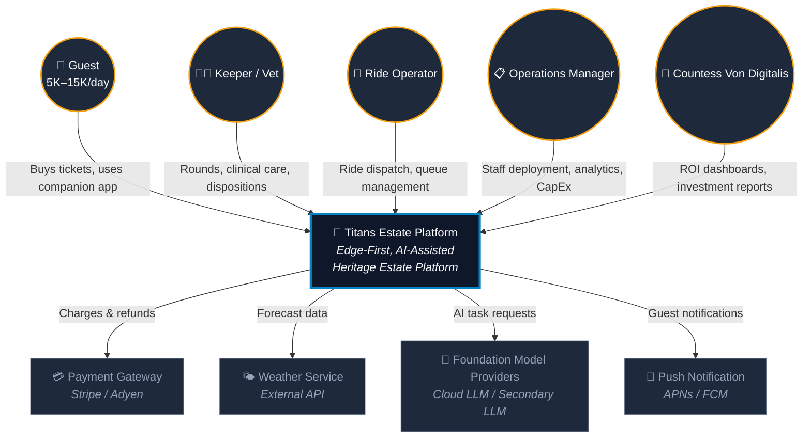
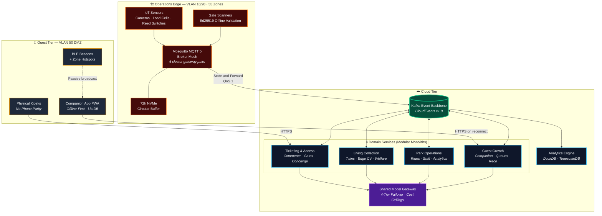

# 🏰 Team Titans — Von Digitalis Estates Platform

**Architectural Katas 2026: AI-Assisted Software Architecture**

| | |
|---|---|
| **Team** | Titans |
| **Platform** | Von Digitalis Estates — Edge-First, AI-Assisted Heritage Estate Platform |
| **Scope** | 40 heritage rides · 200+ exotic animals · 55 enclosures · 5K→15K visitors/day |
| **Architecture** | Event-driven modular monoliths · MQTT 5 edge mesh · Shared Model Gateway |
| **Cost at 15K/day** | $0.021–$0.037 per visitor ($8,850–$15,000/month cloud + AI) |

---

## Overview — How Titans Used AI to Solve Von Digitalis Estates

Four estate problems. One owner each. AI assists; humans decide. Money, credentials, and containment stay deterministic.

**Ticketing**
- Buy tickets and family passes online, at kiosks, or via an AI Concierge.
- Concierge talks in natural language. Commerce still sets every price.
- Pricing advisor may suggest a change only inside ±30% human-approved bands.
- Gates verify Ed25519-signed QR locally. No cloud. No model.

**Park analytics**
- One demand forecast: 15m/2h for staffing, 14 days for pricing.
- Popularity scores and CapEx flags are formulae, not LLM opinions.
- GenAI writes the shift briefing after the numbers exist. Faithfulness check rejects untraceable figures.
- Staff move only when a duty manager Approve / Reject / Modifies.

**Animal monitoring**
- Piranhas counted on the edge as a school (YOLOv8-nano), with a confidence interval — not a fake headcount.
- Appetite and behaviour models advise. They never open a feeder or a lock.
- Lid breach: microcontroller solenoid + siren. No cloud, MQTT, or AI.
- Keeper copilot drafts notes. Accept / reject / correct becomes eval ground truth.

**Growth and profitability**
- GBDT ranks what to show next. GenAI drafts itinerary copy only.
- Living Collection writes animal stories. Guests never see two AI accounts of the same exhibit.
- Spot Saver and virtual queues settle on one capacity ledger.
- Recommendations are congestion-checked before they reach the guest.

**What keeps it standing**
- MQTT 5 mesh on 6 gateway pairs. 72h NVMe buffer. Kafka when the uplink returns.
- One Model Gateway: Primary LLM → Secondary LLM → local SLM → static template.
- Hard fuses: $0.15/session, $600/day.
- One eval pipeline: golden sets, keeper labels, production sampling.

AI perceives, forecasts, and drafts. Humans decide. The estate still runs when the model, the cloud, or the WiFi does not.

---

## C4 Level 1 — System Context

---

## C4 Level 2 — Container Diagram

Component diagrams, sequences, and the shared legend live in [C4 Models](docs/architecture/c4-models.md) and [Diagrams](diagrams/README.md).

---

## Four bounded contexts

| Context | Owns | Offline | Primary ADRs |
|---|---|---|---|
| **Ticketing & Access** | Commerce, credentials, gates, pricing engine, Concierge | Ed25519 QR + Bloom revocation; pre-authorized kiosk slabs | [ADR-003](docs/adrs/ADR-003-offline-cryptographic-ticket-validation.md), [ADR-014](docs/adrs/ADR-014-dynamic-pricing-hard-guardrails.md) |
| **Living Collection** | Clinical/public twins, edge CV census, welfare, exhibit capacity | 72h NVMe, local siren, islanded MQTT | [ADR-009](docs/adrs/ADR-009-edge-cv-for-piranha-biomass-estimation.md), [ADR-010](docs/adrs/ADR-010-clinical-vs-public-digital-twin-split.md) |
| **Park Operations** | Ride dispatch, queue sensing, staff roster, demand forecast, analytics | Local queue counting; buffered ride-cycle events | [ADR-006](docs/adrs/ADR-006-unified-demand-forecasting-in-park-ops.md), [ADR-008](docs/adrs/ADR-008-numbers-first-narrative-second-reporting.md) |
| **Guest Growth** | Companion PWA, virtual queue, Spot Saver, recommendations | LiteDB, bundled maps, BLE beacons | [ADR-005](docs/adrs/ADR-005-living-collection-as-sole-capacity-authority.md), [ADR-013](docs/adrs/ADR-013-modular-monolith-per-bounded-context.md) |

Park Operations owns the operational record of the 40 rides. Mechanical interlocks and e-stops stay hard-wired and un-commandable. Producer/consumer map: [Data Architecture](docs/cross-cutting/data-architecture.md).

---

## AI capabilities

Technique, SLO, and fallback. The story is in the [Overview](#overview--how-titans-used-ai-to-solve-von-digitalis-estates). How we eval each one is in [AI validation](#ai-validation).

| Technique | Domain | In → Out | Latency | Offline fallback |
|---|---|---|---|---|
| **Edge CV (YOLOv8-nano)** | Living Collection | 5-frame burst → school estimate + CI | < 200ms on Jetson | Double-blind keeper count |
| **Clinical Twin (Bayesian)** | Living Collection | 14-day feeding + telemetry → risk [0, 1] | < 5 min | Gross mass delta (consumed < 50%) |
| **Multi-signal demand forecast** | Park Operations | Presales, occupancy, weather, calendar, queues → 15m/2h and 14d curves | < 15 min | Day-of-week averages |
| **Dynamic pricing advisor** | Ticketing | Forecast + inventory → suggested price inside ±30% | Near-real-time | Static calendar pricing |
| **AI Guest Concierge** | Ticketing | Utterance + catalog/availability APIs → proposed cart + NL | < 3s/turn | Catalog UI with search |
| **GBDT ranking** | Guest Growth | Profile + time left + crowd → ranked attraction IDs | < 100ms | Proximity sort |
| **GenAI keeper copilot** | Living Collection | SOPs + twin data (RAG) → clinical note draft | < 5s | Manual typing |
| **GenAI shift briefing** | Park Operations | Structured scores + forecast → faithfulness-checked prose | Per shift | Raw numbers |
| **Keeper disposition** | Living Collection | accept/reject/correct → golden-set labels, Winkler scores | Async | Manual process |
| **Faithfulness check** | All | AI output + source facts → pass/fail | < 500ms | Raw data |

---

## Estate-wide invariants

One owner, one format, or one pipeline — everywhere. That is architectural harmony.

| # | Invariant | Guarantee | Specified in |
|---|---|---|---|
| **I1** | One capacity authority per space | Living Collection alone allocates exhibit slots via `VisitRequested.v1` → `VisitConfirmed.v1` | [Living Collection](docs/domains/living-collection.md), [ADR-005](docs/adrs/ADR-005-living-collection-as-sole-capacity-authority.md) |
| **I2** | One demand forecast, two horizons | Same model serves 15m/2h staffing and 14d pricing | [Park Operations](docs/domains/park-operations.md), [ADR-006](docs/adrs/ADR-006-unified-demand-forecasting-in-park-ops.md) |
| **I3** | One event envelope | CloudEvents 1.0, ULID `id`, PascalCase `.v1` types | [Data Architecture](docs/cross-cutting/data-architecture.md), [ADR-004](docs/adrs/ADR-004-standardized-cloudevents-kafka-backbone.md) |
| **I4** | One transport spine | MQTT 5 on the estate, Kafka in the cloud, mTLS bridge | [Edge](docs/architecture/edge-and-connectivity.md), [ADR-001](docs/adrs/ADR-001-edge-first-mqtt-broker-mesh.md) |
| **I5** | One shared edge fleet | 6 gateway pairs serve 55 zones; topic `estate/{site}/{domain}/{zone}/…` | [Edge](docs/architecture/edge-and-connectivity.md), [ADR-001](docs/adrs/ADR-001-edge-first-mqtt-broker-mesh.md) |
| **I6** | One Model Gateway | Abstract task IDs; $0.15/session and $600/day fuses | [Gateway](docs/ai-architecture/multi-model-gateway.md), [ADR-002](docs/adrs/ADR-002-shared-task-based-model-gateway.md) |
| **I7** | One AI eval pipeline | Four domain adapters, one golden-set and drift bar | [Eval](docs/ai-architecture/eval-and-validation.md), [ADR-012](docs/adrs/ADR-012-unified-ai-eval-pipeline-and-golden-sets.md) |
| **I8** | One autonomy vocabulary | Tier 1 deterministic · Tier 2 ML · Tier 3 GenAI. Humans decide. | [AI Strategy](docs/ai-architecture/ai-strategy-overview.md), [ADR-007](docs/adrs/ADR-007-tiered-autonomy-ai-assists-humans-decide.md) |
| **I9** | One network topology | VLAN 10/20 Operations, 30 Admin, 50 Guest DMZ. No inter-VLAN routing. | [Security](docs/cross-cutting/security-and-threat-model.md), [ADR-016](docs/adrs/ADR-016-three-vlan-segmentation-and-mtls-identity.md) |
| **I10** | Narrative is never re-generated | Living Collection authors welfare stories; Guest Growth pastes them verbatim | [Living Collection](docs/domains/living-collection.md), [Guest Growth](docs/domains/guest-growth.md) |

---

## Artifact index

What “appropriate detail” means in this pack.

| Artifact | Scope | Where |
|---|---|---|
| C4 L1 / L2 | Actors, edge/cloud/guest, four domains | This README |
| C4 L3 | Per-domain components | [C4 Models](docs/architecture/c4-models.md) |
| Sequence diagrams | Gate entry, Concierge, piranha census, staffing, briefing, Spot Saver, pricing, failover | Domain docs · [Diagrams](diagrams/README.md) |
| State machines | Ticket lifecycle, staffing, alerts, outage | Domain docs |
| ER diagrams | Core entities per context | Domain docs |
| Data flow | Edge → Kafka, event catalog | [Data Architecture](docs/cross-cutting/data-architecture.md) |
| Threat model | STRIDE, OWASP Top 10 for LLMs | [Security](docs/cross-cutting/security-and-threat-model.md) |
| Cost model | OpEx at 5K/15K, AI cost, 3-year TCO | [Cost Model](docs/cross-cutting/cost-model.md) |
| Invariants | Ten cross-domain rules | [Above](#estate-wide-invariants) |
| ADRs | 16 MADR records | [ADR Index](docs/adrs/README.md) |
| Quality scenarios | Five falsifiable tests | [Quality Scenarios](docs/quality-scenarios.md) |

---

## AI uncertainty

| Risk | Mitigation | Evidence |
|---|---|---|
| **Provider changes** | Domains call task IDs (e.g. `tk.ticket.concierge`), never vendor SDKs. Swap = config. | [Gateway](docs/ai-architecture/multi-model-gateway.md), [ADR-002](docs/adrs/ADR-002-shared-task-based-model-gateway.md) |
| **Price spikes** | Gateway enforces $0.15/session, $600/day, $2,500/month. | [Cost & Drift](docs/ai-architecture/cost-and-drift-controls.md) |
| **Provider shutdown** | Primary LLM → Secondary LLM → local SLM (Mistral-7B) → static template. Each tier stays *functional*. | [Gateway](docs/ai-architecture/multi-model-gateway.md) |
| **Model drift** | Per-zone forecast error. PSI > 0.25 → alert the owner. No auto-action. Override rate tracked separately. | [Cost & Drift](docs/ai-architecture/cost-and-drift-controls.md), [ADR-015](docs/adrs/ADR-015-deterministic-faithfulness-verification.md) |
| **GenAI hallucination** | Commerce is sole price authority. Faithfulness check on every number and zone. Retry once, then raw data. | [ADR-015](docs/adrs/ADR-015-deterministic-faithfulness-verification.md), [ADR-008](docs/adrs/ADR-008-numbers-first-narrative-second-reporting.md) |
| **Non-determinism** | Golden sets pre-deploy, canary, production sampling. Keeper disposition as live ground truth. Price-mismatch monitor. | [Eval](docs/ai-architecture/eval-and-validation.md), [ADR-012](docs/adrs/ADR-012-unified-ai-eval-pipeline-and-golden-sets.md) |

---

## AI validation

| Capability | Pre-deploy | Production | On failure |
|---|---|---|---|
| **Concierge** | 200 multi-turn golden set: grounding, price-mismatch, tool errors, off-topic | Price-mismatch (quote ≠ catalog); session cost; runaway >10 turns | Catalog UI |
| **Demand forecast** | MAPE on 90-day holdout vs day-of-week baseline | 3-day MAPE > 25% → alert | Historical averages |
| **Piranha census** | Annotated 5-frame bursts across lighting/turbidity | Keeper disposition → Winkler → drift | Double-blind count |
| **Shift briefing** | Every number and zone traceable; no personal names | Content failure, cost, retry rate | Raw numbers to duty manager |
| **Dynamic pricing** | 90-day backtest: revenue vs smoothing | Override rate, revenue vs forecast, utilization | Static calendar pricing |
| **Keeper copilot** | Vet review of 50 notes vs known outcomes | Edit distance, rejection rate | Manual typing |
| **Recommendations** | Historical CTR; A/B harness | Acceptance, revenue, congestion in simulation | Proximity sort |

---

## Document index

Read in this order. Each stage assumes only what came before.

| # | Stage | Document | Purpose |
|---|---|---|---|
| — | Overview | [this README](#overview--how-titans-used-ai-to-solve-von-digitalis-estates) | How Titans used AI on the four estate problems |
| 1 | Orientation | [Executive Summary](docs/00-executive-summary.md) | Two-page brief for the Countess |
| 2 | Orientation | [Assumptions & Constraints](docs/01-assumptions-and-constraints.md) | Layout, zones, budget, inferences |
| 3 | Orientation | [Glossary](docs/02-glossary.md) | Shared language |
| 4 | Orientation | [Non-Goals](docs/03-non-goals.md) | Exclusions and forbidden inbound commands |
| 5 | Architecture | [Domain Decomposition](docs/architecture/domain-decomposition.md) | Four contexts, context map, ownership |
| 6 | Architecture | [C4 Models](docs/architecture/c4-models.md) | Context, container, components |
| 7 | Architecture | [Edge & Connectivity](docs/architecture/edge-and-connectivity.md) | 55-zone MQTT 5, 72h NVMe |
| 8 | Architecture | [Architectural Characteristics](docs/architecture/architectural-characteristics.md) | Ranked quality attributes |
| 9 | Domains | [Ticketing & Access](docs/domains/ticketing-and-access.md) | Commerce, gates, pricing, Concierge |
| 10 | Domains | [Living Collection](docs/domains/living-collection.md) | Twins, census, welfare, capacity |
| 11 | Domains | [Park Operations](docs/domains/park-operations.md) | Rides, queues, staff, forecast |
| 12 | Domains | [Guest Growth](docs/domains/guest-growth.md) | PWA, virtual queue, Spot Saver |
| 13 | AI | [AI Strategy](docs/ai-architecture/ai-strategy-overview.md) | Tiers, shared vs domain-owned |
| 14 | AI | [Multi-Model Gateway](docs/ai-architecture/multi-model-gateway.md) | Task IDs, failover, cost ceilings |
| 15 | AI | [Eval & Validation](docs/ai-architecture/eval-and-validation.md) | Golden sets, adapters, CI |
| 16 | AI | [Cost & Drift Controls](docs/ai-architecture/cost-and-drift-controls.md) | Token budgets, circuit breakers |
| 17 | AI | [Fitness Functions](docs/ai-architecture/fitness-functions.md) | SLO enforcement in CI |
| 18 | Cross-cutting | [Data Architecture](docs/cross-cutting/data-architecture.md) | CloudEvents, hot/warm/cold |
| 19 | Cross-cutting | [Security & Threat Model](docs/cross-cutting/security-and-threat-model.md) | STRIDE, VLANs, LLM threats |
| 20 | Cross-cutting | [Cost Model](docs/cross-cutting/cost-model.md) | BOM, OpEx, TCO |
| 21 | Cross-cutting | [Phased Rollout](docs/cross-cutting/phased-rollout.md) | Three phases, go/no-go gates |
| 22 | Evidence | [Quality Scenarios](docs/quality-scenarios.md) | Five falsifiable tests |
| 23 | Evidence | [ADR Index](docs/adrs/README.md) | 16 decisions |
| 24 | Evidence | [Diagram Suite](diagrams/README.md) | 9 Mermaid diagrams |

**Short paths**

| If you care about… | Read |
|---|---|
| **Domain design** | [Domain Decomposition](docs/architecture/domain-decomposition.md) → [C4](docs/architecture/c4-models.md) → [Characteristics](docs/architecture/architectural-characteristics.md) → [ADR-013](docs/adrs/ADR-013-modular-monolith-per-bounded-context.md) |
| **Edge & data** | [Edge](docs/architecture/edge-and-connectivity.md) → [Data](docs/cross-cutting/data-architecture.md) → [ADR-001](docs/adrs/ADR-001-edge-first-mqtt-broker-mesh.md) → [ADR-004](docs/adrs/ADR-004-standardized-cloudevents-kafka-backbone.md) |
| **AI & providers** | [AI Strategy](docs/ai-architecture/ai-strategy-overview.md) → [Gateway](docs/ai-architecture/multi-model-gateway.md) → [Cost & Drift](docs/ai-architecture/cost-and-drift-controls.md) → [ADR-002](docs/adrs/ADR-002-shared-task-based-model-gateway.md) |
| **AI validation** | [Eval](docs/ai-architecture/eval-and-validation.md) → [Fitness](docs/ai-architecture/fitness-functions.md) → [Quality Scenarios](docs/quality-scenarios.md) → [ADR-012](docs/adrs/ADR-012-unified-ai-eval-pipeline-and-golden-sets.md) |
| **Safety & security** | [Security](docs/cross-cutting/security-and-threat-model.md) → [Non-Goals](docs/03-non-goals.md) → [ADR-016](docs/adrs/ADR-016-three-vlan-segmentation-and-mtls-identity.md) → [ADR-010](docs/adrs/ADR-010-clinical-vs-public-digital-twin-split.md) |
| **Cost & delivery** | [Executive Summary](docs/00-executive-summary.md) → [Cost Model](docs/cross-cutting/cost-model.md) → [Phased Rollout](docs/cross-cutting/phased-rollout.md) → [ADR-014](docs/adrs/ADR-014-dynamic-pricing-hard-guardrails.md) |

---

*Built with pragmatism, defended with evidence, and designed to keep piranhas counted and visitors delighted.*
