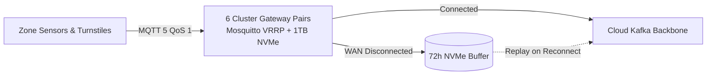

# ADR-001: Edge-First MQTT 5 Mesh with 72h NVMe Store-and-Forward

## Context
The Von Digitalis Estates span extensive outdoor grounds, historic forested areas (Bavarian Wood), and dense stone structures dating back generations. Physical environmental conditions result in intermittent WAN connectivity, occasional fiber trenching damage, and severe cellular dead zones.

However, estate operations cannot halt during a network outage:
- 15,000 visitors must enter through turnstiles without latency spikes.
- Life-safety systems, animal enclosure alarms, and aquatic environmental monitoring (e.g., dissolved oxygen in Amazonia) must operate continuously with sub-second response times.
- Streaming raw sensor feeds and computer vision frames directly to cloud infrastructure over cellular uplinks would incur unsustainable bandwidth expenses ($15,000+/month) and introduce unacceptable latency jitter.

## Decision
We deploy an **Edge-First Architecture** utilizing an **EMQX/Mosquitto MQTT 5 Broker Mesh** across **55 logical Zones** served by **6 physical cluster gateway pairs**:
- Rather than maintaining 55 separate servers, 6 ruggedized industrial DIN-rail gateway pairs (VRRP active/hot-standby) serve physical clusters across both Living Collection and Park Operations sensing.
- Each cluster gateway contains dedicated **1TB NVMe drives** configured for **72-hour store-and-forward buffering**.
- Standardized topic namespace prevents collisions:
  `estate/{site_id}/{domain}/{zone_id}/{place_id}/{channel}/{metric}` (`domain ∈ { lc, po }`).
- Sensors and turnstiles publish telemetry to their cluster broker using MQTT 5 QoS 1.
- During connected states, edge brokers stream events to the centralized Apache Kafka cluster in the cloud via mTLS.
- When WAN connectivity drops, brokers spool messages to local NVMe. Upon link restoration, backpressure-regulated replay drains the queue into Kafka without dropping messages or overwhelming cloud consumers.

## Consequences

### Positive
- **Guaranteed Zero Data Loss**: 72 hours of persistent local NVMe storage buffers high-frequency telemetry even through catastrophic long-weekend cable cuts.
- **Sub-50ms Local Latency**: In-zone devices (turnstiles, habitat controllers) interact with the local broker with predictable sub-50ms response times.
- **Bandwidth Optimization**: Video and raw telemetry are processed and filtered locally; only aggregated CloudEvents leave the estate.

### Negative / Tradeoffs
- **Edge Fleet Management Overhead**: 55 physical edge compute nodes must be provisioned, secured, monitored, and maintained.
- **Out-of-Order Event Processing**: Replayed historical events from partitioned zones must be reconciled using event timestamps and idempotency keys in downstream consumers.

### Risks & Mitigations
- *Risk*: Local NVMe hardware failure.
- *Mitigation*: Industrial-grade high-TBW (Terabytes Written) NVMe drives with automated S.M.A.R.T. health monitoring and dual-zone broker redundancy in high-criticality zones.

## Alternatives Considered & Rejected
1. **Direct-to-Cloud Cellular Telemetry**: Rejected due to high ongoing SIM cellular data costs, high latency jitter, and vulnerability to cellular network saturation during peak estate events.
2. **Local SQLite Store-and-Forward at Each Sensor**: Rejected due to management complexity across 1,000+ tiny sensor devices lacking sufficient flash memory or write endurance.
