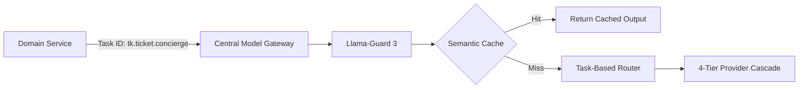

# ADR-002: Shared Estate-Wide Task-Based Model Gateway with Domain Namespaces

## Status
Accepted

## Context
All four bounded contexts require artificial intelligence capabilities:
- **Ticketing & Access**: Multilingual guest concierge chatbot, support triage.
- **Living Collection**: Clinical RAG for veterinary keepers, public animal fun-facts.
- **Park Operations**: Operational shift briefing narrative generation, demand narrative summaries.
- **Guest Growth**: Itinerary generation, personalized contextual recommendations.

If each domain team provisions and manages its own LLM client SDKs, API keys, and failover code, the estate suffers from:
1. Fragmented billing and zero visibility into total estate AI token spend.
2. Inconsistent safety guardrails and vulnerability to prompt injection.
3. Duplicated retry, fallback, and rate-limiting logic across services.
4. Vendor lock-in to a single proprietary LLM provider API.

## Decision
We implement a single, centrally-governed **Estate-Wide Multi-Model Gateway** built as a shared platform service.
- **Task-Based Abstraction**: Domain microservices do not request specific LLM models (e.g., "gpt-4o" or "claude-3-5-sonnet"). Instead, they submit requests using abstract **Task IDs** (e.g., `tk.ticket.concierge`, `lc.keeper.copilot`, `po.ops.briefing`, `gr.chat.concierge`).
- **Domain Namespaces & Token Quotas**: Each bounded context operates in an isolated namespace with strict rate limits and financial ceilings ($0.15/guest session, $150/domain daily).
- **Automated 4-Tier Failover Cascade**: Primary Cloud Frontier $\to$ Secondary Cloud Frontier $\to$ On-Premise Local SLM $\to$ Deterministic Template Engine.
- **Centralized Guardrails & Caching**: Input sanitization (NeMo / Llama-Guard 3) and semantic prompt caching are enforced centrally before any token is transmitted upstream.

## Consequences

### Positive
- **Complete Financial Control**: Hard budget caps prevent runaway API bills.
- **Zero Domain Vendor Lock-In**: Swapping providers (e.g., Anthropic to OpenAI or open-source weights) requires modifying a single gateway configuration file without rebuilding domain services.
- **Universal Safety Compliance**: Guardrails and audit logging apply uniformly across all guest and staff interactions.

### Negative / Tradeoffs
- **Single Point of Dependency**: The gateway must achieve extreme availability (99.99% SLO).
- **Latency Overhead**: Adding gateway routing, guardrails, and cache lookups introduces ~15–30ms of P95 latency overhead.

### Risks & Mitigations
- *Risk*: Gateway crash takes down all AI services across the estate.
- *Mitigation*: Deploy gateway as a multi-region active-active cluster with autonomous local edge gateway fallback instances for critical on-estate staff tasks.

## Alternatives Considered & Rejected
1. **Isolated Gateway per Domain**: Rejected due to 4x infrastructure maintenance overhead and lack of estate-wide token pooling and global spending caps.
2. **Direct Vendor SDK Calls from Domain Services**: Rejected due to tight vendor coupling, absence of centralized cost control, and security risks.

## Judging Criteria Addressed
- **Criterion 2 (AI Practicality & Operational Rigor)**: Centralized token budgets, failover cascades, and semantic caching.
- **Criterion 4 (Completeness)**: Unified approach serving all 4 bounded contexts.
