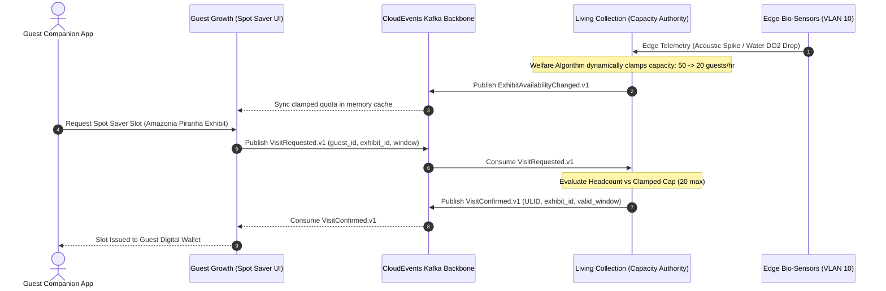

# ADR-005: Living Collection as Sole Authority for Exhibit Capacity (Unified Spot Saver)

## Context
The estate features two competing demands for virtual queuing and capacity allocation via the **Spot Saver** system:
1. **Mechanical Rides (Park Operations / Guest Growth)**: Goal is throughput maximization, revenue generation, and minimizing guest frustration.
2. **Animal Enclosures (Living Collection)**: Goal is biological welfare, stress minimization, and habitat sustainability for 200+ exotic animals.

If Guest Growth or Park Operations controls virtual queue slot issuance for animal exhibits (such as the Amazonia Piranha feeding or Gorilla pavilion), commercial pressure could lead to overcrowding the viewing galleries. High noise and human presence trigger biological distress, behavioral anomalies, and potential enclosure containment hazards.

## Decision
We establish **Living Collection as the sole authority for exhibit viewing capacity and slot allocation**.
- **One Spot Saver, Two Sales Channels**: A guest may reserve a viewing window at checkout (Ticketing, `origin: pre_visit`) or from a bench ten minutes before the feed (Guest Growth, `origin: in_park`). Both are booking *clients*: they render the UI, take the money, and mint the credential, but neither holds a ledger of its own.
- **No Second Exhibit Ledger**: No context outside Living Collection keeps a booking record for an enclosure window. Every exhibit reservation, regardless of sales channel, runs through one CloudEvents 1.0 transaction against one cap (ride virtual-queue positions are a separate concern, held by Guest Growth and signalled to Park Operations):
  1. The booking client (Guest Growth or Ticketing) publishes `VisitRequested.v1` to Kafka, carrying its `origin`.
  2. Living Collection validates biological constraints, real-time stress index, water DO2/turbidity, and current viewing deck headcount against $C_{\text{max}}$.
  3. Living Collection publishes authoritative `VisitConfirmed.v1` (with ULID and time-bounded entry window) or returns a rejection with available alternate windows.
- **Authoritative Biological Throttles**: When enclosure bio-telemetry exceeds welfare thresholds, Living Collection publishes `ExhibitAvailabilityChanged.v1` (with `availability=capped` and a reduced `capacityCap`). Guest Growth and Park Operations **must immediately honor this clamp** without algorithmic override, commercial bypass, or VIP exceptions.

## Consequences

### Positive
- **Animal Welfare Guarantee**: Commercial throughput or queue-smoothing algorithms can never override biological safety constraints.
- **Single Source of Truth**: With one ledger and one cap, a pre-sold slot and an in-park slot cannot silently oversubscribe the same gallery window, and there is no cross-system race to reconcile.
- **Regulatory Compliance**: Demonstrates strict adherence to European Association of Zoos and Aquaria (EAZA) animal welfare standards.
- **Clean Audit Trail**: Every entry slot is backed by a verifiable ULID issued exclusively by Living Collection.

### Negative / Tradeoffs
- **Potential Guest Friction**: Visitors may find popular animal viewing slots abruptly constrained on high-stress days.
- **Cross-Domain Dependency**: Guest Growth virtual queue booking depends on the availability of the Living Collection capacity API.

### Risks & Mitigations
- *Risk*: Living Collection service outage prevents guests from booking animal slots.
- *Mitigation*: Living Collection publishes daily default static capacity schedules to Kafka; Guest Growth falls back to safe conservative static caps if the dynamic service is unreachable.

## Alternatives Considered & Rejected
1. **Central Optimization Engine in Park Operations**: Rejected because Park Operations prioritizes mechanical throughput and guest flow, creating an inherent conflict of interest with animal welfare.
2. **Guest Growth Ownership with Advisory Vet Limits**: Rejected because advisory limits can be bypassed during peak crowd surges to alleviate ride queue pressures.
