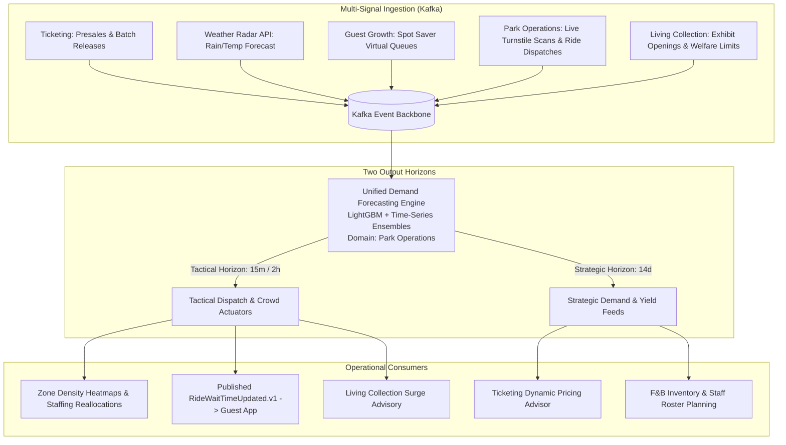

# ADR-006: Unified Multi-Signal Demand Forecasting in Park Operations

## Status
Accepted

## Context
Demand prediction is wanted by three different parts of the estate, and each has a plausible claim to hosting it:
- **Ticketing** needs attendance predictions to set prices and release ticket batches, and already holds presale data.
- **Guest Growth** needs crowd predictions to route guests, and already models guest behaviour.
- **Park Operations** needs occupancy predictions to staff the park, and already holds the live sensor feeds.

Left unresolved, this produces several models trained on overlapping signals, disagreeing about the same Saturday afternoon — pricing discounting a slot that staffing is simultaneously surging for.

Managing staffing rosters (120+ ride operators, cleaners, concession staff), scheduling ride maintenance, and anticipating crowd pinch-points requires synthesizing signals from across the entire estate: presale volume, weather radar, regional holiday calendars, historical attendance curves, live gate scans, and ride dispatch telemetry.

## Decision
We place all estate-wide operational demand forecasting, crowd density simulation, and popularity scoring in the **Park Operations** domain.
- **One Model, Not One Per Consumer**: A single LightGBM multi-signal engine in Park Operations is the estate's only demand forecast. Ticketing does not fit its own yield model and Guest Growth does not fit its own crowd model; both consume the published forecast, so price and staffing decisions can never rest on contradictory predictions of the same hour.
- **Two Distinct Output Horizons**:
  1. **Tactical Operational Horizon (15-minute / 2-hour rolling)**: Ingests real-time turnstile scans, live ride dispatch telemetry, camera vision headcounts, and rain radar updates. Produces ride wait time predictions (`RideWaitTimeUpdated.v1`), zone density alerts, and staffing reallocation recommendations (`StaffingRecommendationRaised.v1`, always human Approve/Reject/Modify).
  2. **Strategic Capacity Horizon (14-day forward rolling)**: Ingests advance ticket sales, school holiday calendars, regional weather models, and historical seasonal trends. Produces day-level attendance curves and zone-level peak projections.
- **Consumption by Downstream Domains**:
  - **Ticketing & Access**: Consumes the 14-day strategic forecast to drive its dynamic pricing advisor and ticket batch release schedules.
  - **Guest Growth**: Consumes the tactical 15m wait times to power Companion App wait time displays, itinerary re-routing, and Spot Saver recommendations.
  - **Living Collection**: Ingests tactical density alerts to anticipate gallery crowd pressure before animal distress occurs.

## Consequences

### Positive
- **Domain Cohesion**: Aligning prediction with operational execution eliminates bureaucratic handoffs between analytics teams and park supervisors.
- **Single Source of Truth**: Estate management, staffing coordinators, and ride operators rely on a single canonical demand forecast.
### Negative / Tradeoffs
- **Increased Scope of Park Operations**: Park Operations engineers must maintain both low-level IoT/SCADA ingestion and high-level statistical forecasting models.
- **Cross-Domain Data Dependency**: Forecast accuracy degrades if upstream ticketing or reservation event streams experience publication lag.

### Risks & Mitigations
- *Risk*: Data drift during unprecedented weather anomalies or external crises.
- *Mitigation*: Daily automated Population Stability Index (PSI) calculation; automatic fallback to 14-day moving average if PSI exceeds 0.25.

## Alternatives Considered & Rejected
1. **Forecasting hosted in Ticketing**: Rejected because Ticketing holds presales but not ride sensors, queue lengths, or weather.

## Judging Criteria Addressed
- **Criterion 1 (Architectural Soundness)**: Rigorous DDD bounded context definition and alignment of responsibility with authority.
- **Criterion 4 (Completeness)**: Comprehensive multi-signal predictive intelligence across the estate.
