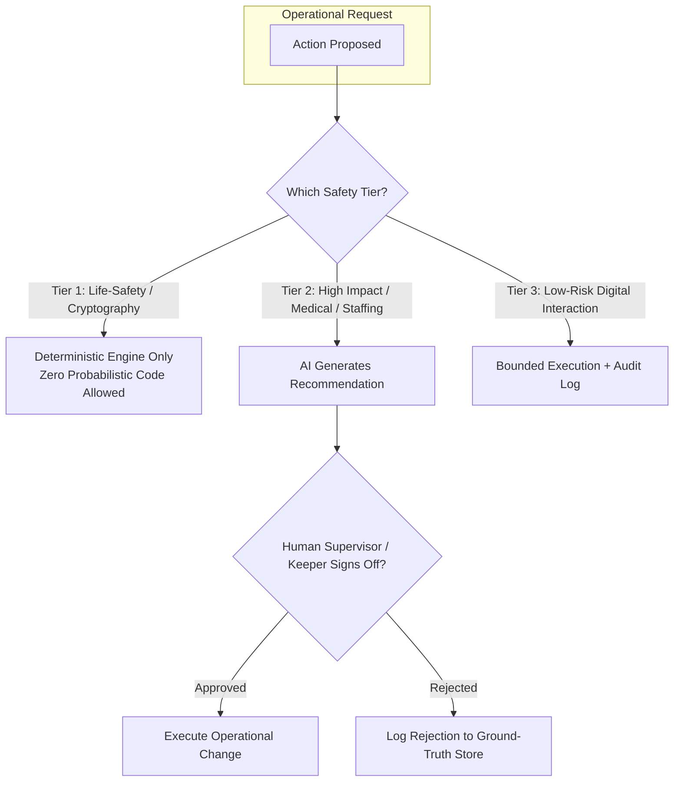

# ADR-007: Strict Tiered Autonomy — AI Assists, Humans Decide

## Status
Accepted

## Context
Deploying artificial intelligence across physical environments presents significant ethical and safety concerns:
- Hallucinated animal medical advice could harm endangered species.
- Unchecked automated staffing modifications could violate labor laws or leave critical rides under-staffed.
- Autonomous dynamic ticket pricing algorithms could lead to predatory surge pricing, damaging the estate's heritage brand and guest trust.
- Premature physical automation (e.g., closing ride brakes or opening enclosure gates purely on AI triggers) poses direct risks to human life.

We require a foundational governance principle that defines where AI is permitted to act autonomously versus where human authority is non-negotiable.

## Decision
We enforce a strict **Tiered Autonomy Framework** across all four bounded contexts:

| Autonomy Tier | Name | System Role | Human Role | Operational Examples |
|---|---|---|---|---|
| **Tier 1** | **Deterministic & Hard Guardrails** | Zero AI. Pure mathematical rules, physical relays, cryptographic checks. | Operators maintain rules; algorithms run without human intervention. | Ed25519 ticket signature verification, physical ride emergency stop interlocks, enclosure magnetic door locks, $\pm 30\%$ price limits. |
| **Tier 2** | **AI Advisory / Human Approval** | AI aggregates signals, generates optimizations, drafts plans. | Human must explicitly click "Approve" or sign off. | Veterinary Keeper Copilot diagnostic recommendations, Park Operations shift briefings and staff roster schedules, ride maintenance alerts. |
| **Tier 3** | **Bounded Autonomous Action** | AI executes low-risk, reversible digital interactions. | Human monitors retrospectively via telemetry and audit dashboards. | AI Concierge FAQ answers, companion app personalized walking paths, Spot Saver reminder nudges, semantic prompt cache responses. |

### The "Forbidden Zones" (Zero GenAI Allowed)
GenAI and probabilistic models are strictly prohibited from:
1. Triggering physical machinery, ride dispatches, or emergency stops.
2. Unlocking enclosure gates or manipulating environmental life-support parameters (water pumps, heaters, DO2 levels).
3. Directly debiting credit cards or changing admission transaction prices outside deterministic database formulas.

## Consequences

### Positive
- **Human Accountability & Safety**: Eliminates algorithmic liability in life-safety and clinical care.
- **Regulatory Alignment**: Fully aligns with the **EU AI Act (High-Risk AI System Requirements)** and the **NIST AI Risk Management Framework (AI RMF 1.0)**.
- **Trust & Adoption**: Estate staff adopt AI willingly because it acts as an assistant that respects their professional expertise, rather than an automated replacement.

### Negative / Tradeoffs
- **Human Latency**: Operational changes requiring approval (e.g., reallocating staff to a crowded ride) incur human review delay (~2 to 10 minutes).
- **UI Complexity**: Internal operator and keeper handhelds must feature intuitive review-and-accept workflows.

### Risks & Mitigations
- *Risk*: Alert fatigue causing humans to rubber-stamp AI recommendations without scrutiny.
- *Mitigation*: The system tracks operator approval dwell times; rubber-stamping (< 1.5s review) triggers audit flags and randomized verification checks by supervisors.

## Alternatives Considered & Rejected
1. **Full Automation (Autonomous Estate Orchestration)**: Rejected as reckless, legally untenable, and dangerous to human life and animal welfare.
2. **Zero AI Deployment**: Rejected because manual scheduling, static paper records, and unassisted crowd control fail to scale to 1.8M annual visitors.

## Judging Criteria Addressed
- **Criterion 2 (AI Practicality & Operational Rigor)**: Realistic, human-in-the-loop operational AI.
- **Criterion 5 (Security, Safety, Ethics & Privacy)**: Responsible AI governance meeting international standards.
