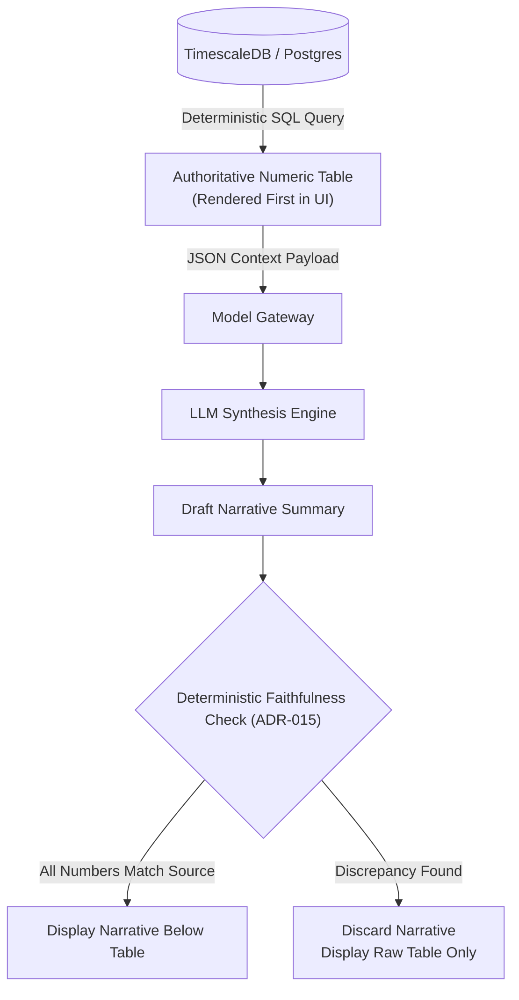

# ADR-008: Numbers-First, Narrative-Second Pattern for Operations & Financials

## Context
Estate operations supervisors, veterinary managers, and Countess Von Digitalis receive daily executive briefings summarizing complex operational metrics: ride uptime percentages, gate scan throughputs, crowd density peaks, food and beverage revenues, and animal welfare vital trends.

When Large Language Models (LLMs) are tasked with synthesizing raw telemetry data into executive reports, they frequently introduce subtle, plausible numerical hallucinations:
- Stating a ride uptime of "96.4%" when the underlying sensor database recorded "89.1%".
- Inverting crowd trends or attributing queue wait time spikes to incorrect attractions.
- Inventing non-existent revenue totals.

In operational management and financial accounting, an inaccurate narrative is worse than no narrative.

## Decision
We mandate the **Numbers-First, Narrative-Second Pattern** for all analytical dashboards, operational shift briefings, and executive reports.
1. **Numbers-First (Deterministic Ingestion & Display)**:
   - All underlying figures, tables, charts, and key performance indicators (KPIs) are queried, aggregated, and rendered **strictly deterministically** directly from SQL/TimescaleDB databases.
   - The primary visual dashboard always renders the authoritative numerical table first.
2. **Narrative-Second (AI-Generated Synthesis)**:
   - An LLM generates an accompanying textual summary explaining context, anomalies, and operational insights.
   - The generated narrative is passed through a **Deterministic Faithfulness Verification Layer (ADR-015)** before rendering.
   - If the faithfulness check detects *any* numeric entity in the narrative that cannot be mathematically derived from the underlying table, the entire AI narrative is discarded, and the dashboard displays only the deterministic numbers.

## Consequences

### Positive
- **Zero Risk of Operational Misinformation**: Management never makes staffing or capital decisions based on fabricated figures.
- **Immediate Value**: Users can immediately review hard figures even if the AI model gateway experiences latency or outage.
- **Architectural Traceability**: Every claim in an operational briefing links directly to an underlying database row.

### Negative / Tradeoffs
- **UI Space Overhead**: Dashboards must accommodate both structured tabular data and synthesized narrative text.
- **Computational Verification Overhead**: Running regular-expression and entity verification on LLM outputs adds ~50ms of post-processing latency.

### Risks & Mitigations
- *Risk*: Users ignoring the table and reading only the narrative.
- *Mitigation*: The narrative visually annotates all numbers as interactive badges that highlight the corresponding row in the primary table when clicked.

## Alternatives Considered & Rejected
1. **Direct LLM End-to-End Reporting (Prompt-to-Report)**: Rejected because LLMs are non-deterministic and prone to silent numerical errors in production reporting.
2. **Static Template Text with Variable Interpolation**: Rejected because rigid template strings lack natural language richness and fail to synthesize cross-cutting contextual insights across multiple anomalies.
