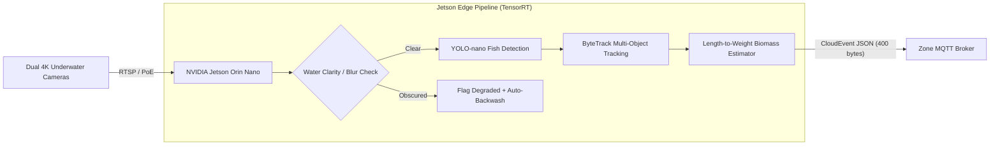

# ADR-009: Edge CV (YOLO-nano) for Piranha Biomass & Anomaly Detection

## Context
The Amazonia exhibit features a massive subterranean aquarium housing approximately 450 red-bellied piranhas (*Pygocentrus nattereri*). Precise biomass tracking is vital: underfeeding leads to cannibalistic frenzies and visitor distress, while overfeeding fouls water chemistry, crashes dissolved oxygen (DO₂), and causes dangerous ammonia spikes.

Physical manual counting is impossible: piranhas form rapid, dense schools and move continuously in 3 dimensions. Furthermore:
1. Streaming continuous 4K underwater video feeds to cloud AI services over the estate's constrained WAN links would consume over 120 GB/day and cost thousands in cloud ingress and GPU inference.
2. In underwater environments, water turbidity fluctuates due to algae and feeding debris; cloud vision models trained on clean data fail silently when water clarity degrades.

## Decision
We deploy a **Local Edge Computer Vision Pipeline** directly inside Zone 14 (Amazonia Pavilion):
- **Hardware**: Dedicated **NVIDIA Jetson Orin Nano (8GB)** connected to dual Sony IMX477 underwater IP67 camera modules over gigabit PoE.
- **Model Architecture**: A customized, INT8-quantized **YOLO-nano (v8/v11)** neural network running via NVIDIA TensorRT.
- **Inference Cadence**: Processes 5 frames per second during daylight hours.
- **Biomass Estimation Pipeline**:
  1. Detects and tracks individual piranha bounding boxes across frames using ByteTrack.
  2. Projects 2D camera boxes against tank calibration markers to estimate physical body length in centimeters.
  3. Converts visual length into estimated fish weight using standard fish biology formulas:
     - **Intuition**: A fish's body volume grows in three dimensions (length, width, and depth), so its weight scales roughly with the cube of its length (`Weight ≈ 0.021 × Length^3.05` for red-bellied piranhas). For example, a 15 cm juvenile weighs ~80 grams, while a 20 cm adult weighs ~190 grams.
  4. Sums all detected fish weights to calculate total school biomass (in kilograms).
- **Environmental Drift Guard (Water Clarity Check)**: Calculates an image sharpness score for each video frame (using standard edge blur detection). If water becomes too murky from algae or feeding debris (sharpness score drops below 120), the system flags the estimate as degraded, halts automated feeder adjustments, and locks feeding amounts to safe historical 7-day rolling baselines.
- **Privacy & Bandwidth**: No raw video footage is ever stored or transmitted. The Jetson outputs only aggregated CloudEvents (`estate.living.biomass_calculated.v1`) to the local MQTT broker.

## Consequences

### Positive
- **Zero Cloud Video Ingress Costs**: Eliminates 100% of cloud GPU video processing expenses.
- **Real-Time Anomaly Detection**: School dispersion anomalies (early indicator of toxic water stratification) are detected at the edge within 200ms.
- **100% Offline Operational Autonomy**: The aquarium monitoring subsystem functions without WAN or internet connectivity.

### Negative / Tradeoffs
- **Edge Deployment Maintenance**: Edge nodes require physical maintenance, firmware patching, and enclosure environmental protection.
- **Edge Hardware CapEx**: Upfront hardware expense ($850 per Jetson node + specialized camera enclosures).

### Risks & Mitigations
- *Risk*: Bio-fouling and algae growth on camera lenses causing permanent detection degradation.
- *Mitigation*: Automated pneumatic lens wiper blades and automated turbidity alerts dispatching maintenance keepers before image quality impacts welfare.

## Alternatives Considered & Rejected
1. **Cloud Video Streaming & Inference (AWS Rekognition / Vertex AI)**: Rejected due to prohibitive bandwidth consumption, latency instability, and recurring cloud OpEx ($18,000+/year).
2. **Manual Daily Dip-Net Weighing**: Rejected because capturing live piranhas stresses the school, damages scales, and poses extreme physical danger to veterinary keepers.
