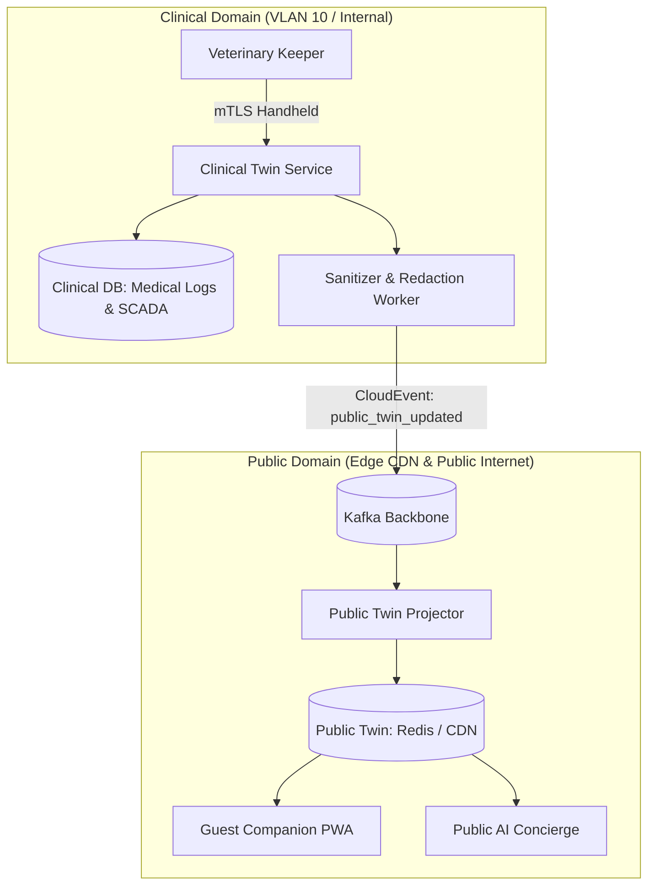

# ADR-010: Dual-Schema Separation: Clinical Twin vs. Public Twin

## Status
Accepted

## Context
The Living Collection domain is responsible for maintaining digital representations ("digital twins") of the estate's 200+ exotic animals. Two distinct stakeholder groups consume animal data with conflicting requirements:
1. **Veterinary Doctors & Keepers**: Require granular clinical data (blood panels, surgical histories, pharmaceutical dosages, behavioral pathologies, exact cage access protocols, and breeding genetics). This data is highly sensitive, regulated under veterinary medicine privacy guidelines, and critical to animal life.
2. **Estate Guests & Public Mobile App**: Require engaging, child-friendly educational content (fun facts, animal nicknames, species conservation status, feeding show times, and real-time viewing habitat status).

A naive architecture might expose a single "Animal Profile" database table or unified GraphQL schema, applying field-level authorization filters. However, this creates severe security and architectural risks:
- An authorization misconfiguration or prompt injection against the AI Concierge could expose sensitive clinical data or internal enclosure security protocols.
- High-volume read traffic from 15,000 public mobile apps querying animal locations could degrade query performance for veterinary keepers administering urgent medical treatments.

## Decision
We enforce a strict **Dual-Schema Separation** with physically segregated data stores:
1. **The Clinical Digital Twin**:
   - **Audience**: Licensed veterinary staff, animal welfare curators, and authenticated keeper handheld terminals.
   - **Data Stored**: Medical histories, pharmacological logs, biometric telemetry, necropsy reports, and containment protocols.
   - **Infrastructure**: Hosted on an isolated, encrypted PostgreSQL database residing in **VLAN 10/20** with strict role-based access control (RBAC) and audit logging.
   - **Zero Public Exposure**: The Clinical Twin database is physically unreachable from the public internet, public API gateways, and public RAG vector indexes.
2. **The Public Digital Twin**:
   - **Audience**: Guest Companion PWA, public educational signage, and AI Concierge.
   - **Data Stored**: Public-safe curated narratives, animal names, species background, live exhibit open/closed status, and child-safe fun facts.
   - **Infrastructure**: Distributed globally via Redis Cache and AWS CloudFront CDN.
3. **One-Way Asynchronous Projection Pipeline**:
   - When a veterinary keeper updates an animal record, an authorized sanitization worker projects only pre-approved, redacted public attributes to the Public Twin via an explicit CloudEvent (`estate.living.public_twin_updated.v1`).
   - Clinical notes, exact medication dosages, and medical distress flags are **never projected** into the public event stream.

## Consequences

### Positive
- **Guaranteed Clinical Data Security**: Even a total compromise of the public mobile app or AI Concierge cannot leak veterinary medical records or enclosure security keys.
- **Independent Scalability**: Millions of public read requests can hit CDN caches without consuming a single IOPS on the clinical veterinary database.
- **Clean Domain Modeling**: Veterinary concepts remain unpolluted by public marketing attributes (e.g., promotional photos, merchandise links).

### Negative / Tradeoffs
- **Data Duplication**: Animal names, species IDs, and baseline habitat assignments are duplicated across both data stores.
- **Eventual Consistency**: Updates made to public exhibit status take ~200–500ms to propagate through Kafka to the public edge CDN cache.

### Risks & Mitigations
- *Risk*: A software bug in the sanitization worker accidentally projects private veterinary fields.
- *Mitigation*: The projection schema is strictly whitelisted using JSON Schema validation in CI/CD; any unmapped field in the payload triggers a build rejection.

## Alternatives Considered & Rejected
1. **Single Unified Table with Row/Column-Level Security (RLS)**: Rejected because software-level RLS policies are vulnerable to SQL injection, ORM bugs, and accidental prompt leakages in unified RAG pipelines.
2. **Manual Public Website Updates via CMS**: Rejected because live exhibit capacity and show timing require automated real-time synchronization with park realities.

## Judging Criteria Addressed
- **Criterion 1 (Architectural Soundness)**: Rigorous DDD separation of concerns and defense-in-depth isolation.
- **Criterion 5 (Security, Safety, Ethics & Privacy)**: Absolute protection of sensitive clinical and containment security data.
