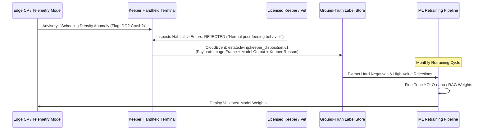

# ADR-011: Keeper Dispositions as Ground-Truth Training Labels

## Context
In the Living Collection and Park Operations domains, AI and computer vision models generate continuous predictions:
- Piranha biomass estimates and schooling dispersion anomaly alerts.
- Automated feed ration suggestions based on weather and water temperatures.
- Early lethargy or respiratory distress warnings derived from habitat camera telemetry.
- Ride dispatch cycle cadence recommendations.

If models retrain exclusively on unvalidated sensor telemetry or synthetic outputs, they suffer from **model collapse, feedback loops, and drift**. Conversely, hiring external data labeling firms to annotate 4K piranha tank video or veterinary logs is cost-prohibitive and lacks the specialized domain knowledge possessed by experienced zoological keepers.

## Decision
We establish **Keeper Operational Dispositions as the Authoritative Ground-Truth Training Data Loop**.
- Every recommendation emitted by the Keeper Copilot or Edge CV system requires an explicit disposition from the human keeper or ride supervisor during daily duties:
  - **ACCEPTED**: The keeper verified the anomaly and took physical corrective action (e.g., "Backwashed filter", "Administered electrolyte supplement").
  - **REJECTED**: The keeper evaluated the condition and determined the alert was a false positive (e.g., "Normal schooling behavior post-feeding", "Water cloudiness due to tank gravel replacement").
  - **MODIFIED**: The keeper accepted the intervention but altered the proposed dosage or feed amount.
- **Event-Driven Telemetry Capture**:
  - Dispositions are captured natively on the keeper's handheld UI and published as CloudEvents: `estate.living.keeper_disposition.v1`.
  - The event payload bundles the original sensor/camera snapshot, the model's intermediate inference embedding, the keeper's badge ID, and the explicit disposition reason code.
- **Active Learning Queue**: Rejected and modified events are automatically prioritized and queued into the monthly model retraining dataset, reviewed by the Head Veterinarian before fine-tuning.

## Consequences

### Positive
- **Zero Labeling Overhead**: High-quality, expert-annotated training data is generated as an organic byproduct of routine keeper work.
- **Rapid Elimination of False Positives**: The models learn specifically from their edge-case errors in the estate's unique physical habitats.
- **Auditable Quality Assurance**: Clear paper trail documenting veterinary decision-making and AI suggestions for compliance inspections.

### Negative / Tradeoffs
- **UI Interaction Friction**: Keepers must spend a few seconds entering dispositions on mobile terminals.
- **Potential Human Bias**: Individual keeper preferences or varying experience levels can introduce labeling inconsistencies.

### Risks & Mitigations
- *Risk*: Keepers blindly accepting alerts to clear their notification queue.
- *Mitigation*: The system tracks operator disposition review dwell times and randomly inserts synthetic calibration cases to audit attention.

## Alternatives Considered & Rejected
1. **Unsupervised Self-Training / Auto-Labeling**: Rejected because feedback loops in biological models can lead to dangerous behavioral misinterpretations and animal harm.
2. **Third-Party Crowdsourced Annotation**: Rejected because general annotators lack ichthyological and zoological expertise to diagnose subtle animal behaviors.
