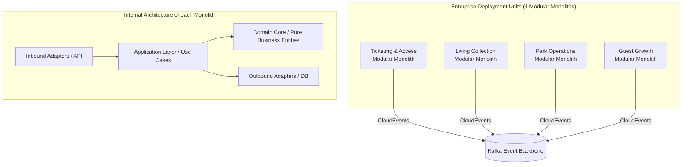

# ADR-013: Modular Monolith per Bounded Context

## Context
A critical architectural decision for the Von Digitalis Estates digital platform is selecting the macro-architectural deployment style:
- **Microservices Sprawl**: Splitting the estate into 25–40 tiny independent microservices (e.g., ticket-cart-service, payment-service, piranha-counter-service, queue-wait-service, weather-service, badge-service).
- **Single Huge Monolith**: Placing all estate code into a single monolithic codebase and single shared relational database.

For an estate with ~1.8M annual visitors, a 20-person engineering department, and physical edge constraints:
1. Microservices sprawl introduces massive operational overhead: complex Kubernetes orchestration, distributed transaction failure modes (Sagas/2PC), network serialization latency, and intricate local development setups.
2. A single unpartitioned monolith causes team merge conflicts, tight database table coupling, accidental boundary leaks, and inability to deploy or scale domains independently.

## Decision
We adopt the **Modular Monolith per Bounded Context** architectural pattern.
- The platform is partitioned strictly into **four deployable backend units**, corresponding exactly to the four DDD Bounded Contexts:
  1. `ticketing-and-access-service`
  2. `living-collection-service`
  3. `park-operations-service`
  4. `guest-growth-service`
- **Internal Modular Design**:
  - Within each service, internal modules are strictly separated into clean hexagonal layers: Domain Core (Entities & Business Rules), Application Services (Use Cases), and Infrastructure Adapters (Database, MQTT, Kafka, HTTP).
  - Internal module boundaries are enforced at compile-time using tools like **ArchUnit** (JVM) or **ESLint dependency boundary rules** (TypeScript). Cross-module database joins are strictly forbidden.
- **Inter-Domain Communication**:
  - All communication between bounded contexts is asynchronous via **CloudEvents over Apache Kafka**, or synchronous via strictly versioned, public REST/gRPC interfaces.
  - Each domain service owns its independent database schema (database-per-service pattern).

## Consequences

### Positive
- **High Cohesion, Low Coupling**: Code within a domain evolves rapidly without distributed network calls, while domain boundaries remain strictly decoupled.
- **Operational Simplicity**: Deploying, observing, and debugging 4 robust services is vastly simpler and more reliable than managing 40 microservices.
- **Independent Scalability & Failover**: A traffic surge on Ticketing or Guest Growth cannot exhaust database connections or crash the Living Collection veterinary service.

### Negative / Tradeoffs
- **Language/Framework Diversity Constrained**: Each bounded context commits to a single primary runtime stack internally.
- **Service Deployment Granularity**: Deploying a minor feature in Ticketing requires restarting that domain's container.

### Risks & Mitigations
- *Risk*: Developers taking shortcuts and leaking domain logic across internal module boundaries.
- *Mitigation*: Automated ArchUnit fitness functions in CI block builds that violate internal boundary rules.

## Alternatives Considered & Rejected
1. **Fine-Grained Microservices (30+ services)**: Rejected due to unnecessary cognitive load, operational fragility, and excessive cloud overhead for the team size.
2. **Single Monolithic Codebase & Shared Database**: Rejected because sharing a database schema across ticketing, animal welfare, and park operations inevitably destroys domain boundaries.
