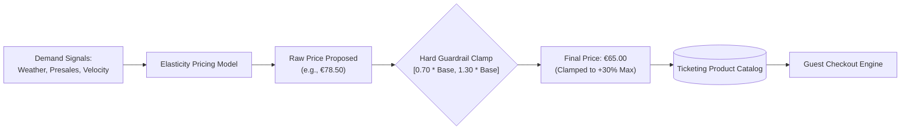

# ADR-014: Dynamic Pricing Engine with Hard Guardrails (±30% Cap)

## Context
The Von Digitalis Estates seek to maximize revenue and distribute crowd attendance across off-peak weekdays and shoulder seasons using dynamic pricing. Machine learning algorithms (reinforcement learning or elasticity models) can optimize ticket pricing in real time based on historical attendance curves, hotel occupancy, weather forecasts, and remaining calendar capacity.

However, unconstrained dynamic pricing presents severe commercial and reputational hazards:
- **Predatory Price Surges**: Extreme surge pricing during holidays or sunny weekends alienates loyal regional families and generates intense public backlash against Countess Von Digitalis.
- **Race-to-the-Bottom Discounting**: Aggressive downward discounting undermines the estate's heritage luxury positioning and risks devaluing season passes.
- **LLM / Agent Exploitation**: If guest-facing AI agents possess discretion over transaction pricing, prompt injections could trick models into issuing tickets for $0.01.

## Decision
We implement an **Algorithmic Dynamic Pricing Engine with Hard Guardrails**:
1. **Demand-Adjusted Price Calculation**:
   The engine calculates a proposed raw ticket price based on real-world demand signals:
   - **Approved Base Price**: Starts with the Countess-approved standard ticket price (e.g., €50.00).
   - **Demand Signals**: A machine learning model calculates an adjustment percentage using:
     - Presale booking velocity (how fast tickets are selling compared to historical averages)
     - Weather forecasts (sunny vs. rainy day attendance impact)
     - Calendar timing (weekdays vs. high-demand weekends and bank holidays)
     - Current estate capacity fill rate
   - **Calculation in Simple Terms**:
     ```text
     Proposed Price = Base Price × (1 + Demand Adjustment Percentage)
     ```
     *Example*: On a €50.00 base ticket, if high demand indicates a +40% adjustment, the raw proposed price is `€50.00 × 1.40 = €70.00`.

2. **Hard Guardrail Enforcement (Strict ±30% Boundary)**:
   Regardless of what the algorithm proposes, the final published price is strictly clamped between an unbreakable floor and ceiling:
   - **Minimum Price Floor (-30%)**: 0.70 × Base Price (€35.00 minimum for a €50.00 base ticket)
   - **Maximum Price Ceiling (+30%)**: 1.30 × Base Price (€65.00 maximum for a €50.00 base ticket)
   - **Rule in Simple Terms**:
     ```text
     Final Price = Clamped between Minimum Floor (€35.00) and Maximum Ceiling (€65.00)
     ```
     *Example*: If extreme surge demand calculates a raw price of €78.50, the guardrail automatically clamps it down to €65.00. If an off-peak algorithm suggests €25.00, the system automatically clamps it up to €35.00.
   - **Under no circumstances can an admission ticket deviate by more than ±30% from its base price.**

3. **Execution Layer**:
   - Pricing calculations are executed **strictly deterministically** inside the Ticketing & Access core domain engine.
   - The AI Concierge and Guest Growth services are strictly read-only consumers of the published pricing schedule and cannot negotiate, override, or alter transaction amounts.

4. **Rate of Change Throttling**:
   - Published ticket prices cannot change more frequently than once every 4 hours, and price changes are capped at a maximum shift of €5.00 per adjustment window to prevent guest checkout panic.



## Consequences

### Positive
- **Brand & Trust Protection**: Protects the estate's heritage reputation from price-gouging accusations while still capturing yield optimization.
- **Immunity from AI Vulnerabilities**: AI chat agents cannot be manipulated into altering financial transaction terms.
- **Revenue Predictability**: Financial controllers can forecast floor and ceiling revenues with certainty.

### Negative / Tradeoffs
- **Constrained Revenue Potential**: During extreme super-peak events, the estate forfeits marginal revenue that an unconstrained surge model might extract.
- **Algorithmic Damping**: Heavy dampening of price signals limits the speed at which pricing alone can smooth extreme crowd spikes.

### Risks & Mitigations
- *Risk*: Misconfiguration of the base ticket price causing unexpected price shifts across the estate.
- *Mitigation*: Any change to the base ticket price requires cryptographic dual-authorization by the Chief Financial Officer and Estate General Manager.

## Alternatives Considered & Rejected
1. **Uncapped Real-Time Surge Pricing (Uber / Airline Model)**: Rejected due to severe brand destruction, customer hostility, and violation of the estate's heritage family mission.
2. **Fixed Static Pricing**: Rejected because it fails to incentivize attendance shifting from overcrowded Saturdays to underutilized Tuesdays.
