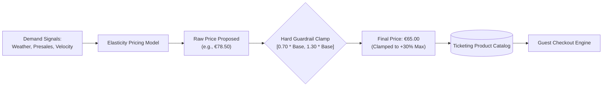

# ADR-014: Dynamic Pricing Engine with Hard Guardrails (±30% Cap)

## Status
Accepted

## Context
The Von Digitalis Estates seek to maximize revenue and distribute crowd attendance across off-peak weekdays and shoulder seasons using dynamic pricing. Machine learning algorithms (reinforcement learning or elasticity models) can optimize ticket pricing in real time based on historical attendance curves, hotel occupancy, weather forecasts, and remaining calendar capacity.

However, unconstrained dynamic pricing presents severe commercial and reputational hazards:
- **Predatory Price Surges**: Extreme surge pricing during holidays or sunny weekends alienates loyal regional families and generates intense public backlash against Countess Von Digitalis.
- **Race-to-the-Bottom Discounting**: Aggressive downward discounting undermines the estate's heritage luxury positioning and risks devaluing season passes.
- **LLM / Agent Exploitation**: If guest-facing AI agents possess discretion over transaction pricing, prompt injections could trick models into issuing tickets for $0.01.

## Decision
We implement an **Algorithmic Dynamic Pricing Engine with Hard Mathematical Guardrails**:
1. **Mathematical Pricing Formulation**:
   The calculated ticket price $P_{\text{calc}}$ is computed as:
   
   $$P_{\text{calc}} = P_{\text{base}} \cdot \left(1 + \sum_{i=1}^k w_i \cdot f_i(\mathbf{x})\right)$$
   
   where $P_{\text{base}}$ is the Countess-approved baseline price (e.g., €50.00), $w_i$ are model weights, and $f_i(\mathbf{x})$ are normalized demand factors (presale velocity, weather score, day of week, capacity fill rate).
2. **Hard Mathematical Guardrail Enforcement**:
   The final emitted price $P_{\text{final}}$ is strictly bounded by a deterministic clamping function:
   
   $$P_{\text{final}} = \max\Big( 0.70 \cdot P_{\text{base}}, \; \min\big( 1.30 \cdot P_{\text{base}}, \; P_{\text{calc}} \big) \Big)$$
   
   **Under no circumstances can an admission ticket price deviate by more than $\pm 30\%$ from the base price** (€35.00 floor, €65.00 ceiling).
3. **Execution Layer**:
   - Pricing calculations are executed **strictly deterministically** inside the Ticketing & Access core domain engine.
   - The AI Concierge and Guest Growth services are strictly read-only consumers of the published pricing schedule and cannot negotiate, override, or alter transaction amounts.
4. **Rate of Change Throttling**:
   - Published ticket prices cannot change more frequently than once every 4 hours, and price changes are capped at a maximum shift of €5.00 per adjustment window to prevent guest checkout panic.

## Consequences

### Positive
- **Brand & Trust Protection**: Protects the estate's heritage reputation from price-gouging accusations while still capturing yield optimization.
- **Immunity from AI Vulnerabilities**: AI chat agents cannot be manipulated into altering financial transaction terms.
- **Revenue Predictability**: Financial controllers can forecast floor and ceiling revenues with certainty.

### Negative / Tradeoffs
- **Constrained Revenue Potential**: During extreme super-peak events, the estate forfeits marginal revenue that an unconstrained surge model might extract.
- **Algorithmic Damping**: Heavy dampening of price signals limits the speed at which pricing alone can smooth extreme crowd spikes.

### Risks & Mitigations
- *Risk*: Misconfiguration of $P_{\text{base}}$ causing unexpected price shifts across the estate.
- *Mitigation*: Any change to $P_{\text{base}}$ requires cryptographic dual-authorization by the Chief Financial Officer and Estate General Manager.

## Alternatives Considered & Rejected
1. **Uncapped Real-Time Surge Pricing (Uber / Airline Model)**: Rejected due to severe brand destruction, customer hostility, and violation of the estate's heritage family mission.
2. **Fixed Static Pricing**: Rejected because it fails to incentivize attendance shifting from overcrowded Saturdays to underutilized Tuesdays.

## Judging Criteria Addressed
- **Criterion 5 (Security, Safety, Ethics & Privacy)**: Fair, ethical pricing guardrails preventing algorithmic exploitation.
- **Criterion 1 (Architectural Soundness)**: Deterministic bounding pattern applied to probabilistic inputs.
