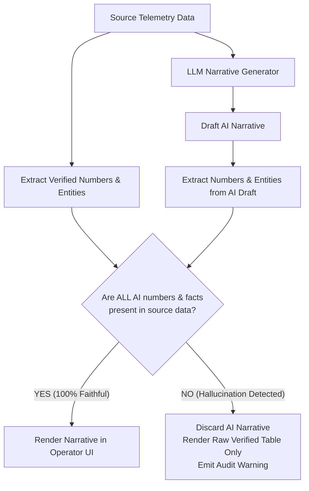

# ADR-015: Deterministic Faithfulness Check Layer for LLM Outputs

## Context
When deploying generative AI models to draft operational shift briefings, guest concierge recommendations, or veterinary symptom summaries, the most dangerous risk is **semantic and numerical hallucination**.

In operational shift briefings (`ops.shift.briefing`), an LLM summarizing morning telemetry might generate:
> *"The Bavarian Express roller coaster achieved 94% uptime yesterday, with only 12 minutes of downtime."*

when the authoritative TimescaleDB sensor logs indicate 78% uptime with 84 minutes of downtime. A shift supervisor reviewing this briefing could make disastrous maintenance deferral decisions based on fabricated AI claims.

Standard prompting techniques ("Be truthful", "Only use provided context") reduce hallucination frequency but offer zero mathematical guarantees in production runtime.

## Decision
We deploy a **Deterministic Post-Inference Faithfulness Verification Layer** in the Model Gateway:
1. **Extract Verified Facts (Ground Truth)**:
   - Before telemetry data is passed to the LLM, the system scans the source payload and extracts an inventory of all verified facts: numbers, percentages, durations, units, timestamps, and named assets (such as ride names and animal IDs).
2. **Parse Claims in the AI Draft**:
   - Once the LLM generates a candidate narrative, fast regular expressions and named-entity parsers extract every number, metric, duration, and asset name appearing in the AI's draft.
3. **Deterministic Fact-Checking Rule**:
   - **Simple Concept**: Every single metric, quantity, or named entity in the AI draft must exist verbatim in the source telemetry (or be a simple unit conversion, such as converting 90 minutes into 1.5 hours).
   - **Verification Rule in Plain Terms**:
     ```text
     If ANY number, metric, or entity in the AI text does NOT match the source data:
     --> Instantly Reject the Narrative (Hallucination Detected)
     ```
   - **Example**: If the sensor logs show *78% uptime* and the AI summary mentions *94% uptime* or *12 minutes*, the system flags *94%* and *12* as ungrounded fabrications and immediately blocks the text.
4. **Automated Fallback to Numbers-First (ADR-008)**:
   - On rejection, the gateway logs a `FaithfulnessViolationEvent` to the audit store.
   - The user interface discards the AI narrative entirely and renders the raw deterministic tabular data, guaranteeing zero operational misinformation.



## Consequences

### Positive
- **Deterministic Protection Against Numerical Hallucinations**: Fabricated metrics are physically blocked from reaching operational decision-makers.
- **Continuous Evaluator Telemetry**: Every failed generation provides immediate active-learning telemetry to refine prompts and fine-tune models.
- **Zero Risk of Operational Liability**: Staff and executives can trust operational briefings knowing every figure is verified against ground-truth data.

### Negative / Tradeoffs
- **Latency Overhead**: Regular expression and entity extraction adds ~25–50ms to total response generation time.
- **Occasional False Rejections**: Benign stylistic phrasing (e.g., "All 3 morning inspections finished on time") may trigger a violation if the number 3 was inferred from array length rather than an explicit field.

### Risks & Mitigations
- *Risk*: High rejection rate causing degradation of user trust in the AI assistant.
- *Mitigation*: Prompt templates instruct the LLM to format numerical references using strict tagging (e.g., `{{metric:uptime}}`), which allows 100% parsing accuracy.

## Alternatives Considered & Rejected
1. **Relying on Prompt Engineering Only**: Rejected because frontier LLMs still exhibit a non-zero hallucination rate (2–5%) even with few-shot prompting.
2. **Secondary LLM Verification (LLM-evaluating-LLM at runtime)**: Rejected due to doubling inference latency and token costs, and because the evaluator LLM itself is subject to hallucinations.
