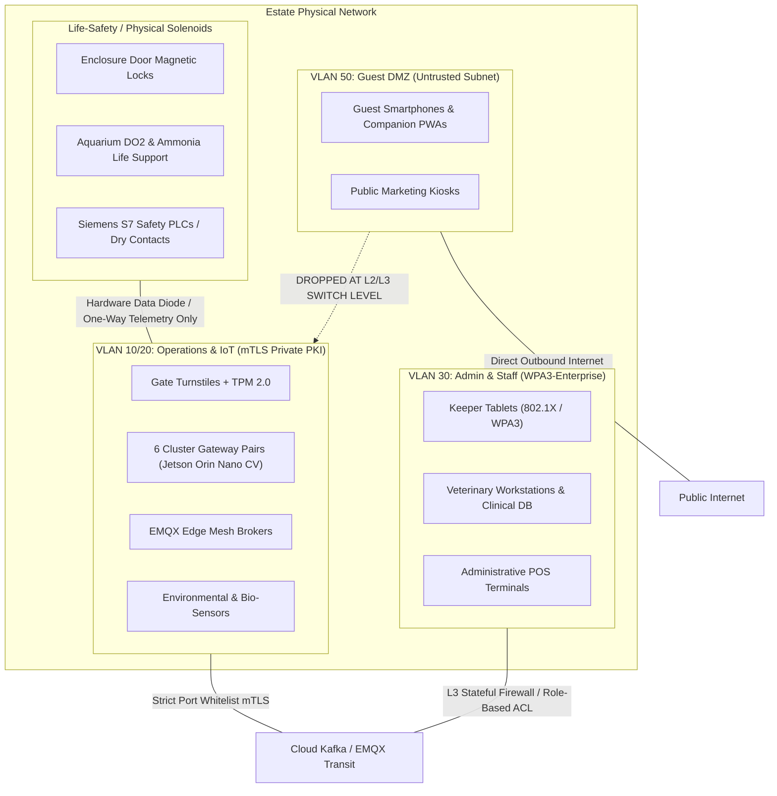

# ADR-016: Strict Network Segmentation (VLAN 10/20, 30, 50) & mTLS Device Identity

## Status
Accepted

## Context
The Von Digitalis Estates digital platform bridges physical life-safety systems (dangerous animal enclosure locks, ride dispatch controls), enterprise operations (turnstiles, ticketing POS, IoT telemetry, keeper tablets), administrative systems (veterinary workstations, payroll), and untrusted public guest devices (15,000 visitors accessing estate Wi-Fi).

Operating a flat or loosely segregated local network on the estate grounds represents a catastrophic security vulnerability:
- A malicious guest connecting to public estate Wi-Fi could perform ARP spoofing, network scanning, or exploit unpatched IoT camera firmwares.
- A compromised turnstile controller or vendor IoT device could pivot laterally into life-safety PLC controllers or access the veterinary clinical database.
- Turnstile admission passes could be intercepted or cloned via packet sniffing on the local subnet.

## Decision
We enforce a strict **Three-Tier Network Segmentation Architecture (VLAN 10/20, 30, 50)** combined with **mTLS (Mutual Transport Layer Security) Device Identity** and **Hardware Data Diodes**:

### 1. The Authoritative VLAN Segmentation:
- **Life-Safety (Air-Gapped & Diode Isolated)**:
  - Contains physical enclosure door magnetic interlocks, emergency lockdown relays, and aquarium life-support solenoid valves.
  - **Zero IP-Routable Path**: Completely isolated; only one-way hardware optical data diodes or dry-contact relays export state metrics to VLAN 10/20. No network commands can physically actuate life safety without local manual key interlocks.
- **VLAN 10/20: Operations & IoT Telemetry**:
  - Contains turnstile controllers, 6 physical cluster gateway pairs (Jetson Orin Nano + dual Mosquitto/EMQX edge brokers), environmental sensors, and gate validation endpoints.
  - **Zero Direct Public Exposure**: Inaccessible from VLAN 50 or the public internet. All broker and gateway transit uses mTLS with client certificates.
- **VLAN 30: Admin & Staff (Corporate Operational)**:
  - WPA3-Enterprise 802.1X authenticated staff network for keeper tablets, operational dashboards, veterinary workstations, and administrative POS.
  - Inter-VLAN access to VLAN 10/20 is restricted via stateful L3 firewalls to specific whitelisted management ports (e.g., SSH bastion, MQTT control).
- **VLAN 50: Guest DMZ (Untrusted Public Subnet)**:
  - High-density guest Wi-Fi. Connected directly to an isolated commercial ISP egress with strict client isolation (clients cannot communicate with other clients).
  - **Hard Dropped Routing**: Inter-VLAN routing between VLAN 50 and VLAN 10/20 is completely dropped at the managed edge switch layer (IEEE 802.1Q). No guest packet can reach an operational endpoint.

### 2. Device Identity via mTLS & Hardware Root of Trust:
- Every device on VLAN 10/20 (turnstiles, cameras, cluster gateway pairs, edge servers) must authenticate using **mutual TLS (mTLS) with X.509 certificates**.
- Certificates are issued by the estate's private internal Public Key Infrastructure (PKI / HashiCorp Vault) and tied to physical hardware **TPM 2.0 chips** or secure enclaves.
- Traffic without valid cryptographic client certificates is dropped at the switch port level (IEEE 802.1X network access control).

## Consequences

### Positive
- **Lateral Movement Prevention**: An attacker compromising a public guest phone or guest Wi-Fi router cannot even ping internal turnstiles, zone brokers, or animal enclosure systems.
- **Hardware-Enforced Identity**: Rogue devices plugged into physical Ethernet ports in the park cannot join the operational network without an authorized TPM-backed certificate.
- **Life-Safety Protection**: Physical life-safety interlocks remain fully operational and completely isolated even during a major cloud or enterprise security incident.

### Negative / Tradeoffs
- **Network Infrastructure Cost**: Requires enterprise-grade managed Layer-3 PoE+ switches across all 55 zones ($24,750 CapEx).
- **PKI Lifecycle Maintenance**: Managing certificate enrollment, 90-day automated rotation, and revocation lists requires robust automation.

### Risks & Mitigations
- *Risk*: Expired device certificates causing turnstiles or zone brokers to disconnect from the mesh.
- *Mitigation*: EST (Enrollment over Secure Transport) automated certificate renewal with 30-day grace periods and automated expiration alerts.

## Alternatives Considered & Rejected
1. **Flat Network with Software Firewall Rules**: Rejected due to high human configuration error risk and lack of hardware-level isolation.
2. **Pre-Shared WPA2 Keys for Staff Tablets**: Rejected because pre-shared keys are easily shared, stolen, or leaked by departing temporary seasonal staff.

## Judging Criteria Addressed
- **Criterion 5 (Security, Safety, Ethics & Privacy)**: Enterprise-grade zero-trust physical and cryptographic defense-in-depth.
- **Criterion 3 (Deployability & Operational Feasibility)**: Industry-standard 802.1X and mTLS architectures.
