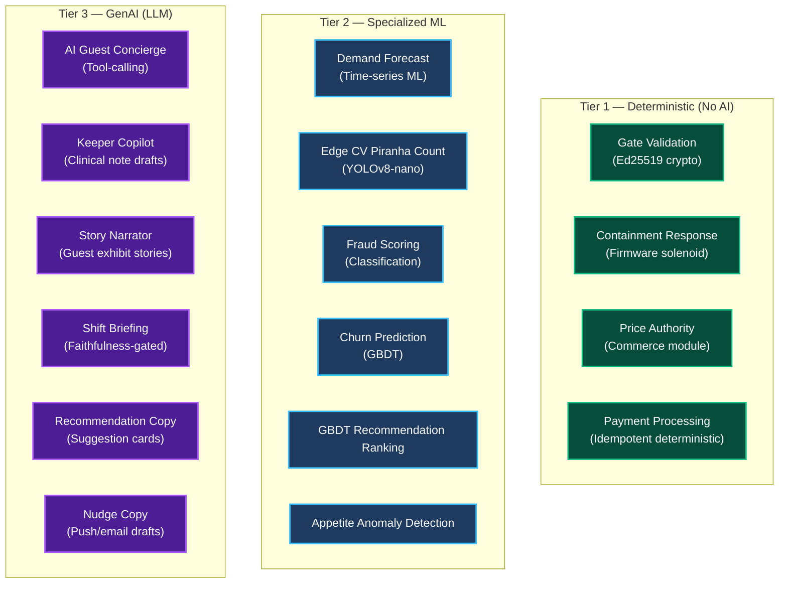

# AI Strategy Overview

## Tiered Autonomy — AI Assists, Humans Decide

The Von Digitalis Estates platform deploys AI deliberately across a spectrum of autonomy. No AI capability operates without human oversight, a deterministic fallback, and a cost ceiling.

---

## What Is Shared, and What Stays Domain-Owned

The three tiers are a common vocabulary, not a mandate to centralise. Sharing is applied where it removes duplicated *risk surface*; it is withheld where it would couple systems that fail for unrelated reasons.

| Tier | Shared estate-wide | Owned by the domain | Why the line falls here |
|---|---|---|---|
| **Tier 1 — Deterministic** | Nothing. These are local by nature. | Life-support interlocks, ride e-stops, Ed25519 validation, the pricing engine, the popularity formula, staffing rules | Different physics and different ledgers. Sharing would couple a life-safety relay to a commerce rule. |
| **Tier 2 — Specialized ML** | **The demand forecast only** — one model, two horizons, in Park Operations | Edge CV (piranha census, queue counting), appetite anomaly, fraud scoring, churn, GBDT ranking | Only the forecast had two consumers predicting the *same* quantity. The rest differ in inputs, latency budgets, and failure modes; a common "ML platform" would buy coupling, not savings. |
| **Tier 3 — GenAI** | Invocation path, failover chain, cost fuses, and the deterministic grounding gate | Prompts, tool schemas, medical/commercial denylists | Every domain faces the same provider uncertainty and the same hallucination risk; none of them share vocabulary. Clinical prose and upsell copy need one plumbing and two voices. |

Two camera-bearing models make the distinction concrete: `lc.census.school.density` and `po.queue.occupancy.count` run on the same class of sensor, on the same cluster gateway, on the same VLAN — and remain separate models with separate retention (clinical evidence vs. 4-hour operational debug). Sharing the hardware is worth it; sharing the model would mix guest-queue geometry with an animal census.

---

## Estate AI Task Catalog

One central estate-wide catalog, namespaced by domain. Every task is invoked via a stable **Task ID** through the shared Model Gateway. Domain microservices never import vendor-specific SDKs:

| Task ID | Tier | Runtime | Owner | Output | Guardrail / Fallback |
|---|---|---|---|---|---|
| `lc.census.school.density` | 2 | Edge (Jetson Orin) | Living Collection | $\hat{N}$, [ci_low, ci_high] | Double-blind human count on CI non-overlap |
| `lc.welfare.appetite.anomaly` | 2 | Edge / Cloud | Living Collection | Risk [0, 1] | Emits advisory claim; cannot actuate feeder |
| `lc.welfare.behaviour.anomaly` | 2 | Edge (Jetson) | Living Collection | Anomaly + clip ID | Flags video clip on local node; zero cloud egress |
| `lc.keeper.copilot.draft` | 3 | Cloud (SLM backup) | Living Collection | Markdown draft | Never auto-submits; clinical medication denylist |
| `lc.guest.narrator.card` | 3 | Cloud | Living Collection | Story card text | Tool-gated to public fields; no clinical leaks |
| `lc.ugc.exhibit.classify` | 2 | Cloud | Living Collection | Enclosure ID, `welfare_safe` | Side-channel queue; zero clinical write permission |
| `tk.concierge.ticket.chat` | 3 | Cloud | Ticketing & Access | Proposed cart + NL reply | Read-only tool access; Commerce module sets price |
| `tk.offer.next_best_action` | 2+3 | Cloud | Ticketing & Access | Ranked offers + promo copy | Inventory stock-checked; static template fallback |
| `tk.fraud.transaction.score` | 2 | Cloud | Ticketing & Access | Risk score [0, 1] | 3DS step-up challenge; rule fallback |
| `tk.customer.churn.score` | 2 | Cloud | Ticketing & Access | Return prob [0, 1] | Feeds Guest Growth retention engine; rule fallback |
| `tk.concierge.weather.rebook` | 3 | Cloud | Ticketing & Access | Rebooking recommendation | Guest must explicitly accept; template fallback |
| `po.popularity.score` | 1 | Cloud (~30s) | Park Operations | Composite popularity score | Pure deterministic formula; baseline on silence |
| `po.demand.forecast` | 2 | Cloud (~15min) | Park Operations | Micro & macro occupancy | **Single unified forecast**; PSI drift-monitored |
| `po.staffing.recommendation` | 1 | Cloud | Park Operations | Zone-to-zone move | Human Approve/Reject/Modify; no automated dispatch |
| `po.capex.flag` | 1 | Cloud (monthly) | Park Operations | CapEx flag indicator | Stateless threshold computation; human review |
| `po.shift.briefing` | 3 | Cloud | Park Operations | Narrative prose | Numbers-first; deterministic faithfulness check |
| `po.silence.detector` | 1 | Cloud | Park Operations | Signal status flag | Prevents unannounced ride silence read as unpopularity |
| `gr.wait.time.estimate` | 1 | Cloud | Guest Growth | Estimated wait minutes | Derived from PO queue counts; enforces honesty invariant |
| `gr.nudge.timing` | 2 | Cloud | Guest Growth | Delivery score [0, 1] | Gated by anti-congestion simulation before delivery |

---

## Where AI Is Forbidden

| Forbidden Zone | Why | What Happens Instead |
|---|---|---|
| **Setting prices** | LLM hallucination → financial loss | Commerce module is sole price authority. AI signal is input only |
| **Containment decisions** | Probabilistic output → life-safety risk | Firmware-level solenoid + deterministic microcontroller |
| **Payment processing** | Non-determinism → financial integrity breach | Idempotent deterministic commerce |
| **Credential issuance** | Fabricated credential → security breach | Ed25519 cryptographic signing |
| **Staff dispatch** | System cannot see breaks, fatigue, context | Duty manager decides and radios |
| **Clinical diagnosis** | AI lacks veterinary judgment | Keeper/vet is sole diagnostic authority |
| **Closing/opening enclosures** | Safety-adjacent actuation | Keeper/vet manual action with alert prompt |

---

## AI Risk Matrix

| Risk | Domain | Consequence | Mitigation |
|---|---|---|---|
| **Price hallucination** | Ticketing | Customer charged wrong amount | Commerce is sole authority; price-mismatch monitoring |
| **Missed containment alert** | Living Collection | Animal escape (life-safety) | LLM never in safety path; firmware response |
| **False piranha count** | Living Collection | Incorrect population belief | School aggregate with CI; keeper disposition verification |
| **Biased recommendation** | Guest Growth | Guest sent to congested zone | Congestion simulation gate before delivery |
| **Stale demand forecast** | Park Operations | Wrong staffing recommendation | Drift monitoring; "estimated" indicators; human approval |
| **Fabricated narrative** | Park Operations | Duty manager acts on false data | Deterministic faithfulness check; raw numbers fallback |
| **Provider shutdown** | All | AI capabilities unavailable | 4-tier failover: Primary → Secondary → Local SLM → Static |
| **Cost explosion** | All | Budget overrun | Per-session/daily/monthly ceilings enforced by Model Gateway |

---

## NIST AI RMF Alignment

The platform's AI governance maps to the NIST AI Risk Management Framework (AI RMF 1.0):

| NIST Function | Platform Implementation |
|---|---|
| **GOVERN** | Policy kernel in Model Gateway: cost ceilings, failover chains, task routing. Tiered autonomy (AI assists, humans decide) |
| **MAP** | AI capability map (this document). Per-capability risk assessment. Forbidden zones explicitly documented |
| **MEASURE** | Evaluation observatory: golden sets, keeper dispositions, faithfulness checks, drift metrics, Winkler scoring |
| **MANAGE** | 4-tier failover, canary deployment, automated rollback triggers, human-in-the-loop for all safety-adjacent decisions |
