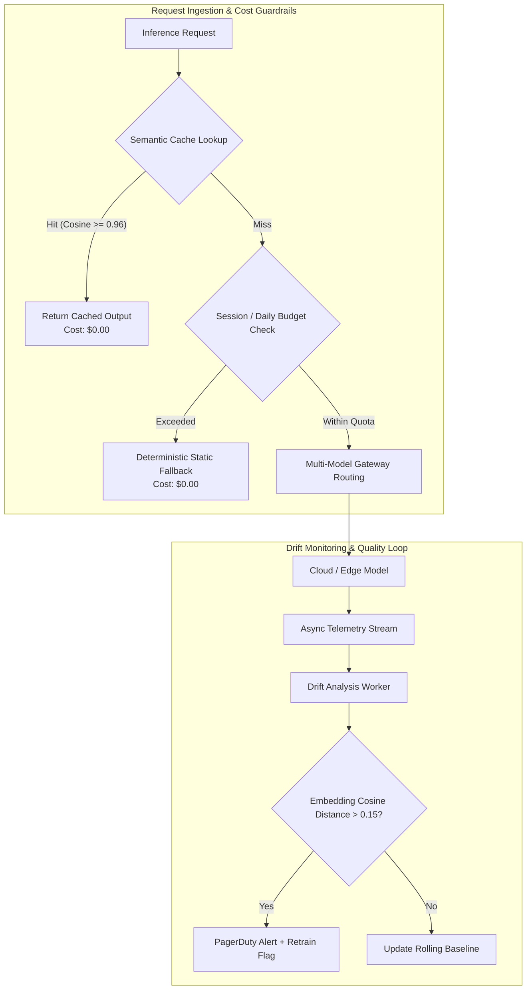
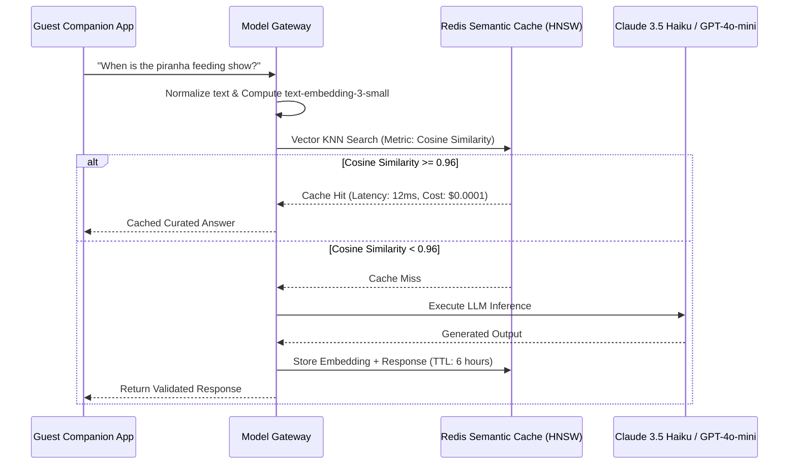

# AI Cost Governance and Model Drift Controls

## Strategic Governance Architecture

Uncontrolled LLM and computer vision costs represent an existential risk to the operating margins of the Von Digitalis Estates. Concurrently, data distribution shifts (seasonal crowd variance, animal growth, habitat water turbidity changes) can degrade model performance silently. 

Our dual governance architecture establishes:
1. **Multi-Tiered Cost Control**: Semantic caching, token quotas, and hard economic circuit breakers.
2. **Continuous Drift Monitoring**: Statistical covariate shift detection, embedding distance monitoring, and automated retraining triggers.

---

## 1. Multi-Tiered Cost Control Framework

### A. Strict Economic Ceilings

The Model Gateway enforces hard cost ceilings at both the user session and estate-wide daily levels:

| Tier | Hard Limit | Enforcement Point | Action on Breach |
|---|---|---|---|
| **Per Guest Session** | **$0.15 USD** (Max ~15 multi-turn exchanges) | Model Gateway Token Bucket | Downgrades session from Tier 3 (LLM) to Tier 1 (Deterministic Rules / FAQ template). |
| **Per Domain Daily** | **$150 USD / day** | Redis Global Domain Counter | Domain falls back to local quantized SLM or cached responses. |
| **Estate-Wide Daily** | **$600 USD / day** | Cloud Gateway Killswitch | Absolute circuit breaker trips; non-critical AI disabled; operations switch to deterministic emergency displays. |

### B. Two-Tier Semantic Prompt Caching

Repeated inquiries ("What time does the Piranha feeding start?", "Where are the restrooms in Bavarian Wood?") represent ~65% of all guest concierge queries.

#### Cache Invalidation Policies
- **Time-to-Live (TTL)**: Dynamic schedules (e.g., live wait times, current exhibit closures) have a TTL of 3 minutes; static historical facts have a TTL of 24 hours.
- **Event-Driven Invalidation**: A `RideDowntimeDeclared` or `EnclosureMaintenanceBegun` CloudEvent instantly evicts all cache keys tagged with that asset ID.

---

## 2. Mathematical Formulations for Drift Detection

### A. Embedding Drift Detection (Semantic Covariate Shift)

To detect if guest queries or habitat visual frames are drifting from the golden distribution, we track the rolling centroid of query embeddings in 384-dimensional vector space.

Let $B = \{\vec{e}_1, \dots, \vec{e}_M\}$ be the baseline golden embedding set with centroid:

$$\vec{\mu}_B = \frac{1}{M} \sum_{i=1}^M \vec{e}_i$$

Let $W_t = \{\vec{x}_1, \dots, \vec{x}_N\}$ be the sliding window of query embeddings over the last 1,000 requests. Its centroid is:

$$\vec{\mu}_{W_t} = \frac{1}{N} \sum_{j=1}^N \vec{x}_j$$

We measure the **Centroid Cosine Distance**:

$$D_{\text{drift}}(B, W_t) = 1 - \frac{\vec{\mu}_B \cdot \vec{\mu}_{W_t}}{\|\vec{\mu}_B\|_2 \|\vec{\mu}_{W_t}\|_2}$$

- **Threshold**: When $D_{\text{drift}} > 0.15$ for two consecutive sliding windows:
  1. Automated notification dispatched to the ML Engineer on-call.
  2. The window queries are persisted to the candidate retraining queue.

### B. Population Stability Index (PSI) for Numerical Tabular Models

For the Park Operations multi-signal demand forecasting model (LightGBM):

$$\text{PSI} = \sum_{k=1}^K \Big( P_{\text{actual}}(k) - P_{\text{expected}}(k) \Big) \times \ln\left(\frac{P_{\text{actual}}(k)}{P_{\text{expected}}(k)}\right)$$

- $\text{PSI} < 0.10$: Stable; no action.
- $0.10 \le \text{PSI} < 0.25$: Moderate drift; log warning and trigger shadow evaluation.
- $\text{PSI} \ge 0.25$: Severe drift; automatic fallback to 14-day historical moving average.

---

## 3. Computer Vision Drift & Turbidity Compensator

In the Living Collection Amazonia piranha habitat, bio-fouling, algae blooms, and artificial lighting shifts degrade YOLO-nano confidence scores.

### Visual Quality Metrics Monitored at Edge:
1. **Mean Pixel Intensity ($I_\mu$)**: Detects lighting failure ($I_\mu < 30$) or glare wash-out ($I_\mu > 230$).
2. **Laplacian Variance ($\sigma_{\text{Lap}}^2$)**: Measures image sharpness and water turbidity:

$$\sigma_{\text{Lap}}^2 = \text{Var}\big(\nabla^2 I\big)$$

- If $\sigma_{\text{Lap}}^2 < 120$: Water turbidity is classified as **Severe**. The edge gateway triggers an automated backwash notification for the aquarium filtration subsystem and temporarily flags biomass count certainty as degraded.

---

## 4. Cost & Drift Telemetry Dashboard

All telemetry is aggregated into a TimescaleDB instance and rendered in real-time on the Grafana Estate Command Dashboard:

| Metric Panel | Target Baseline | Critical Alert Threshold | Auto-Remediation Triggered |
|---|---|---|---|
| **Semantic Cache Hit Ratio** | $\ge 60\%$ | $< 35\%$ over 1 hour | Alert on novel query clusters; expand FAQ prompts. |
| **Average Cost per Session** | $\$0.04$ | $> \$0.12$ | Enforce prompt truncation; force Haiku over Sonnet. |
| **Model Gateway P95 Latency** | $< 1,800\text{ ms}$ | $> 3,500\text{ ms}$ | Activate Tier 3 provider failover. |
| **YOLO-nano Detection Confidence** | $\ge 0.88$ | $< 0.70$ | Flag camera lens maintenance; request manual visual census. |
| **Daily Spend Accrual** | $\le \$250/\text{day}$ | $> \$500/\text{day}$ | Hard clamp on non-essential GenAI features. |
