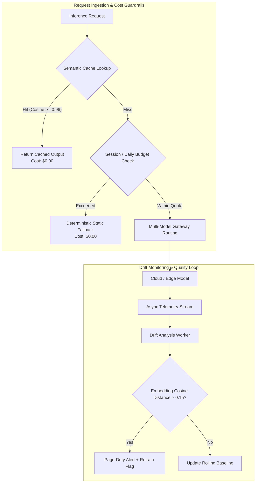
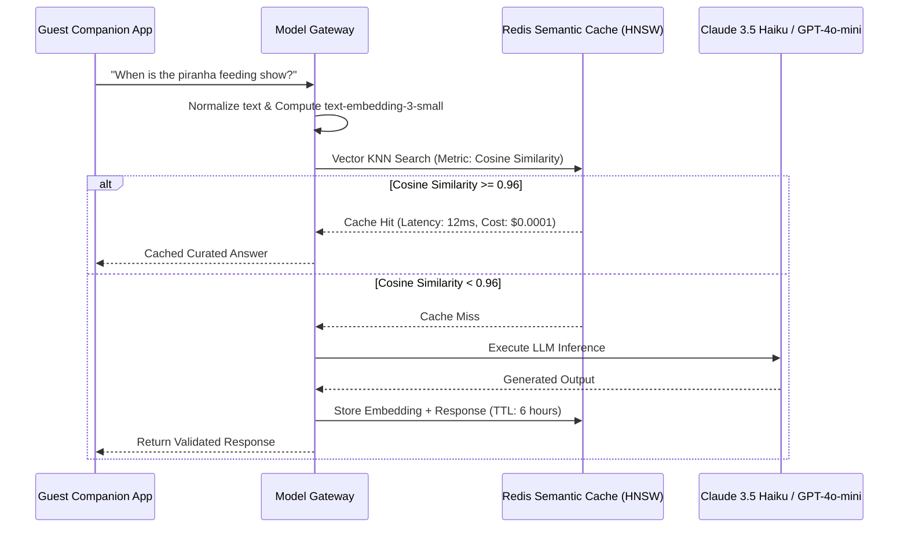

# AI Cost Governance and Model Drift Controls

## Strategic Governance Architecture

Uncontrolled LLM and computer vision costs represent an existential risk to the operating margins of the Von Digitalis Estates. Concurrently, data distribution shifts (seasonal crowd variance, animal growth, habitat water turbidity changes) can degrade model performance silently. 

Our dual governance architecture establishes:
1. **Multi-Tiered Cost Control**: Semantic caching, token quotas, and hard economic circuit breakers.
2. **Continuous Drift Monitoring**: Statistical covariate shift detection, embedding distance monitoring, and automated retraining triggers.



---

## 1. Multi-Tiered Cost Control Framework

### A. Strict Economic Ceilings

The Model Gateway enforces hard cost ceilings at both the user session and estate-wide daily levels:

| Tier | Hard Limit | Enforcement Point | Action on Breach |
|---|---|---|---|
| **Per Guest Session** | **$0.15 USD** (Max ~15 multi-turn exchanges) | Model Gateway Token Bucket | Downgrades session from Tier 3 (LLM) to Tier 1 (Deterministic Rules / FAQ template). |
| **Per Domain Daily** | **$150 USD / day** | Redis Global Domain Counter | Domain falls back to local quantized SLM or cached responses. |
| **Estate-Wide Daily** | **$600 USD / day** | Cloud Gateway Killswitch | Absolute circuit breaker trips; non-critical AI disabled; operations switch to deterministic emergency displays. |

### B. Two-Tier Semantic Prompt Caching

Repeated inquiries ("What time does the Piranha feeding start?", "Where are the restrooms in Bavarian Wood?") represent ~65% of all guest concierge queries.



#### Cache Invalidation Policies
- **Time-to-Live (TTL)**: Dynamic schedules (e.g., live wait times, current exhibit closures) have a TTL of 3 minutes; static historical facts have a TTL of 24 hours.
- **Event-Driven Invalidation**: A `RideDowntimeDeclared` or `EnclosureMaintenanceBegun` CloudEvent instantly evicts all cache keys tagged with that asset ID.

---

## 2. Drift Detection & Statistical Quality Controls

### A. Semantic Drift Detection (Tracking Topic & Question Shifts)

To detect if guest queries or habitat visual frames are drifting from expected patterns, we track shifts in semantic vector embeddings:
- **Baseline Average**: The central "topic center" representing typical, verified historical questions and FAQs.
- **Recent Window Average**: The moving topic center calculated across the most recent 1,000 live guest queries.
- **Semantic Distance in Simple Terms**:
  ```text
  Drift Distance = 1 - (Semantic Similarity between Baseline Average and Recent 1,000 Questions)
  ```
- **Action Thresholds**:
  - When `Drift Distance > 0.15` across two consecutive windows (meaning guests are asking questions significantly different from established topics, e.g., during sudden ride disruptions or severe weather):
    1. Dispatches an automated notification to the on-call ML engineer.
    2. Automatically stores the anomalous queries into a retraining queue to refresh prompts, FAQs, and domain knowledge.

### B. Population Stability Index (PSI) for Numerical Tabular Models

For the Park Operations multi-signal demand forecasting model (LightGBM), the system tracks how input data distributions (such as hourly visitor arrivals, weather temperatures, and ticket sales) compare to historical training data:

```text
PSI = Sum across all data buckets of:
      (Actual % - Expected %) × Natural Log(Actual % / Expected %)
```

- **PSI < 0.10 (Stable)**: Minimal distribution shift; the forecasting engine operates normally with full automation.
- **0.10 ≤ PSI < 0.25 (Moderate Drift)**: Noticeable change in visitor behavior or weather trends; logs an operational warning and runs shadow evaluations against alternate models.
- **PSI ≥ 0.25 (Severe Drift)**: Significant distribution change (e.g., severe flash storm or unanticipated regional event); model predictions are deemed unreliable, triggering an automatic fallback to a 14-day historical moving average.

---

## 3. Computer Vision Drift & Turbidity Compensator

In the Living Collection Amazonia piranha habitat, bio-fouling, algae blooms, and artificial lighting shifts degrade YOLO-nano confidence scores.

### Visual Quality Metrics Monitored at Edge:
1. **Mean Pixel Intensity (Average Lighting)**: Detects habitat light fixture failure (average brightness < 30 on a 0–255 scale) or glare wash-out (brightness > 230).
2. **Edge Sharpness Score (Water Clarity Check)**: Evaluates image clarity using edge blur detection (Laplacian variance):
   ```text
   Sharpness Score = Variance of image edge contrasts
   ```
   - **If Sharpness Score < 120**: Water turbidity is classified as **Severe** (murky water from algae or feeding debris). The edge node flags biomass estimates as degraded, locks feeding amounts to safe historical 7-day baselines, and alerts aquarium life support to trigger an automated filter backwash.

---

## 4. Cost & Drift Telemetry Dashboard

All telemetry is aggregated into a TimescaleDB instance and rendered in real-time on the Grafana Estate Command Dashboard:

| Metric Panel | Target Baseline | Critical Alert Threshold | Auto-Remediation Triggered |
|---|---|---|---|
| **Semantic Cache Hit Ratio** | ≥ 60% | < 35% over 1 hour | Alert on novel query clusters; expand FAQ prompts. |
| **Average Cost per Session** | $0.04 | > $0.12 | Enforce prompt truncation; force Haiku over Sonnet. |
| **Model Gateway P95 Latency** | < 1,800 ms | > 3,500 ms | Activate Tier 3 provider failover. |
| **YOLO-nano Detection Confidence** | ≥ 0.88 | < 0.70 | Flag camera lens maintenance; request manual visual census. |
| **Daily Spend Accrual** | ≤ $250 / day | > $500 / day | Hard clamp on non-essential GenAI features. |
