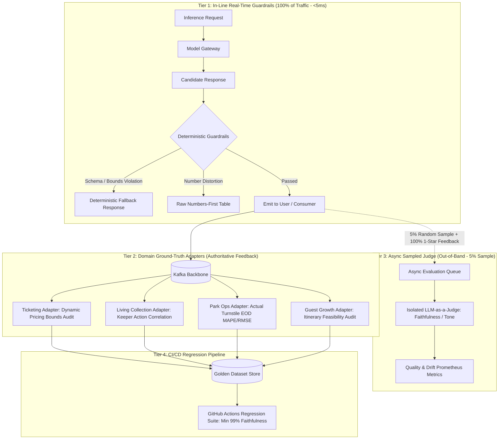
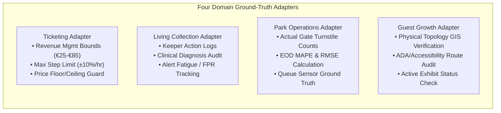
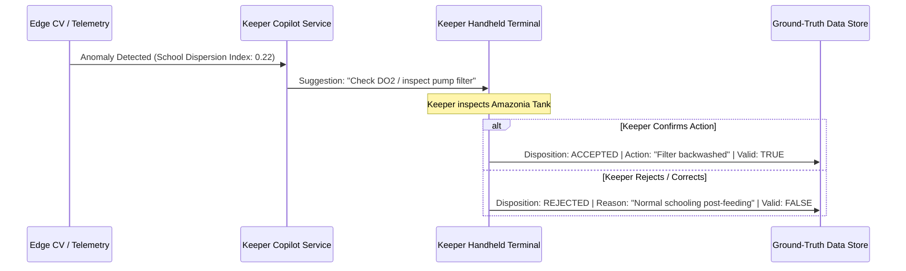

# AI Evaluation and Validation Pipeline

## Overview & Evaluation Philosophy

The Von Digitalis Estates AI platform operates in high-stakes environments spanning wildlife welfare, physical guest safety, and financial transactions. Standard probabilistic heuristics, loose prompt engineering, or naive LLM-as-a-judge in the production critical path are fundamentally flawed:
- **LLM-as-a-Judge in the Critical Path is an Anti-Pattern**: Adding a second frontier LLM call to judge every real-time response doubles inference latency (>6s), doubles OpEx, and introduces recursive hallucination risks.
- **Pure Deterministic Checks Miss Nuance**: Regex and schemas cannot validate semantic helpfulness or conversational tone.

We implement the **4-Tier Hybrid Evaluation Architecture**:
1. **Tier 1: In-Line Deterministic Guardrails**: Runs synchronously on 100% of inferences (<5ms latency penalty). Validates JSON schemas, numerical bounds, forbidden tokens, and verbatim telemetry numbers (ADR-015).
2. **Tier 2: Four Domain Ground-Truth Adapters**: Deterministic domain evaluators that anchor model outputs directly against physical, verifiable ground-truth data (prices, keeper actions, turnstile counts, ride wait times).
3. **Tier 3: Asynchronous Sampled LLM-as-a-Judge**: Evaluates out-of-band on a 5% background sample of conversational interactions and 100% of negative guest feedback. Zero impact on guest-facing latency and negligible OpEx.
4. **Tier 4: CI/CD Golden Dataset Regression Suite**: Version-controlled golden test cases executed before any prompt, model, or parameter update is deployed.



---

## 1. Golden Dataset Architecture

A Golden Dataset is a version-controlled, immutable test suite composed of real-world operational scenarios, adversarial edge cases, and historical edge failures across all 4 bounded contexts.

### Dataset Composition (50+ Curated Edge Cases)

| Domain | Task ID | Sample Size | Scenario Types Covered |
|---|---|---|---|
| **Ticketing & Access** | `concierge.ticket.chat` | 75 dialogs | Prompt injection attempts, ambiguous discount requests, expired voucher redemption, out-of-bounds date requests, foreign currency inquiries. |
| **Living Collection** | `keeper.copilot.query` | 60 queries | Rare symptom triage, contra-indicated dosage queries, venomous species handling SOP extraction, ambiguous diet substitution. |
| **Park Operations** | `ops.shift.briefing` | 50 scenarios | Contradictory weather forecasts, multi-ride simultaneous breakdown reports, emergency crowd re-routing, missing sensor streams. |
| **Guest Growth** | `guest.recs.personalized` | 65 profiles | Mobility-impaired routing (avoiding steep grades), severe dietary allergy dining recommendations, rainy day itinerary generation. |

### Golden Test Case Schema (`golden_case_v1.json`)

```json
{
  "$schema": "http://json-schema.org/draft-07/schema#",
  "title": "GoldenCase",
  "type": "object",
  "required": [
    "case_id",
    "domain",
    "task_id",
    "input_payload",
    "ground_truth_reference",
    "deterministic_assertions",
    "judge_rubric"
  ],
  "properties": {
    "case_id": { "type": "string", "example": "TC-TICK-042" },
    "domain": { "type": "string", "enum": ["ticketing", "living-collection", "park-operations", "guest-growth"] },
    "task_id": { "type": "string" },
    "input_payload": { "type": "object" },
    "ground_truth_reference": {
      "type": "object",
      "properties": {
        "canonical_answer": { "type": "string" },
        "source_document_ids": { "type": "array", "items": { "type": "string" } },
        "permitted_numeric_ranges": { "type": "object" }
      },
      "required": ["canonical_answer", "source_document_ids"]
    },
    "deterministic_assertions": {
      "type": "array",
      "items": {
        "type": "object",
        "properties": {
          "type": { "type": "string", "enum": ["regex_match", "regex_absent", "json_schema", "range_check", "exact_token"] },
          "expression": { "type": "string" }
        },
        "required": ["type", "expression"]
      }
    },
    "judge_rubric": {
      "type": "object",
      "properties": {
        "faithfulness_min": { "type": "number", "minimum": 0.0, "maximum": 1.0 },
        "relevance_min": { "type": "number", "minimum": 0.0, "maximum": 1.0 },
        "safety_min": { "type": "number", "minimum": 0.0, "maximum": 1.0 }
      },
      "required": ["faithfulness_min", "safety_min"]
    }
  }
}
```

---

## 2. Four Domain Ground-Truth Adapters (Tier 2 Evaluation)

Rather than relying on generic LLM-based judgments for domain accuracy, the platform utilizes four **Domain Ground-Truth Adapters**. These are deterministic background workers that correlate AI outputs against physical, operational facts on the ground:



### 1. Ticketing Adapter (`tk.pricing.ground_truth`)
- **Evaluated Task**: `tk.pricing.dynamic`
- **Ground-Truth Source**: Financial commerce ledger and regulatory ticket price schedule.
- **Assertion**: Ensures AI dynamic pricing recommendations strictly adhere to approved price boundaries:
  - **Price Floor & Ceiling**: Advisory price must stay within estate limits (€25.00 floor to €85.00 ceiling).
  - **Rate of Change Limit**: Maximum allowed price adjustment is capped at 10% per hour.
- **Failure Action**: Hard clamp to nearest allowed boundary; incident logged for yield management review.

### 2. Living Collection Adapter (`lc.welfare.ground_truth`)
- **Evaluated Task**: `lc.school.anomaly` & `lc.keeper.copilot`
- **Ground-Truth Source**: Veterinary electronic medical records (EMR) and keeper disposition logs.
- **Assertion**: Validates whether detected acoustic spikes or schooling anomalies corresponded to genuine clinical issues rather than routine feeding activity. Maintains a strict false alarm limit:
  - **Target False Alarm Rate**: Less than 5% false positive rate to protect keepers from alarm fatigue.
- **Failure Action**: Flags anomalous event sequences for weekly retraining and sensitivity adjustment.

### 3. Park Operations Adapter (`po.forecast.ground_truth`)
- **Evaluated Task**: `po.crowd.forecast` & `po.wait_time.predict`
- **Ground-Truth Source**: Actual end-of-day turnstile ingress totals and ride dispatch telemetry.
- **Assertion**: Evaluates prediction accuracy against real physical gate admissions:
  - **Tactical Accuracy Target**: Average percentage error (MAPE) must remain below 15% across short-term horizons (15-minute and 2-hour forecasts).
- **Failure Action**: If tactical error exceeds 15% or Population Stability Index (PSI) exceeds 0.25, falls back to the 14-day rolling moving average.

### 4. Guest Growth Adapter (`gr.itinerary.ground_truth`)
- **Evaluated Task**: `gr.itinerary.generate` & `gr.chat.concierge`
- **Ground-Truth Source**: GIS physical park topology, accessibility maps, and real-time exhibit status.
- **Assertion**: Validates that recommended routes never suggest inaccessible paths (e.g. stairs for wheelchair users) or route guests to closed/clamped animal exhibits.
- **Failure Action**: Immediate itinerary regeneration using deterministic A* routing fallback.

### What the Shared Pipeline Deliberately Does *Not* Share

One runner, one canary path, and one drift monitor — but three things stay with the domain, on purpose:

| Not shared | Why |
|---|---|
| **Golden set content** | Annotated piranha bursts and family-pass dialogues have nothing in common but their file format. Each domain curates its own cases against its own ground truth. |
| **Alert routing** | A welfare-model regression pages the keeper inbox; a forecast drift lands on the duty-manager dashboard; a price-mismatch goes to ticket admin. A single "AI health" dashboard would hide a keeper-disposition collapse behind a healthy Concierge grounding rate. |
| **Automatic model shutoff** | The pipeline *alerts*; a named human switches the model. Drift is evidence, not authority — the same rule that governs every other AI output on the estate ([ADR-007](../adrs/ADR-007-tiered-autonomy-ai-assists-humans-decide.md)). |

---

## 3. LLM-as-a-Judge Quality Rubrics (Tier 3 Evaluation)

To achieve objective, automated scoring on open-ended conversational text, out-of-band evaluation tasks utilize an isolated, high-parameter frontier model (e.g., Claude 3.5 Sonnet / GPT-4o) with strictly typed numeric scores (0.0 to 1.0).

### Evaluation Metrics

#### 1. Faithfulness Score (Truthfulness to Ground Truth)
Measures whether every factual claim made in the AI-generated answer is directly supported by retrieved reference documents:

```text
Faithfulness Score = (Count of Claims Backed by Reference Context) / (Total Claims Made)
```

- **Threshold for Release**: 1.0 (Strict 100% ground-truth backing with zero tolerance for ungrounded claims in Ticketing pricing and Keeper clinical SOPs).

#### 2. Context Relevance Score (Signal-to-Noise Ratio)
Measures how much of the retrieved text passed to the model was actually needed to answer the user's question:

```text
Context Relevance Score = (Relevant Sentences Used) / (Total Sentences Retrieved)
```

- **Target**: ≥ 0.85 (Ensures low token costs and prevents extraneous, distracting context).

#### 3. Answer Relevancy Score (Directness of Response)
Measures whether the AI directly answered what the user asked without diverging or answering an unintended question:
- **Evaluation Mechanism**: The judge LLM generates questions based solely on the AI's answer, and computes semantic alignment against the user's original query.
- **Target**: ≥ 0.90 semantic alignment with the original user prompt.

---

## 4. Deterministic Faithfulness Check Layer (ADR-015 Implementation)

For operational and shift briefing summaries (`ops.shift.briefing`), narrative text must not distort underlying telemetry numbers. 

### Faithfulness Extraction Algorithm
1. **Source Fact Extraction**: Parse all numeric entities, percentages, currency amounts, and time values from the source telemetry payload.
2. **Response Fact Extraction**: Parse all numeric entities from the AI-generated draft narrative.
3. **Verification Check**:
   ```text
   If ANY number or metric in the AI text does NOT match the source telemetry (or an allowed unit conversion):
   --> Violation Detected: Discard the AI narrative immediately
   ```

If any extracted number in the generated response did not originate directly in the telemetry payload or an allowed unit conversion (such as converting 90 minutes into 1.5 hours), the response is discarded, and the raw markdown table (Numbers-First) is displayed directly without the AI narrative.

```python
import re

def verify_narrative_faithfulness(telemetry_data: dict, narrative_text: str) -> bool:
    """
    Ensures zero hallucinated metrics in operations shift briefing.
    """
    # Extract all numbers from telemetry
    allowed_numbers = set()
    for key, val in telemetry_data.items():
        if isinstance(val, (int, float)):
            allowed_numbers.add(str(val))
            allowed_numbers.add(f"{val:.1f}")
            allowed_numbers.add(f"{int(val)}")

    # Extract all numbers from generated narrative
    found_numbers = re.findall(r'\b\d+(?:\.\d+)?\b', narrative_text)
    
    # Check for unauthorized additions
    unauthorized = [num for num in found_numbers if num not in allowed_numbers]
    return len(unauthorized) == 0
```

---

## 5. Keeper Dispositions as Ground-Truth Training Labels (ADR-011)

In the Living Collection domain, AI models provide recommendations (e.g., diet adjustments, habitat humidity alerts, early lethargy warnings). The ultimate authority remains the human veterinary keeper.

### Disposition Telemetry Flow



### Dataset Lifecycle:
- **Weekly Ingestion**: All disposition records are packaged as CloudEvents (`FeedingCompleted.v1`, keeper audit logs).
- **Active Learning Queue**: Rejection events are prioritized for human-in-the-loop review by the Head Veterinarian.
- **Model Fine-Tuning**: Validated edge dispositions are incorporated into the monthly edge model retrain set.

---

## 6. CI/CD Model Gate & Automated Regression

Every model update, prompt tweak, or temperature modification must pass the automated GitHub Actions / GitLab CI pipeline before deployment to the Model Gateway.

```yaml
# .github/workflows/ai-eval-regression.yml
name: AI Evaluation & Regression Suite
on:
  pull_request:
    paths:
      - 'services/model-gateway/**'
      - 'prompts/**'
      - 'models/**'

jobs:
  run-golden-evals:
    runs-on: ubuntu-latest
    steps:
      - uses: actions/checkout@v4
      - name: Run Deterministic Assertion Suite
        run: |
          npm run test:eval:deterministic
      - name: Run LLM-as-a-Judge Eval on Golden Sets
        env:
          EVAL_JUDGE_API_KEY: ${{ secrets.EVAL_JUDGE_API_KEY }}
        run: |
          python -m eval_runner \
            --golden-dir ./tests/golden-sets \
            --min-faithfulness 0.99 \
            --min-safety 1.00 \
            --output-report ./eval-report.json
      - name: Assert No Regression vs Baseline
        run: |
          python -m eval_runner compare --baseline ./baselines/v2.1.json --current ./eval-report.json --max-drop 0.01
```
