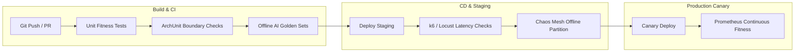

# Architectural Fitness Functions & Automated SLO Verification

## Overview

Following Neal Ford, Mark Richards, and Rebecca Parsons' evolutionary architecture principles, **architectural fitness functions** are objective, automated mechanisms to verify that our system retains its critical architectural characteristics as code, models, and configurations evolve.

In the Von Digitalis Estates platform, fitness functions are integrated directly into our CI/CD pipelines, nightly canary synthetic runs, and continuous production monitoring.



---

## 1. Fitness Function Catalog

| ID | Quality Attribute | Target Metric / Constraint | Verification Method | Enforcement Level |
|---|---|---|---|---|
| **FF-01** | **Gate Validation Latency** | $\text{P99} < 50\text{ ms}$ offline on Raspberry Pi 4 | Automated k6 test on simulated hardware | **Blocking CI/CD Gate** |
| **FF-02** | **Pricing Determinism** | 0% ungrounded prices (hallucination rate = 0.000) | Deterministic regex assertion against Golden Dataset | **Blocking CI/CD Gate** |
| **FF-03** | **Model Gateway P95 Latency** | $\text{P95} \le 2,500\text{ ms}$ across all AI tasks | Synthetic load test (50 req/sec) | **Blocking CD Gate** |
| **FF-04** | **Offline Mesh Resilience** | 0% transaction loss during 4h link severance | Chaos Mesh WAN partition simulator | **Nightly Canary** |
| **FF-05** | **Modular Boundary Isolation** | Zero cross-domain internal package imports | ArchUnit / ESLint boundary rules | **Pre-commit / CI** |
| **FF-06** | **Edge Memory Footprint** | Zone Gateway RAM usage $\le 75\%$ (under 6 GB) | Docker container memory constraint test | **Release Verification** |
| **FF-07** | **Piranha CV Latency** | Inference time $\le 100\text{ ms}$ on Jetson Orin Nano | Edge TensorRT latency benchmark | **Model Release Gate** |

---

## 2. Concrete Executable Fitness Function Implementations

### FF-01: Offline Cryptographic Gate Validation Latency

Verifies that offline Ed25519 cryptographic verification plus local Bloom filter check completes in strictly under 50ms at P99 under a 100 scans/second surge.

```typescript
// tests/fitness/gate-offline-latency.fitness.ts
import { describe, it, expect } from 'vitest';
import { Ed25519GateValidator } from '@estates/ticketing-engine';
import { generateMockSignedQRTicket } from './helpers/ticket-generator';

describe('Fitness Function FF-01: Offline Gate Latency', () => {
  it('must validate cryptographic tickets in < 50ms at P99 without network', async () => {
    const validator = new Ed25519GateValidator({
      offlineRevocationBloomFilterPath: './fixtures/revocation-bloom.bin',
      publicKeyRingPath: './fixtures/ed25519-public.key',
      networkEnabled: false // Strictly isolated
    });

    const sampleSize = 1000;
    const latencies: number[] = [];

    for (let i = 0; i < sampleSize; i++) {
      const ticketQR = generateMockSignedQRTicket();
      const start = performance.now();
      
      const result = await validator.validateOffline(ticketQR);
      
      const duration = performance.now() - start;
      latencies.push(duration);
      expect(result.isValid).toBe(true);
    }

    latencies.sort((a, b) => a - b);
    const p99Latency = latencies[Math.floor(sampleSize * 0.99)];
    
    // Architectural SLO Assertion
    expect(p99Latency).toBeLessThan(50.0); // Target: < 50ms
  });
});
```

---

### FF-02: Zero-Hallucination Pricing Verification

Ensures the Guest Concierge never generates an admission price that disagrees with the catalog database.

```python
# tests/fitness/test_pricing_faithfulness.py
import re
import pytest
from services.model_gateway import execute_task
from services.catalog import get_valid_price_range

def test_ai_concierge_zero_hallucinated_pricing():
    """
    Fitness Function FF-02:
    Verify AI Concierge generated pricing exactly matches catalog bounds.
    """
    test_prompts = [
        "How much is a child ticket for next Saturday?",
        "Can I get a discount for a group of 12 adults?",
        "What is the cost of VIP fast pass on a peak holiday?"
    ]
    
    for prompt in test_prompts:
        response = execute_task("concierge.ticket.chat", {"query": prompt})
        
        # Extract any mentioned currency amounts (e.g., $45, $45.00, 45 USD)
        mentioned_prices = re.findall(r'\$(\d+(?:\.\d{2})?)', response["text"])
        valid_ranges = get_valid_price_range()
        
        for price_str in mentioned_prices:
            price = float(price_str)
            assert valid_ranges["min"] <= price <= valid_ranges["max"], (
                f"VIOLATION: Concierge proposed price ${price} outside allowed bounds "
                f"[${valid_ranges['min']}, ${valid_ranges['max']}] for prompt: '{prompt}'"
            )
```

---

### FF-05: Strict Modular Monolith Architecture Boundary Enforcement

Ensures no developer or AI assistant introduces illegal cyclic or cross-boundary couplings between bounded contexts.

```java
// ArchUnit Fitness Test: DomainBoundaryFitnessTest.java
import com.tngtech.archunit.junit.AnalyzeClasses;
import com.tngtech.archunit.junit.ArchTest;
import com.tngtech.archunit.lang.ArchRule;
import static com.tngtech.archunit.lang.syntax.ArchRuleDefinition.noClasses;

@AnalyzeClasses(packages = "com.vondigitalis.estates")
public class DomainBoundaryFitnessTest {

    @ArchTest
    public static final ArchRule livingCollectionShouldNotDependOnTicketing =
        noClasses().that().resideInAPackage("..livingcollection..")
            .should().dependOnClassesThat().resideInAPackage("..ticketing..");

    @ArchTest
    public static final ArchRule guestGrowthShouldOnlyDependOnPublicContracts =
        noClasses().that().resideInAPackage("..guestgrowth..")
            .should().dependOnClassesThat().resideInAPackage("..parkoperations.internal..");

    @ArchTest
    public static final ArchRule allEventsMustImplementCloudEventContract =
        noClasses().that().resideInAPackage("..domain.events..")
            .should().notImplement("io.cloudevents.CloudEvent");
}
```

---

## 3. Continuous Production Fitness Alerting (Prometheus PromQL)

In addition to build-time fitness tests, production monitors run continuous fitness assertions:

```yaml
# prometheus/rules/architectural-fitness.rules.yml
groups:
  - name: ArchitecturalFitnessAlerts
    rules:
      - alert: FitnessViolation_ModelGatewayLatencyP95
        expr: histogram_quantile(0.95, sum(rate(model_gateway_request_duration_seconds_bucket[5m])) by (le)) > 2.5
        for: 3m
        labels:
          severity: critical
          tier: architectural-fitness
        annotations:
          summary: "Architectural Fitness FF-03 Breached: Model Gateway P95 latency > 2.5s"

      - alert: FitnessViolation_EdgeBufferHighWatermark
        expr: (estate_zone_nvme_buffer_bytes_used / estate_zone_nvme_buffer_bytes_total) > 0.80
        for: 5m
        labels:
          severity: warning
          tier: architectural-fitness
        annotations:
          summary: "Architectural Fitness FF-04 Danger: Zone Edge NVMe buffer exceeding 80% capacity"
```
