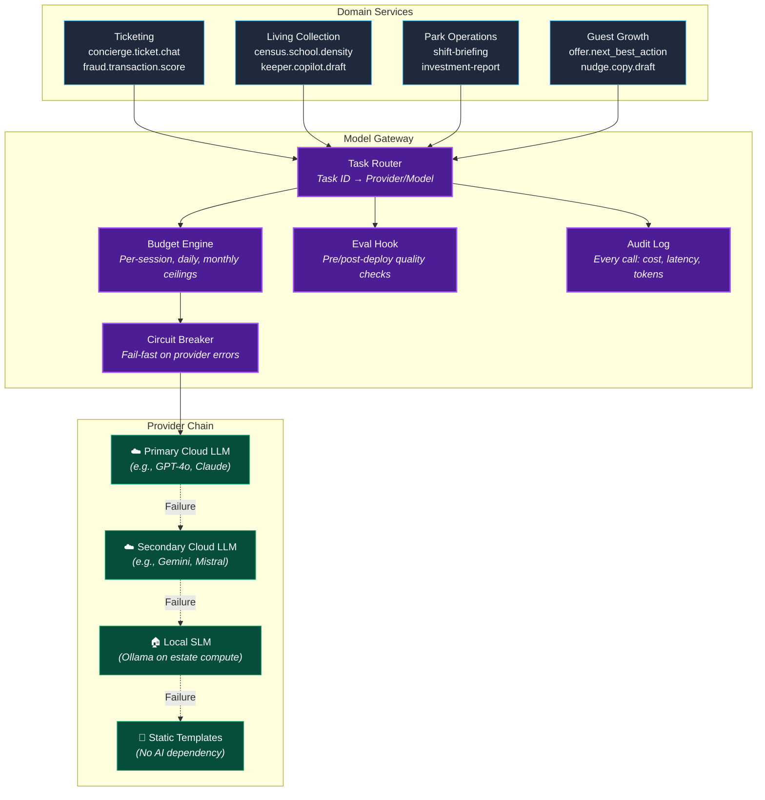
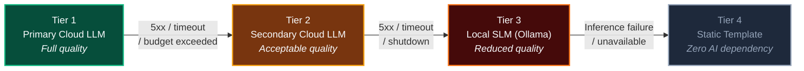

# Multi-Model Gateway

## Purpose

The Model Gateway is the **single point of AI provider abstraction** for all four bounded contexts. Domain services call abstract **Task IDs** (e.g., `concierge.ticket.chat`, `census.school.density`). The gateway handles routing, failover, cost enforcement, and evaluation — no domain code imports a provider-specific SDK.

**One gateway does not mean one brain.** What is shared is the *invocation path*: routing, the 4-tier failover chain, cost fuses, and the requirement that every output clear a deterministic gate before it reaches a human. What stays inside each domain is the *content*: prompts, tool schemas, denylists, and the domain's own Tier 2 models. A clinical note draft and a ticket upsell have the same plumbing and completely different words — and a piranha census model has no business sharing a training loop with fraud scoring. See [Tiered Autonomy](ai-strategy-overview.md) for the full split.

---

## Architecture



---

## Task Routing Configuration

The gateway routes each Task ID to a provider/model via configuration — not code:

```yaml
tasks:
  tk.concierge.ticket.chat:
    tier: 3  # GenAI
    primary:
      provider: anthropic
      model: claude-3-5-haiku
      max_tokens: 1024
      temperature: 0.3
    failover:
      - provider: openai
        model: gpt-4o-mini
      - provider: local
        model: mistral-7b-instruct
      - provider: static
        template: catalog_redirect
    budget:
      per_session_usd: 0.15
      max_turns: 10
      domain_daily_usd: 150
      estate_daily_usd: 600
    tools:
      - search_products  # read-only
      - check_availability  # read-only

  lc.census.school.density:
    tier: 2  # Specialized ML
    primary:
      provider: edge
      model: yolov8n-piranha-v1.4
    failover:
      - provider: manual
        action: keeper_double_blind_count

  po.shift.briefing:
    tier: 3  # GenAI
    primary:
      provider: openai
      model: gpt-4o-mini
    failover:
      - provider: local
        model: mistral-7b-instruct
      - provider: static
        template: raw_structured_numbers
    budget:
      hourly_rate_limit: 2
      domain_daily_usd: 50
    validation:
      faithfulness_check: true
```

---

## 4-Tier Failover Chain



### Failover Behavior Per Task

| Task | Tier 1 | Tier 2 | Tier 3 | Tier 4 |
|---|---|---|---|---|
| AI Concierge | Full NL conversation | Shorter responses | Basic Q&A | Redirect to catalog UI |
| Keeper Copilot | Polished clinical note | Adequate draft | Bullet-point summary | Manual typing |
| Shift Briefing | Full narrative | Adequate narrative | Raw data with labels | Structured numbers only |
| Recommendation Copy | Engaging suggestion card | Template + personalization | Template only | "Nearby attractions" list |

---

## Cost Ceiling Enforcement

Cost ceilings are enforced **at the infrastructure level**, not by policy:

| Guardrail | Threshold | Action on Breach | Fallback |
|---|---|---|---|
| **Per-session ceiling** | $0.15 | Terminate LLM calls | Static response / redirect |
| **Per-turn limit** | $0.05 | Switch to cheaper model or SLM | Reduced quality response |
| **Daily AI budget** | $600/day (15K scale) | Disable non-critical AI tasks | Critical tasks (fraud scoring) remain |
| **Monthly AI budget** | $2,500/month (15K scale) | Alert finance + reduce availability | Prioritize high-value sessions |
| **Provider cost spike** | > 2× expected per-token cost | Auto-failover to secondary | Secondary → SLM → static |
| **Runaway session** | > 10 turns per Concierge session | End conversation with summary | Link to catalog |

---

## Provider Swap Procedure

When a provider changes pricing, deprecates a model, or shuts down:

| Step | Action | Downtime |
|---|---|---|
| 1 | Update gateway configuration (YAML) | Zero |
| 2 | Run golden set evaluation against new provider | Offline eval (no production impact) |
| 3 | Canary deploy to 5% of traffic | Zero (shadow mode) |
| 4 | Monitor quality metrics for 24h | Zero |
| 5 | Promote to 100% | Zero |

**Total code changes required: Zero.** Provider swap is a configuration change validated by the evaluation pipeline.

---

## Gateway Operational Metrics

| Metric | Purpose | Alert Threshold |
|---|---|---|
| Requests per second per task | Load tracking | > 2× expected baseline |
| p99 latency per task | SLO compliance | > SLO per task |
| Token cost per request | Budget tracking | > 2× expected average |
| Failover rate | Provider health | > 5% in 15-min window |
| Error rate per provider | Circuit breaker input | > 10% → open circuit |
| Daily cumulative cost | Budget enforcement | > 80% of daily ceiling |
| Monthly cumulative cost | Budget enforcement | > 80% of monthly ceiling |
