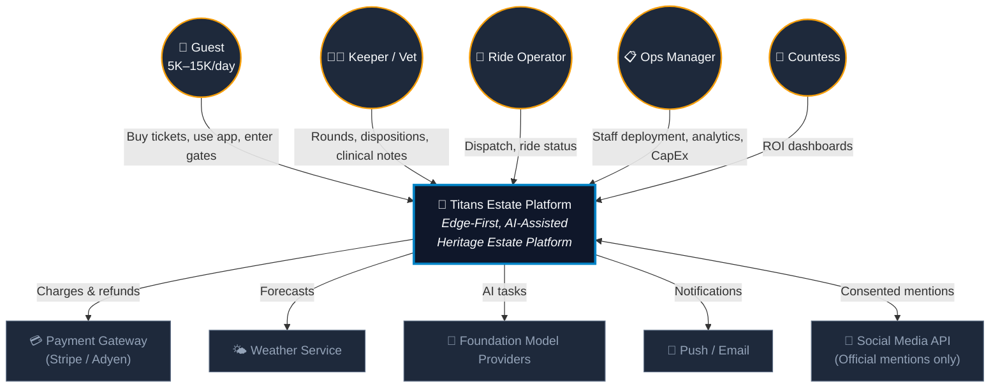
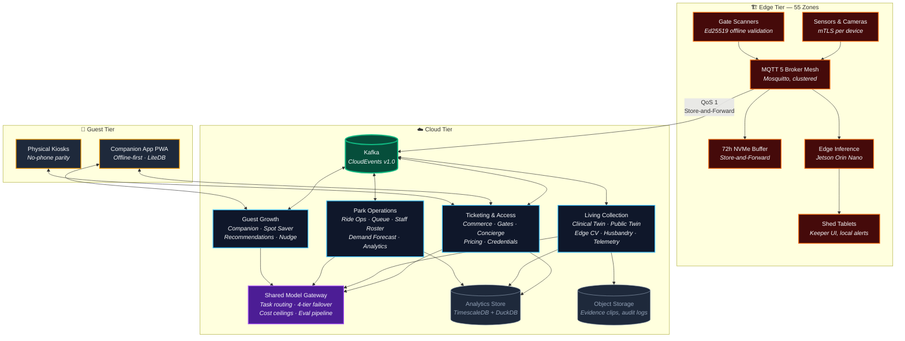
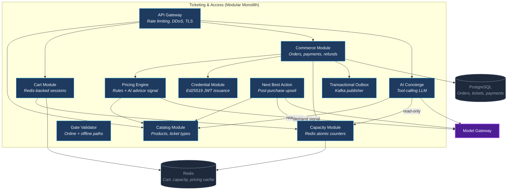
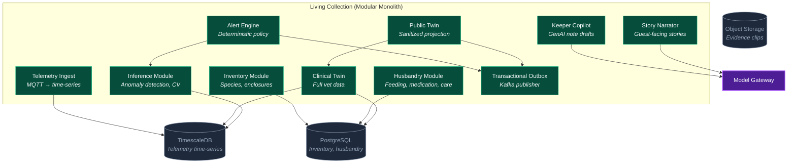
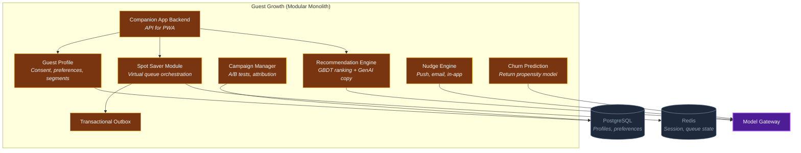

# C4 Architecture Models

## Level 1 — System Context

> Who uses the platform and what external systems does it depend on?

---

## Level 2 — Container Diagram

> What are the major deployable units and how do they communicate?

---

## Level 3 — Component Diagrams (Per Domain)

### Ticketing & Access — Components

### Living Collection — Components

### Park Operations — Components

```mermaid
graph TB
    subgraph PO["Park Operations (Modular Monolith)"]
        RideOps["Ride Ops Module<br/><i>Dispatch, status, cycles</i>"]
        QueueSense["Queue Sensing<br/><i>Vision counting</i>"]
        StaffRoster["Staff Roster<br/><i>Positions, shifts</i>"]
        DemandForecast["Demand Forecast<br/><i>ML time-series model</i>"]
        Popularity["Popularity Score<br/><i>Weighted composite</i>"]
        StaffRules["Staffing Rules<br/><i>Threshold → recommendation</i>"]
        CapEx["CapEx Flag Engine<br/><i>Sustained trend detection</i>"]
        ShiftBriefing["Shift Briefing<br/><i>GenAI narrative + faithfulness</i>"]
        InvestReport["Investment Report<br/><i>Monthly GenAI narrative</i>"]
        Outbox["Transactional Outbox"]
    end

    TimescaleDB[("TimescaleDB<br/><i>Sensor signals, history</i>")]
    PG[("PostgreSQL<br/><i>Roster, recommendations, audit</i>")]
    MGW["Model Gateway"]

    RideOps --> TimescaleDB
    QueueSense --> TimescaleDB
    DemandForecast --> TimescaleDB
    Popularity --> TimescaleDB
    StaffRoster --> PG
    StaffRules --> PG
    CapEx --> PG
    ShiftBriefing --> MGW
    InvestReport --> MGW
    DemandForecast --> MGW
    StaffRules --> Outbox

    classDef mod fill:#4c1d95,stroke:#a855f7,stroke-width:1px,color:#f8fafc
    classDef store fill:#1e293b,stroke:#94a3b8,stroke-width:1px,color:#94a3b8
    classDef ai fill:#4c1d95,stroke:#a855f7,stroke-width:2px,color:#f8fafc

    class RideOps,QueueSense,StaffRoster,DemandForecast,Popularity,StaffRules,CapEx,ShiftBriefing,InvestReport,Outbox mod
    class TimescaleDB,PG store
    class MGW ai
```

### Guest Growth — Components

