# Domain Decomposition

## Why Four Bounded Contexts

The Von Digitalis Estates have four natural lines of business, each with distinct **domain experts, operational cadences, failure tolerances, and AI requirements**. Following DDD strategic design, we identify four bounded contexts that align 1:1 with organizational boundaries:

```mermaid
graph LR
    subgraph TK["Ticketing & Access"]
        TK1["Commerce"]
        TK2["Credentials"]
        TK3["Concierge"]
        TK4["Pricing"]
        TK5["Gates"]
    end

    subgraph LC["Living Collection"]
        LC1["Clinical Twin"]
        LC2["Public Twin"]
        LC3["Edge CV"]
        LC4["Husbandry"]
        LC5["Telemetry"]
    end

    subgraph PO["Park Operations"]
        PO1["Ride Ops & Safety"]
        PO2["Queue Sensing"]
        PO3["Staff Roster & Sched"]
        PO4["Unified Demand Forecast"]
        PO5["Analytics & Heatmaps"]
    end

    subgraph GG["Guest Growth"]
        GG1["Companion App"]
        GG2["Spot Saver Facade"]
        GG3["Recommendations"]
        GG4["Nudge Engine"]
        GG5["Profile"]
    end

    TK -->|"TicketPurchased.v1<br/>VisitorEntered.v1"| PO
    GG -->|"VisitRequested.v1 (origin: in_park)"| LC
    TK -->|"VisitRequested.v1 (origin: pre_visit)"| LC
    LC -->|"VisitConfirmed.v1 / Rejected"| GG
    LC -->|"ExhibitAvailabilityChanged.v1"| TK
    LC -->|"ExhibitAvailabilityChanged.v1<br/>WelfareStoryReady.v1"| GG
    LC -->|"StressIndexUpdated.v1<br/>FeedingCompleted.v1"| PO
    PO -->|"ZoneOccupancyChanged.v1<br/>RideWaitTimeUpdated.v1"| GG
    PO -->|"DemandForecastUpdated.v1"| TK
    GG -->|"QueueJoined.v1<br/>QueueCalled.v1"| PO

    classDef tk fill:#1e3a5f,stroke:#38bdf8,stroke-width:2px,color:#f8fafc
    classDef lc fill:#064e3b,stroke:#10b981,stroke-width:2px,color:#f8fafc
    classDef po fill:#4c1d95,stroke:#a855f7,stroke-width:2px,color:#f8fafc
    classDef gg fill:#78350f,stroke:#f59e0b,stroke-width:2px,color:#f8fafc

    class TK,TK1,TK2,TK3,TK4,TK5 tk
    class LC,LC1,LC2,LC3,LC4,LC5 lc
    class PO,PO1,PO2,PO3,PO4,PO5 po
    class GG,GG1,GG2,GG3,GG4,GG5 gg
```

---

## Context Map — Integration Patterns

All inter-context communication uses **asynchronous domain events** on a shared Kafka backbone with CloudEvents 1.0 envelopes (`id` is a ULID idempotency key; `type` follows PascalCase `.v1`). No synchronous API calls cross bounded context boundaries.

| Upstream Context | Downstream Context | Event(s) | Pattern | Rationale |
|---|---|---|---|---|
| **Ticketing** | Park Operations | `TicketPurchased.v1`, `VisitorEntered.v1`, `VisitorExited.v1`, `CapacityThresholdReached.v1` | Published Language | PO consumes presales for demand forecast; entry/exit for real-time occupancy. |
| **Living Collection** | Ticketing | `ExhibitAvailabilityChanged.v1` | Anti-Corruption Layer | Ticketing halts timed-entry sales; LC internal clinical data never leaks to commerce. |
| **Living Collection** | Guest Growth | `ExhibitAvailabilityChanged.v1`, `WelfareStoryReady.v1`, `BestViewingWindowPredicted.v1` | Published Language | GG presents viewing windows and story cards without re-generating copy. |
| **Living Collection** | Park Operations | `StressIndexUpdated.v1`, `FeedingCompleted.v1`, `CensusUpdated.v1` | Published Language | PO correlates animal stress with crowd density and schedules keeper labor. |
| **Park Operations** | Guest Growth | `ZoneOccupancyChanged.v1`, `RideWaitTimeUpdated.v1`, `RideStatusChanged.v1` | Published Language | GG shows live wait times, prevents silence read as unpopularity. |
| **Park Operations** | Ticketing | `DemandForecastUpdated.v1` | Published Language | Single unified forecast drives Ticketing's dynamic pricing advisor. |
| **Guest Growth / Ticketing** | Living Collection | `VisitRequested.v1` | Published Language | The *single* exhibit-reservation request path. LC confirms via `VisitConfirmed.v1`. |
| **Guest Growth** | Park Operations | `QueueJoined.v1`, `QueueCalled.v1`, `QueueExpired.v1` | Published Language | PO balances ride dispatch & queue lane throughput. |

### Conformist vs. Anti-Corruption Layer

- **Ticketing → Park Operations**: Published Language. PO consumes `ticket-scanned.v1` idempotently on envelope `id`.
- **Living Collection → Ticketing**: **Anti-Corruption Layer** (ACL). Ticketing translates LC's `ExhibitAvailabilityChanged` into its own capacity model. LC's internal clinical data never leaks into Ticketing's domain.
- **Park Operations → Guest Growth**: Published Language with **thin ACL** in Guest Growth to translate zone-level snapshots into per-attraction wait times.

---

## Domain Ownership Matrix

| Concern | Ticketing | Living Collection | Park Operations | Guest Growth |
|---|---|---|---|---|
| **Ticket lifecycle** | ✅ Owner | — | — | — |
| **Price authority** | ✅ Owner | — | Provides forecast signal | — |
| **Gate validation** | ✅ Owner | — | — | — |
| **Enclosure capacity** | — | ✅ Owner (sole authority) | — | Reads via events |
| **Animal health** | — | ✅ Owner | — | — |
| **Ride operations** | — | — | ✅ Owner | — |
| **Queue wait times** | — | — | ✅ Owner | Reads via events |
| **Demand forecast** | Consumes | — | ✅ Owner | Consumes |
| **Staff recommendations** | — | — | ✅ Owner | — |
| **Guest profile** | Identity owner | — | — | ✅ Owner (enrichment) |
| **Virtual queue** | Mints credentials | Capacity authority for exhibit windows only | Ride dispatch throughput; reads queue depth | ✅ Owner (UX + ride queue positions) |
| **Recommendations** | — | — | — | ✅ Owner |

---

## Bounded Context Architectural Characteristics

Each context optimizes for different quality attributes, but all share a common integration style:

| Characteristic | Ticketing | Living Collection | Park Operations | Guest Growth |
|---|---|---|---|---|
| **Primary driver** | Availability | Safety | Operational insight | Engagement |
| **Failure budget** | < 0.1% of gate denials | Zero missed containment alerts | Recommendation freshness (15 min) | Degraded UX acceptable |
| **Data consistency** | Strong (financial) | Strong (clinical) | Eventual (analytics) | Eventual |
| **AI risk profile** | Financial (price hallucination) | Life-safety (false negative) | Operational (bad recommendation) | Engagement (bad suggestion) |
| **Offline requirement** | Full (gate + kiosk) | Full (edge + siren) | Partial (buffered) | Partial (cached maps/data) |
| **Internal style** | Modular monolith | Modular monolith | Modular monolith | Modular monolith |
| **External integration** | Async events (Kafka) | Async events (Kafka) | Async events (Kafka) | Async events (Kafka) |
