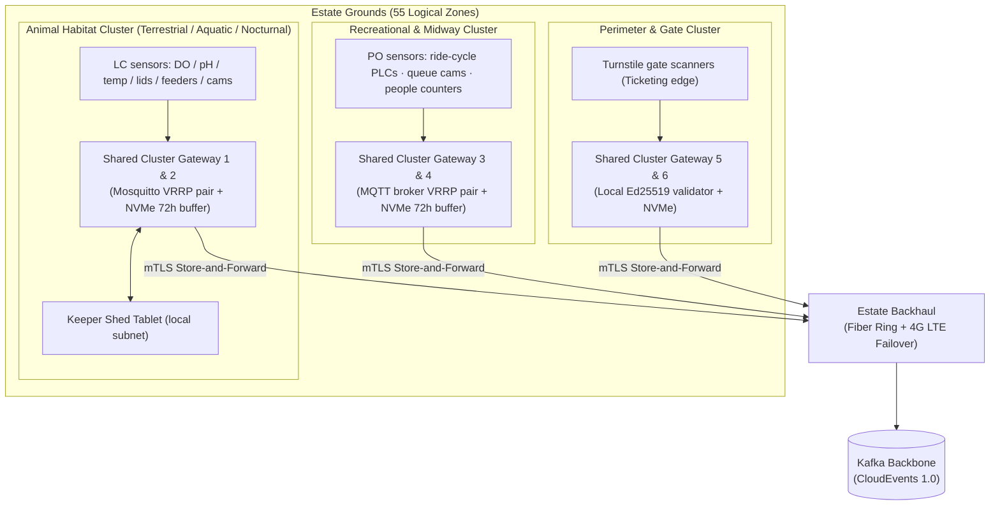
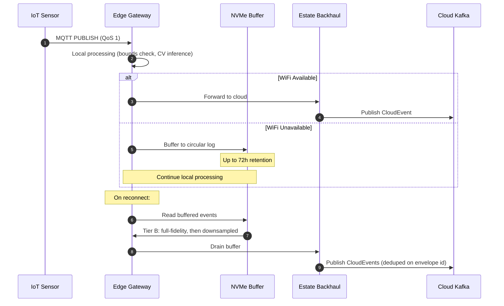

# Edge & Connectivity Architecture

## The Problem

WiFi on the Von Digitalis Estates is patchy. A piranha containment breach, a dissolved oxygen crash, or a peak-hour gate surge cannot wait for the cloud. The edge architecture treats **delay-tolerant networking as the normal operating mode**, not an exception to handle.

---

## 55-Zone Logical Model & 6-Cluster Physical Gateway Fabric

The estate is divided into **55 logical Zones**, matching Guest Growth's per-enclosure/area granularity. Each Zone carries a `zone_type` enum drawn from the Living Collection biomes plus recreational areas:

| `zone_type` | Description | Example Places | Sensing Profile |
|---|---|---|---|
| `terrestrial` | Land exotic / venomous habitats | Serpent house, salamander vivaria | Air temp, humidity, lux, RFID, load-cell feeders, thermal cams |
| `aquatic` | Water habitats incl. jumping piranhas | Amazon House, subterranean tanks | Dissolved oxygen (DO), pH, ammonia, water level, hydrophones, submersible cams |
| `nocturnal` | Low-light / carnivorous displays | Nocturnal house, carnivorous flora | Low-light/thermal cameras, door interlocks, red lux spectrum |
| `recreational` | Heritage rides & midway plazas | Gnome Coaster, carousel, plazas | Ride-cycle PLCs, queue cameras, optical people counters |
| `mixed` | Estate pathways, gardens, food courts | Rose Garden path, retail midways | Optical people counters on the Operations VLAN; BLE wayfinding beacons and guest kiosks sit on the Guest DMZ (VLAN 50) and never touch the MQTT fabric |

### Shared Physical Gateway Sizing (6 Cluster Pairs)

Rather than provisioning 55 redundant server racks (which would waste ~$18,000 in CapEx), edge hardware is consolidated into **6 physical cluster gateway pairs**. One cluster gateway serves all operational sensing in its physical perimeter: a serpent-house thermal camera and a coaster queue counter fifty metres apart share the same broker, the same NVMe buffer, and the same Operations VLAN (10/20), differing only by the `domain` segment of their topic.



---

## Unified MQTT Topic Namespace

The estate adopts a single, standardized topic namespace with a `domain` segment so Living Collection and Park Operations share brokers without collisions:

```
estate/{site_id}/{domain}/{zone_id}/{place_id}/{channel}/{metric}
```

- `domain ∈ { lc, po }`
- **Examples**:
  - `estate/main/lc/aquatic-3/enc-amazon-17/env/dissolved_oxygen` *(LC water telemetry, retained)*
  - `estate/main/lc/aquatic-3/enc-amazon-17/integrity/lid` *(LC containment lid contact, retained)*
  - `estate/main/lc/aquatic-3/enc-amazon-17/vision/result` *(LC edge CV piranha census, non-retained)*
  - `estate/main/po/recreational-7/place-gnome-coaster/ride/cycle` *(PO ride cycle dispatch, Tier B)*
  - `estate/main/po/recreational-7/place-gnome-coaster/queue/count` *(PO queue lane count, Tier A)*
  - `estate/main/po/mixed-12/zone/people_count` *(PO optical people counter, Tier A)*
  - `estate/main/node/{device_id}/{hello|lwt|cmd}` *(Device lifecycle & heartbeat)*

**Broker-Side Topic ACLs**: Enforced via X.509 client certificates. An LC node cannot publish to PO topics, and turnstiles cannot subscribe to animal telemetry.

---

## 3-VLAN Network Segmentation

Network traffic across the estate is strictly segregated into three isolated VLAN tiers to prevent unauthorized lateral movement and protect life-safety telemetry:

### 1. VLAN 10/20 — Operations & IoT Telemetry *(Restricted / mTLS Only)*
- **Workloads & Endpoints**: Living Collection enclosure nodes, Park Operations ride/queue sensors, and shared zone cluster brokers.
- **Access & Mobility**: Turnstile gate scanners, keeper handheld tablets (`WPA3-Enterprise`).
- **Security Controls**: Mandatory X.509 mutual TLS (`mTLS`) authentication; `IEEE 802.1X` switch port enforcement.
- **Egress / Ingress**: WireGuard tunnel over estate backhaul (fiber ring + LTE failover) directly to the Kafka cluster.

### 2. VLAN 30 — Estate Administration & Back-Office
- **Workloads & Endpoints**: Executive workstations, finance terminals, and ticketing back-office services.
- **Security Controls**: Hardware-backed Multi-Factor Authentication (MFA) required.
- **Isolation Policy**: Air-gapped / firewall-isolated from IoT sensor telemetry and life-safety actuator networks.

### 3. VLAN 50 — Guest DMZ *(Untrusted Public Subnet)*
- **Workloads & Endpoints**: Visitor smartphones running the companion PWA and public guest Wi-Fi access points.
- **Park Fixtures**: Interactive guest kiosks (`IEEE 802.1X` isolated) and Bluetooth Low Energy (BLE) wayfinding beacons.
- **Boundary Enforcement**: Direct internet egress only.
  > [!IMPORTANT]
  > **Lateral Movement Prevention**: All inter-VLAN routing from VLAN 50 to VLAN 10/20 (Operations) and VLAN 30 (Administration) is unconditionally dropped at the edge firewall switch.


---

## Three-Tier Edge Buffering & Signal-Quality Strategy

Sensors produce data with vastly different loss tolerances. The architecture enforces three distinct buffering tiers:

| Tier | Signal Types | QoS | Buffer Policy | On Recovery | Rationale |
|---|---|---|---|---|---|
| **Tier A** | Optical people-counts, queue depth cameras, dwell sensors | QoS 0/1 | Drop-tail on saturation; packet loss flag set | Latest value overwrites — self-correcting | Counting a queue twice is worse than missing one sample |
| **Tier B** | Ride-cycle dispatches, turnstile scans, keeper feeding logs | QoS 1 | 72-hour NVMe circular write buffer | Full-fidelity drain to Kafka, then downsampled | Each ride dispatch and ticket scan is an irreplaceable fact |
| **Tier C** | Life-safety alarms (DO crash, venomous lid breach) | QoS 2 | Autonomous local relay/solenoid trip; zero cloud dependency | Instant local siren + persisted audit event | Animal life and human safety cannot wait for WAN recovery |

---

## Pixel & Data Sovereignty

To comply with GDPR and prevent guest privacy violations:
1. **Frames Never Leave Edge Hardware**: All camera streams (underwater piranha cameras, queue monitoring cameras) are ingested into NVIDIA Jetson memory and processed by INT8-quantized YOLO models.
2. **Zero Cloud Video Ingress**: Raw video is immediately discarded from RAM after feature extraction. Only aggregated scalar CloudEvents (`CensusUpdated.v1`, `QueueCountUpdated.v1`) leave the local zone.
3. **Automated De-Identification**: Any still image retained for keeper clinical review automatically passes through edge facial de-identification filters before storage.

### Silence Detection

Different signal types have different definitions of "silence":

| Signal Delivery Pattern | Silence Detection Method | Threshold |
|---|---|---|
| **Polled** (people-counters at 30s intervals) | Missing reading count ≥ 3× interval | 90 seconds of no data |
| **Event-per-occurrence** (ride-cycle, containment) | MQTT Keep Alive / Last Will & Testament (LWT) | LWT published by broker on disconnect |
| **On-change** (environmental thresholds) | MQTT Keep Alive / LWT | LWT published by broker on disconnect |

---

## Offline Capabilities Matrix

| Capability | Online Behavior | Offline Behavior | Reconciliation |
|---|---|---|---|
| **Gate ticket validation** | Real-time API call (authoritative) | Ed25519 signature + Bloom filter revocation (500ms timeout to fallback) | Entry events synced on reconnect |
| **Kiosk ticket sales** | Full commerce flow | Pre-authorized inventory slabs (non-overlapping ranges) | Unsold slabs return to pool on reconnect |
| **Animal telemetry** | Real-time cloud ingestion | 72h NVMe buffer with QoS 1 store-and-forward | Full-fidelity drain, gaps left as gaps |
| **Containment alerts** | Cloud + shed tablet + local siren | Local siren + shed tablet (zero cloud dependency) | Event log synced on reconnect |
| **Companion app** | Live data, real-time recommendations | Cached maps, last-known wait times, offline ticket wallet | Foreground sync on reconnect |
| **AI inference** | Cloud model via Model Gateway | Local SLM on Jetson (for keeper copilot); edge CV (for piranha count) | N/A — inference results used immediately |

---

## Edge-to-Cloud Data Flow



---

## Gateway Failure & Redundancy

| Failure Mode | Detection | Response | Impact |
|---|---|---|---|
| **Single sensor failure** | Missing readings at 3× interval | Substitute baseline estimate; show "estimated" indicator | Adjacent sensors continue |
| **Edge gateway failure** | VRRP heartbeat miss | Secondary gateway assumes VIP | < 5 second failover |
| **Zone power failure** | UPS monitoring | 4h battery operation; all alerts active | Reduced to local operation only |
| **Estate backhaul failure** | Dual-path monitoring (WiFi + 4G) | NVMe buffering up to 72h | All edge functions continue |
| **All gateways down** | Cloud heartbeat monitoring | Dispatch field IT engineer | Sensors buffer locally; shed tablets on battery |
