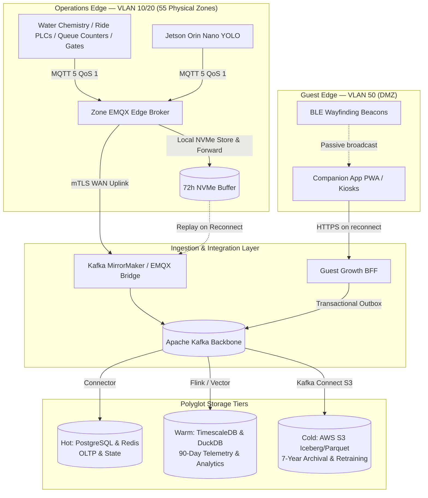

# Data Architecture & Event Fabric

## Architecture Philosophy: Edge-First to Global Event Backbone

The Von Digitalis Estates data architecture unifies high-frequency telemetry from 55 physical zones with cloud-native event-driven microservices. The architecture bridges the physical realm (MQTT 5 edge brokers) and enterprise systems (Apache Kafka) using a standardized **CloudEvents v1.0** envelope.



---

## 1. CloudEvents 1.0 Specification & Complete Event Catalog

All asynchronous domain events across the estate adhere strictly to the **CloudEvents 1.0 specification**. One envelope binds all 4 bounded contexts, so any consumer can deduplicate, trace, and version-gate any producer's stream without a bespoke adapter:

### Universal CloudEvents Envelope Rules

| Envelope Field | Specification & Binding Decision |
|---|---|
| **`id`** | **ULID** (Universally Unique Lexicographically Sortable Identifier); acts as the **idempotency key** for at-least-once delivery. Consumers deduplicate on `id`. |
| **`source`** | Reverse-scoped context name: `ticketing`, `living-collection`, `park-operations`, `guest-growth`. |
| **`type`** | **PascalCase** event name + explicit **`.v1`** version suffix (e.g., `ExhibitAvailabilityChanged.v1`). A breaking change bumps the suffix to `.v2`; shapes are never mutated in place. |
| **`subject`** | Primary entity ID the event concerns (`enc-amazon-17`, `place-gnome-coaster`, `zone-a`). |
| **`time`** | RFC 3339 UTC. Domain ordering uses payload timestamps (`occurredAt`, `scannedAt`). |
| **`datacontenttype`**| `application/json`. |
| **`data`** | Strongly-typed JSON payload validated against JSON Schema in CI/CD. |

```json
{
  "specversion": "1.0",
  "id": "01J7Z8E9F1G2H3J4K5L6M7N8P9",
  "source": "living-collection",
  "type": "ExhibitAvailabilityChanged.v1",
  "datacontenttype": "application/json",
  "dataschema": "https://schema.vondigitalis.com/living/ExhibitAvailabilityChanged.v1.json",
  "time": "2026-09-16T12:00:00.000Z",
  "subject": "enc-amazon-17",
  "traceparent": "00-4bf92f3577b34da6a3ce929d0e0e4736-00f067aa0ba902b7-01",
  "data": {
    "enclosureId": "enc-amazon-17",
    "availability": "closed",
    "capacityCap": 0,
    "reasonClass": "welfare",
    "estimatedReopening": "2026-09-16T14:30:00.000Z",
    "occurredAt": "2026-09-16T11:59:58.210Z"
  }
}
```

### Complete Estate Event Catalog

#### Ticketing & Access — Published Events
| Event (`type`) | Consumers | Key Data Fields | Architectural Impact |
|---|---|---|---|
| `TicketPurchased.v1` | Park Ops, Growth | `orderId`, `ticketIds[]`, `partySize`, `visitDate`, `timeSlot`, `totalAmountUsd` | Park Ops updates presales for demand forecast; Growth starts session. |
| `TicketCancelled.v1` | Park Ops, Growth | `orderId`, `ticketIds[]`, `reason`, `refundAmountUsd` | Forecast adjustments; revocation Bloom filter updated. |
| `TicketRescheduled.v1` | Park Ops, Growth | `orderId`, `originalDate`, `newDate`, `newTimeSlot` | Daily capacity reallocation. |
| `VisitorEntered.v1` | Park Ops, Growth, Living Collection | `ticketId`, `gateId`, `zoneId`, `scannedAt`, `partySize` | Authoritative in-park occupancy increment; starts companion session. |
| `VisitorExited.v1` | Park Ops | `ticketId`, `gateId`, `scannedAt` | Decrements live occupancy count. |
| `CapacityThresholdReached.v1` | Park Ops | `date`, `timeSlot`, `currentSold`, `capacityLimit`, `utilizationPct` | Correlates with crowd forecast and dynamic pricing advisor. |

#### Living Collection — Published Events
| Event (`type`) | Consumers | Key Data Fields | Architectural Impact |
|---|---|---|---|
| `ExhibitAvailabilityChanged.v1` | Ticketing, Park Ops, Growth | `enclosureId`, `availability`, `capacityCap`, `reasonClass`, `estimatedReopening` | Ticketing halts sales; Spot Saver re-offers; Growth suppresses promotion. |
| `EnclosureUnsafe.v1` | Ticketing, Park Ops, Security | `enclosureId`, `code` (`lid_breach`/`barrier_down`), `occurredAt` | Park-wide safety alert; perimeter isolation; turnstiles seal zone. |
| `CensusUpdated.v1` | Park Ops, Keepers | `schoolId`, `nHat`, `ciLow`, `ciHigh`, `method` | PO correlates population density with visitor dwell times. |
| `BiomassEstimated.v1` | Living Collection (Clinical Twin), Keepers | `enclosureId`, `taxon`, `biomassKg`, `individualsDetected`, `confidence`, `method` | Edge CV (YOLO-nano) piranha biomass/anomaly signal; feeds welfare thresholds and nutrition planning. |
| `WaterQualityTelemetry.v1` | Living Collection, Park Ops | `enclosureId`, `do2Mgl`, `ph`, `waterTempC`, `turbidityNtu`, `asOf` | Aquatic life-support telemetry; drives welfare alerts and CV turbidity-degradation gating. |
| `FeedingCompleted.v1` | **Park Ops**, Keepers | `stationId`, `offeredG`, `consumedG`, `durationS` | PO uses for keeper labor utilization & staffing roster. |
| `StressIndexUpdated.v1` | **Park Ops** | `enclosureId`, `stressIndex` (0.0–1.0), `window` | PO throttles adjacent queue flow and moves staff. |
| `WelfareStoryReady.v1` | Guest Growth | `enclosureId`, `taxon`, `storyMarkdown`, `viewingTip` | Growth composes into itinerary cards without re-generation. |
| `BestViewingWindowPredicted.v1` | Guest Growth | `enclosureId`, `windowStart`, `windowEnd`, `confidence` | Growth itinerary planning; suggests which Spot Saver windows to offer first. |
| `VisitConfirmed.v1` | Guest Growth, Ticketing, Park Ops | `requestId`, `enclosureId`, `windowStart`, `windowEnd`, `partySize` | The authoritative slot grant. Only Living Collection may publish it; booking clients render the credential from it. |
| `VisitDenied.v1` | Guest Growth, Ticketing | `requestId`, `enclosureId`, `reasonClass` (`welfare`/`capacity`/`safety`), `alternativeWindows[]` | Welfare, capacity, or safety refusal; carries alternate windows so the client can re-offer rather than fail. |
| `SightingHonourable.v1` | Guest Growth | `contributorId`, `enclosureId`, `reasonCode` | Growth awards non-monetary digital badge. |

#### Park Operations — Published Events
| Event (`type`) | Consumers | Key Data Fields | Architectural Impact |
|---|---|---|---|
| `ZoneOccupancyChanged.v1` | Growth, Ticketing, Living Collection | `zoneId`, `occupancyCount`, `asOf` | Raw occupancy; Growth calculates congestion weights; LC assesses crowd stress. |
| `RideWaitTimeUpdated.v1` | **Growth, Ticketing** | `placeId`, `rideId`, `waitMinutes`, `asOf`, `confidence` | Growth renders live wait times; Ticketing Concierge advises best times. |
| `DemandForecastUpdated.v1` | **Ticketing, Growth** | `zoneId`, `horizonStart`, `horizonEnd`, `predictedOccupancy`, `isEstimated` | Single forecast drives Ticketing dynamic pricing and Growth routing. |
| `StaffingRecommendationRaised.v1` | Duty Manager UI, Audit Store | `sourceZoneId`, `targetZoneId`, `headcount`, `reason`, `isEstimated` | Human Approve/Reject/Modify workflow; system never dispatches directly. |
| `RideStatusChanged.v1` | Growth, Ticketing | `rideId`, `status` (`running`/`maintenance`/`closed`), `occurredAt` | Prevents silence read as unpopularity; triggers instant Growth companion reroute. |
| `RideCycleCompleted.v1` | **Park Ops** (Wait-Time Engine) | `rideId`, `dispatchId`, `cycleStart`, `cycleEnd`, `throughput`, `vehiclesDispatched` | Raw ride-dispatch telemetry feeding the wait-time estimation model (the source signal for `RideWaitTimeUpdated.v1`). |
| `QueueCountUpdated.v1` | **Park Ops** | `queueId`, `rideId`, `physicalCount`, `asOf`, `method` | Edge vision counter for physical (stand-by) queues; feeds dispatch balancing and wait-time estimation. |

#### Guest Growth — Published Events
| Event (`type`) | Consumers | Key Data Fields | Architectural Impact |
|---|---|---|---|
| `QueueJoined.v1` | **Park Ops** | `queueId`, `guestSessionId`, `rideId`, `partySize`, `enrolledAt`, `estimatedReturnTime` | Park Ops balances ride dispatch & queue lane throughput. |
| `QueueCalled.v1` | **Park Ops** | `queueId`, `guestSessionId`, `rideId`, `calledAt`, `graceExpiresAt` | Park Ops summons guests to boarding platform. |
| `QueueExpired.v1` | **Park Ops** | `queueId`, `guestSessionId`, `rideId`, `reason` | Park Ops adjusts real-time ride demand and throughput. |
| `VisitRequested.v1` | Living Collection, Park Ops | `requestId`, `guestSessionId` / `orderId`, `enclosureId`, `windowStart`, `windowEnd`, `partySize`, `origin` | Exhibit reservation request with `origin: in_park`. Ticketing publishes the identical event with `origin: pre_visit`; there is no second request path. |
| `FeedbackSubmitted.v1` | Park Ops (Analytics), Ticketing | `feedbackId`, `guestSessionId`, `rating1to10`, `questionnaireAnswers{}`, `frictionSignals{}` | Estate analytics & guest satisfaction loop. |
| `ReturnVisitPropensity.v1` | Ticketing | `customerId`, `score`, `segments[]` | Ticketing personalized email/SMS offers (batch). |

---

## 2. Inbound Guarded Commands

Commands are point-to-point invocations subject to strict allow-lists and forbidden actions:

| Command | Sender(s) | Target | Action | Forbidden Sub-Actions |
|---|---|---|---|---|
| `CapExhibitCapacity` | Ticketing, Park Ops | Living Collection | Reduce public `capacityCap` due to overcrowding/spillover. | Cannot increase cap, open gates, or override veterinary quarantine. |
| `PausePublicExperience` | Guest Growth | Living Collection | Request suppression of feeding talks/story cards. | Request only; clinical staff can decline. |
| `SuspendExperienceSales` | Living Collection (via `ExhibitAvailabilityChanged`), Park Ops | Ticketing | Halt sales for an enclosure or ride. | Must carry verified `reasonClass`. |
| `AdjustCapacityCap` | Park Operations | Ticketing | Reduce sellable inventory for an admission slot. | Reduce only; increases require dual human sign-off. |

---

## 2. Storage Tiering Lifecycle (Hot / Warm / Cold)

| Storage Tier | Technology | Retention | SLA / Access Profile | Data Types Stored |
|---|---|---|---|---|
| **Hot (Operational)** | PostgreSQL 16 + Redis Cluster | 14 Days | Sub-millisecond to 10ms read latency; strong ACID for payments. | Tickets, guest wallets, active sessions, gate Bloom filters, current ride states. |
| **Warm (Analytical)** | TimescaleDB + DuckDB | 90 Days | 50ms – 500ms query latency; time-series aggregation. | High-frequency water chemistry, BLE dwell metrics, queue lengths, model inference logs. |
| **Cold (Archival)** | S3 + Apache Iceberg (Parquet) | 7 Years | Batch processing via Athena / DuckDB / Spark. | Raw telemetry history, raw CV frames with keeper annotations, training sets, financial audits. |

---

## 3. GDPR, Privacy & Compliance Architecture

The platform adheres to EU GDPR and the UK Data Protection Act:

1. **Facial Anonymization at the Edge**:
   - Camera feeds processed by Jetson Orin Nano hardware run YOLO-nano edge inference directly in memory.
   - **Zero raw video or facial frames** are ever transmitted to the cloud or saved to disk. Only aggregated bounding box counts and centroid coordinates are converted to CloudEvents.
2. **Right to Be Forgotten (GDPR Article 17)**:
   - Guest identifiers (`guest_id`) are pseudonymized using cryptographic salt-hashes.
   - Erasure requests issue a crypto-shredding transaction: deleting the tenant encryption key from AWS KMS instantly renders historical cold-tier telemetry cryptographically inaccessible.
3. **Children's Privacy Protection**:
   - The Companion App does not require child name entry. Child passes are issued under the parent's primary account with zero biometric or behavioural profiling enabled.
