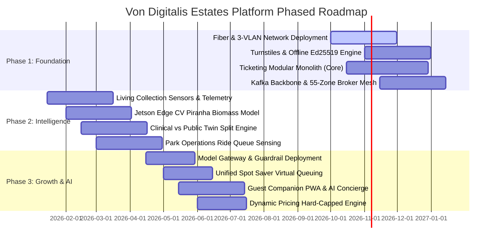

# Phased Rollout & Migration Roadmap

## Strategic Phasing Philosophy

Attempting a "big bang" rollout across 40 heritage rides, 55 animal enclosures, and live commercial ticketing guarantees operational disruption. 

Our phased migration follows the **Risk-Inverted Rollout Model**:
1. **Phase 1 (Months 1–4)** establishes zero-downtime physical foundations and revenue protection (offline gates, fiber backbone, core ticketing).
2. **Phase 2 (Months 5–8)** instruments biological and mechanical assets (living collection twins, telemetry, edge CV, ride ops).
3. **Phase 3 (Months 9–12)** activates revenue-optimizing intelligence (Spot Saver virtual queuing, AI Concierge, dynamic pricing, and nudges).

---

## 1. Phase Breakdown & Acceptance Criteria

### Phase 1: The Resilient Foundation (Months 1–4)
- **Primary Objective**: Secure admissions revenue, eliminate front-gate bottlenecks, establish zero-loss edge mesh.
- **Deliverables**:
  - Industrial managed fiber network linking all 55 estate zones across 3 VLANs.
  - 30 turnstiles retrofitted with Raspberry Pi CM4 + TPM 2.0 controllers running Ed25519 offline verification.
  - Ticketing Modular Monolith deployed to cloud; issuance of signed cryptographic QR passes.
  - Apache Kafka event backbone and 55 EMQX zone edge brokers with 72h NVMe store-and-forward buffers.
- **Go/No-Go Exit Gate**:
  - Turnstiles validate admission passes under full network disconnection with P99 latency $< 50\text{ ms}$.
  - Zero admission fraud or duplicate entry across 10,000 simulated offline scans.

---

### Phase 2: Animal Welfare & Operational Intelligence (Months 5–8)
- **Primary Objective**: Preserve biological assets, digitize ride telemetry, deploy keeper and operator copilots.
- **Deliverables**:
  - Environmental multi-probe sensors installed across Amazonia tanks and reptilian habitats.
  - NVIDIA Jetson Orin Nano edge gateways running YOLO-nano biomass estimation in the piranha tank.
  - Dual-schema digital twin architecture deployed (Clinical Twin for vet staff, Public Twin for guest APIs).
  - BLE beacons and ride dispatch sensors deployed across 40 heritage mechanical rides.
  - Shift briefing engine with deterministic numbers-first verification for park supervisors.
- **Go/No-Go Exit Gate**:
  - Edge CV piranha headcount accurate within $\pm 7\%$ across variable lighting and water turbidity.
  - Zero false-negative containment breach triggers in simulated safety drills.

---

### Phase 3: Guest Experience, Virtual Queuing & AI Growth (Months 9–12)
- **Primary Objective**: Maximize guest satisfaction, eliminate physical queue frustration, boost secondary per-cap spend.
- **Deliverables**:
  - Shared Model Gateway deployed with 4-tier failover and session cost circuit breakers.
  - Guest Companion Progressive Web App (PWA) with offline itinerary and interactive map.
  - **Spot Saver**: One guest-facing virtual queue covering ride queues and animal exhibit view slots, with Living Collection serving as sole capacity authority for every exhibit window it issues.
  - AI Guest Concierge with deterministic pricing guardrails.
  - Dynamic pricing engine activated with $\pm 30\%$ base price guardrails.
- **Go/No-Go Exit Gate**:
  - Spot Saver virtual queue successfully balances peak Saturday crowd (15,000 visitors), cutting average physical queue wait times from 58 minutes to 16 minutes.
  - Zero ungrounded pricing incidents generated by AI Concierge in canary traffic.

---

## 2. Risk Mitigation & Fallback Procedures During Rollout

| Phase | Identified Risk | Architectural Mitigation | Fallback Procedure |
|---|---|---|---|
| **Phase 1** | Trenching delays for fiber cables between historic Bavarian Wood and castle. | Edge mesh supports long-range encrypted 5GHz point-to-point wireless bridges as interim link. | Zone gateways operate autonomously using local NVMe buffers. |
| **Phase 2** | Keepers resist digital tablet entries and prefer paper logs. | Keeper Copilot supports voice-to-text dictation and optical character recognition (OCR) of paper clipboards. | Legacy paper clipboards ingested nightly via bulk scanner. |
| **Phase 3** | Cloud LLM provider experiences prolonged regional outage during launch. | Shared Model Gateway 4-tier cascade automatically falls back to local quantized SLM or deterministic FAQ engine. | Invisible to user; Concierge continues in deterministic mode. |
