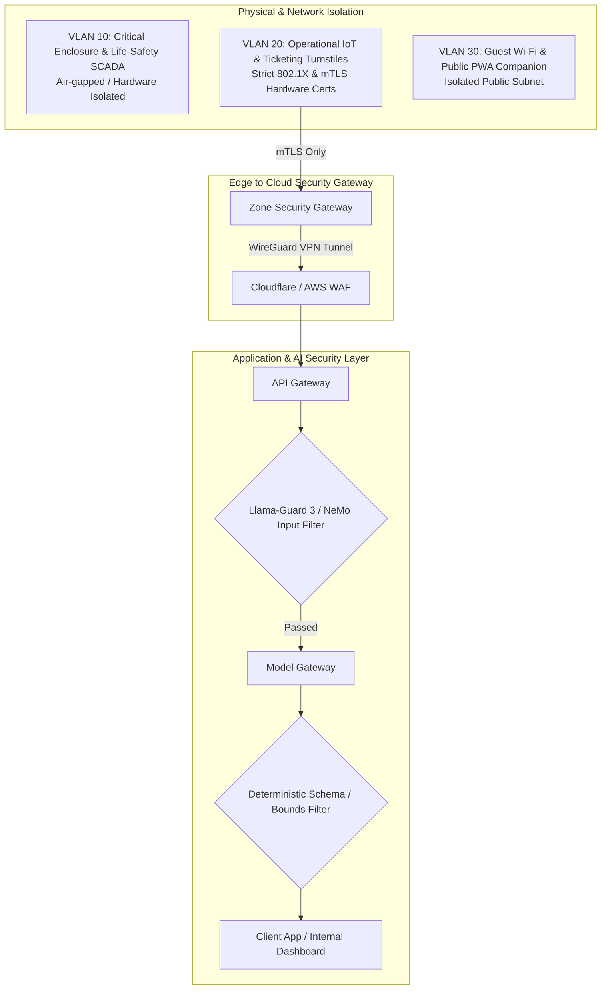

# Security Architecture & Threat Model

## Defense-in-Depth Architecture

The Von Digitalis Estates digital platform controls physical infrastructure (turnstiles, high-speed heritage ride dispatch locks, dangerous animal enclosure barriers) and processes financial payments. Security is architected using zero-trust network principles, cryptographic hardware tokens, and defense-in-depth AI safety guardrails.

---

## 1. STRIDE Threat Model Across Bounded Contexts

| Bounded Context | Threat Category | Attack Vector & Scenario | Architectural Mitigation |
|---|---|---|---|
| **Ticketing & Access** | **Spoofing / Tampering** | Attacker clones QR code or modifies admission date. | **Ed25519 asymmetric signatures** embedded in QR payload; validated against local public key ring. Local Bloom filter prevents replay of redeemed tickets. |
| **Living Collection** | **Elevation of Privilege** | Attacker accesses clinical twin or overrides containment alarm. | **Physical VLAN 10 isolation** for SCADA; dual-schema separation (Clinical vs Public twin); hardware interlocks cannot be overridden via software. |
| **Park Operations** | **Denial of Service** | Malicious flooding of ride queue sensors or wait-time endpoints. | Rate-limiting at Edge Gateway; MQTT broker client certificate authentication; automatic failover to baseline historical throughput tables. |
| **Guest Growth** | **Information Disclosure** | Scraping of guest locations or harvesting child user records. | Strict GDPR pseudonymization; salt-hashed device identifiers; zero persistent raw GPS coordinates (only coarse zone-dwell buckets stored). |

---

## 2. OWASP Top 10 for LLMs Mitigations

| OWASP LLM Vulnerability | Attack Description | Mitigation Implemented in Estate Architecture |
|---|---|---|
| **LLM01: Prompt Injection** | Guest enters jailbreak strings into AI Concierge to acquire free passes or alter prices. | **Dual-stage defense**: Inbound queries pass through Llama-Guard 3 / NeMo guardrail; prompts are structurally separated into system instructions and untrusted user input tags. Pricing is strictly calculated deterministically—LLMs cannot emit authoritative payment amounts. |
| **LLM02: Insecure Output Handling** | LLM generates malicious scripts or SQL injection payloads that are rendered by admin dashboards. | All downstream consumers treat LLM outputs as untrusted strings. UI renders text using strict HTML sanitization and markdown parsers with script execution disabled. |
| **LLM04: Model Denial of Service** | Adversary submits recursive, extremely long prompts to exhaust token quotas and cause timeout spikes. | Hard input limits (max 500 characters for concierge chat); token rate-limiting (token bucket per session); hard session cost ceiling ($0.15 limit). |
| **LLM06: Sensitive Information Disclosure** | Model regurgitates internal staff schedules, animal medical records, or estate security codes. | **Dual-Schema Isolation**: Public-facing models only index the Public Digital Twin and public knowledge bases. Clinical health notes and keeper credentials are physically isolated and never embedded into public RAG vector indexes. |
| **LLM09: Overreliance** | Ride operators or keepers accept hallucinated AI shift briefings or diagnosis without validation. | **ADR-007 (Tiered Autonomy)** & **ADR-008 (Numbers-First)**: High-stakes actions require human authorization; shift briefings present raw telemetry tables first, with AI narrative strictly verified by deterministic faithfulness checks. |

---

## 3. Network Segmentation (VLAN Architecture — ADR-016)

The estate enforces strict network segmentation across managed Layer-3 switches:

### 1. VLAN 10/20 — Operations & IoT Telemetry *(Restricted / mTLS Only)*
- **Protected Systems**: Enclosure SCADA & PLCs, water chemistry probes, turnstile gate scanners, and Jetson Orin Nano CV gateways.
- **Operator Access**: Keeper handheld tablets authenticated via `WPA3-Enterprise`.
- **Zero-Trust Controls**: Mandatory X.509 mutual TLS (`mTLS`) client certificates; `IEEE 802.1X` port authentication on all physical switch ports.
- **Uplink Transport**: Outbound WireGuard mTLS tunnel over estate backhaul ring to the Kafka cluster.

### 2. VLAN 30 — Estate Administration & Back-Office
- **Internal Systems**: Finance terminals, Ticketing back-office workstations, and executive administrative consoles.
- **Access Controls**: Role-Based Access Control (RBAC) enforced with mandatory Multi-Factor Authentication (MFA).
- **Network Isolation**: Strictly isolated from operational IoT sensor telemetry, actuator circuits, and guest-facing subnets.

### 3. VLAN 50 — Guest DMZ *(Untrusted Public Subnet)*
- **Guest Endpoints**: Visitor smartphones running the companion PWA, public Wi-Fi access points, and BLE beacons.
- **Physical Devices**: Interactive self-service kiosks (`IEEE 802.1X` isolated) with captive portal DNS filtering.
- **Egress Policy**: Direct internet egress only.

> [!IMPORTANT]
> **Zero Inter-VLAN Routing**: Managed Layer-3 hardware switches explicitly drop all packet flows between VLAN 50 and VLAN 10/20. A compromised guest smartphone or malicious actor on the public guest Wi-Fi cannot route to, ping, or port-scan any operational gateway, turnstile controller, or enclosure PLC.

> [!NOTE]
> **Physical One-Way SCADA Data Diode**: Critical enclosure door magnetic contacts and life-support dissolved oxygen controllers on VLAN 10 export state to VLAN 20 brokers through hardware-level one-way optical data diodes, physically precluding any software-level reverse command injection or actuation.

---

## 4. Hardware Identity & Key Management

- **Turnstile Gate Credentials**: Each gate controller has an embedded TPM 2.0 chip containing its private key and the estate's public Ed25519 signing key.
- **Certificate Rotation**: X.509 device certificates rotate automatically every 90 days via EST (Enrollment over Secure Transport) protocol.
- **Emergency Revocation**: If a turnstile or keeper terminal is stolen or physically tampered with, its certificate is instantly added to the local CRL (Certificate Revocation List) broadcasted via the zone MQTT mesh.
