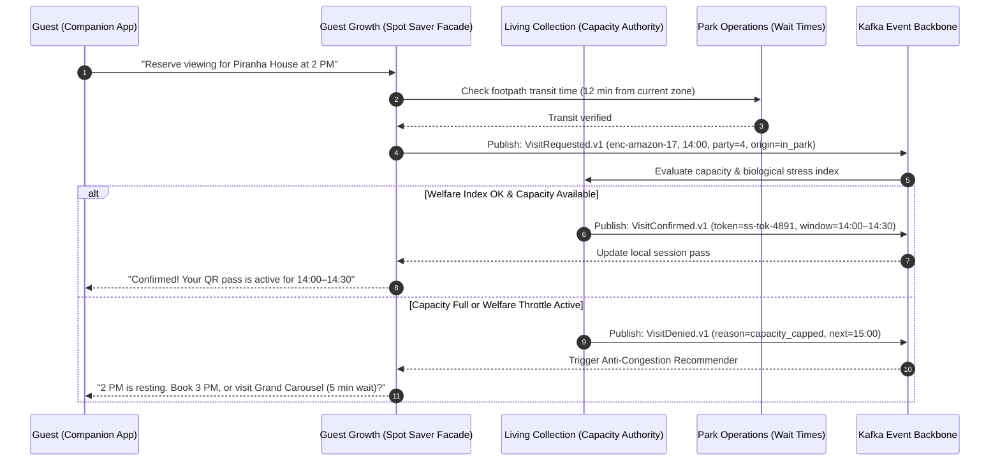
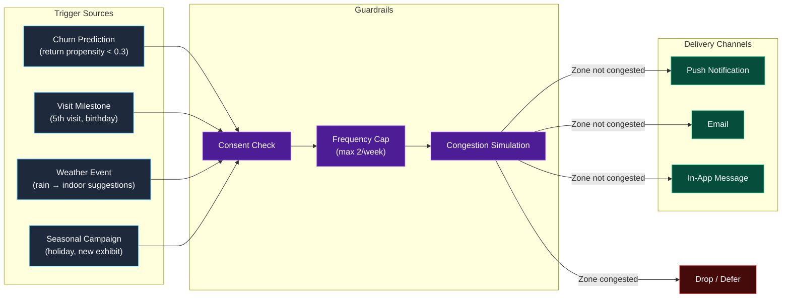
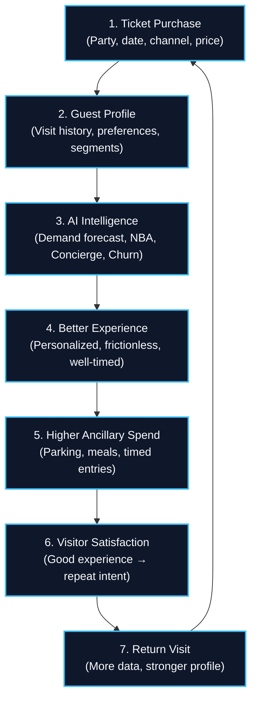

# Guest Growth Domain

## Domain Overview

Guest Growth owns the **guest-facing digital experience** beyond ticketing: the Companion App PWA, virtual queuing (Spot Saver), personalized recommendations, nudge-based engagement, and return-visit optimization. The goal is to grow the estate from 5,000 to 15,000 daily visitors — and keep them coming back.

**Key Invariant:** The recommendation engine never sends a guest into a congested zone. Every nudge is checked against the current crowd simulation before delivery.

---

## Module Decomposition

| Module | Responsibility | AI Involvement |
|---|---|---|
| **Companion App Backend** | API for PWA: ticket wallet, maps, wait times, stories | None (serves data) |
| **Spot Saver** | Unified virtual queue orchestration for rides + enclosures | None (event coordination) |
| **Guest Profile** | Consent management, preferences, visit history, segments | None |
| **Recommendation Engine** | GBDT ranking model + GenAI copy drafting for suggestions | ML ranking + GenAI |
| **Nudge Engine** | Push, email, in-app message orchestration | GenAI copy drafting |
| **Churn Prediction** | Return propensity scoring [0, 1] | ML classification |
| **Campaign Manager** | A/B testing, attribution, experiment management | None (deterministic) |

---

## Companion App — Offline-First PWA

The companion app is a **Progressive Web App** (PWA) that works without installation and degrades gracefully offline:

| Feature | Online | Offline |
|---|---|---|
| **Ticket Wallet** | Live QR with real-time validation | Cached QR (Ed25519-signed, self-validating) |
| **Estate Map** | Live crowd heatmap overlay | Bundled vector map, static paths |
| **Wait Times** | Real-time from Park Ops events | Last-known values (stale indicator) |
| **Recommendations** | Personalized GBDT-ranked list | Proximity-based sorting from BLE |
| **Stories** | Live GenAI-narrated enclosure stories | Cached last-fetch stories |
| **Spot Saver** | Full queue management | View existing reservations only |
| **Notifications** | Real-time push | Queued for delivery on reconnect |

### Technology Stack

| Component | Choice | Rationale |
|---|---|---|
| Framework | PWA with service workers | No app store dependency; works for international visitors |
| Local storage | LiteDB (via IndexedDB) | Structured offline storage for tickets, preferences, history |
| Maps | Bundled vector tiles | No tile server dependency offline |
| Proximity | BLE beacon scanning | Zone detection without WiFi; works with phone in pocket |
| Sync | Background Sync API | Automatic foreground data sync on reconnect |

---

## Spot Saver — Unified Virtual Queue & Reservation Engine

Spot Saver is one guest-facing queue for two very different kinds of capacity: heritage mechanical rides, whose throughput is governed by Park Operations, and animal exhibits, whose occupancy is governed by Living Collection's welfare limits. Guest Growth owns the experience and neither ledger.

For **exhibits**, `VisitRequested.v1` $\to$ `VisitConfirmed.v1` is the **single reservation path** across the estate — the same two events carry a slot booked weeks ahead at checkout (`origin: pre_visit`) and a slot booked from a bench ten minutes before the feed (`origin: in_park`), and both draw down the same welfare-clamped cap. For **rides**, Guest Growth holds the virtual queue position itself and publishes `QueueJoined.v1` / `QueueCalled.v1` / `QueueExpired.v1` so Park Operations can balance dispatch against the queue it can no longer see on the ground:

### UX Honesty Invariants

To maintain absolute guest trust, the Companion App enforces three non-negotiable honesty invariants:
1. **Never Under-Report Wait Times**: The app can never display an estimated wait time lower than the authoritative sensor-derived figure published by Park Operations (`RideWaitTimeUpdated.v1`).
2. **Never Route Into Closures**: A recommendation or nudge can never target an exhibit marked `closed`, `delayed`, or `quarantined` by Living Collection.
3. **Transparent Latency / Offline Indicators**: When operating offline or on stale cache, all wait times and crowd densities display an explicit "As of [time] · Offline" visual badge.

| Attraction Type | Capacity Authority | Queue Management |
|---|---|---|
| **Enclosures** | Living Collection (sole authority; GG holds no ledger) | Spot Saver reservation via GG |
| **Rides** | Park Operations (dispatch throughput) | Virtual queue position held by GG, signalled to PO |
| **Path segments** | Park Operations (advisory only) | Recommendation avoidance |

---

## Recommendation Engine

### Ranking Model

| Component | Technology | Input | Output |
|---|---|---|---|
| **Feature Extraction** | Real-time feature store | Guest profile + time remaining + crowd state + weather + party composition | Feature vector |
| **Ranking Model** | GBDT (Gradient Boosted Decision Trees) | Feature vector | Sorted attraction IDs + relevance scores |
| **Copy Drafting** | GenAI via Model Gateway | Top-3 ranked attractions + guest context | Natural language suggestion card |
| **Congestion Check** | Simulation (deterministic) | Recommended zone + current occupancy + pending recommendations | Pass/fail |

### Anti-Congestion Rule

> A recommendation is **never delivered** if it would push a zone's projected occupancy beyond the congestion threshold when aggregated with all other pending recommendations to the same zone.

This is enforced deterministically — the GenAI drafts the copy, but the simulation gates delivery.

### Recommendation Fallback Chain

| Tier | Condition | Behavior |
|---|---|---|
| **Full** | Online, model available | Personalized GBDT ranking + GenAI copy |
| **Degraded** | Model available, GenAI down | GBDT ranking + template copy |
| **Minimal** | Model down | Proximity-based sorting (nearest attractions) |
| **Offline** | No connectivity | Last-cached recommendations + BLE proximity |

---

## Nudge Engine — Retention Campaigns

---

## Churn Prediction Model

| Parameter | Value |
|---|---|
| **Model Type** | Gradient Boosted Classification (XGBoost) |
| **Features** | Visit frequency, recency, spend per visit, ticket type, time-of-year, weather-on-visit, party size |
| **Output** | Return propensity [0, 1] within 90 days |
| **Training Data** | Historical visit + purchase data (anonymized) |
| **Retraining** | Monthly, or when return rate diverges > 15% from predicted |
| **Evaluation** | AUC-ROC on holdout set; benchmark vs. naïve frequency predictor |

---

## Data Virtuous Cycle

---

## Published CloudEvents

All events use CloudEvents 1.0 format with ULID `id` and PascalCase `.v1`:

| Published Event (`type`) | Consumers | Key Data Fields | Architectural Impact |
|---|---|---|---|
| `QueueJoined.v1` | **Park Ops** | `queueId`, `guestSessionId`, `rideId`, `partySize`, `enrolledAt`, `estimatedReturnTime` | Park Ops balances ride dispatch & queue lane throughput. |
| `QueueCalled.v1` | **Park Ops** | `queueId`, `guestSessionId`, `rideId`, `calledAt`, `graceExpiresAt` | Park Ops summons guests to boarding platform. |
| `QueueExpired.v1` | **Park Ops** | `queueId`, `guestSessionId`, `rideId`, `reason` | Park Ops adjusts real-time ride demand and throughput. |
| `VisitRequested.v1` | Living Collection, Park Ops | `requestId`, `guestSessionId` / `orderId`, `enclosureId`, `windowStart`, `windowEnd`, `partySize`, `origin` | Exhibit reservation request with `origin: in_park`; Ticketing publishes the identical event with `origin: pre_visit`. Guest Growth never grants the slot itself. |
| `FeedbackSubmitted.v1` | Park Ops (Analytics), Ticketing | `feedbackId`, `guestSessionId`, `rating1to10`, `questionnaireAnswers{}`, `frictionSignals{}` | Estate analytics & guest satisfaction loop. |
| `ReturnVisitPropensity.v1` | Ticketing | `customerId`, `score`, `segments[]` | Ticketing personalized email/SMS offers (batch). |

---

## Failure & Degraded-Mode Matrix

| Failure | Response | Guest Experience |
|---|---|---|
| Recommendation engine down | Proximity-based sorting | "Nearby attractions" instead of "For you" |
| GenAI copy drafter down | Template-based suggestion cards | Slightly less polished text |
| Push notification provider down | Queue and retry; tickets remain valid | Delayed notification; app shows data normally |
| Living Collection events stale | Show last-known enclosure status with stale indicator | "Wait times may be outdated" badge |
| Park Operations events stale | Show last-known wait times with stale indicator | Same stale badge approach |
| Complete offline | Cached maps, tickets, last-known data | Full ticket wallet + basic navigation |

---

## Domain ADRs

- [ADR-005: Living Collection as Sole Capacity Authority](../adrs/ADR-005-living-collection-as-sole-capacity-authority.md)
- [ADR-013: Modular Monolith per Bounded Context](../adrs/ADR-013-modular-monolith-per-bounded-context.md)
