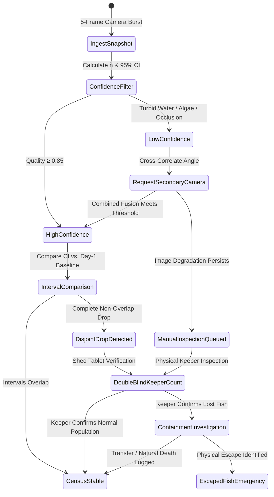
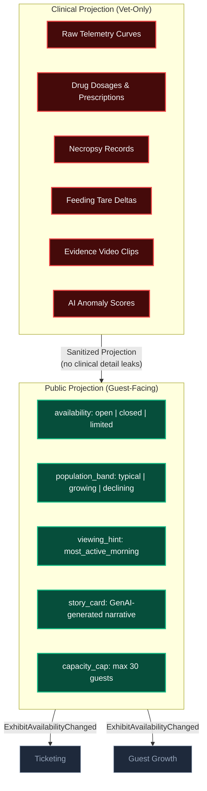
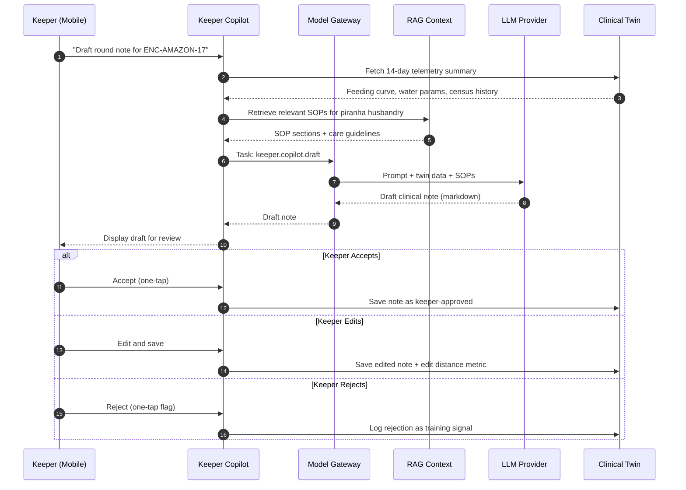

# Living Collection Domain

## Domain Overview

Living Collection owns the **welfare, monitoring, and public representation** of 200+ exotic animals across 55 enclosures. This is the highest-safety domain: a missed containment alert on a venomous snake or a piranha escape is a life-threatening emergency.

**Key Invariants:**
1. LLM is **never** in the safety path. Safety is deterministic; health detection is specialized ML; LLMs draft keeper notes and guest stories only.
2. Living Collection is the **sole capacity authority** for enclosure timed-entry windows.
3. The **Clinical Projection** (vet-only) and **Public Projection** (guest-facing) are strictly separated at the aggregate boundary.

---

## Module Decomposition

| Module | Responsibility | AI Involvement |
|---|---|---|
| **Telemetry Ingest** | MQTT → time-series storage. Deduplication, bounds-checking. | None |
| **Inventory** | Species catalog, enclosure registry, individual/school aggregates | None |
| **Husbandry** | Feeding schedules, medication, care logs, round records | None |
| **Clinical Twin** | Full veterinary data: telemetry curves, drug dosages, necropsy data | Anomaly detection (ML) |
| **Public Twin** | Sanitized projection: `availability`, `population_band`, `viewing_hint`, `story_card` | None (data projection) |
| **Inference** | Edge CV (piranha count), appetite anomaly, behavioral anomaly | Edge CV + ML models |
| **Alert Engine** | Deterministic policy: AI probabilities → operational rules → alert actions | None (deterministic rules) |
| **Keeper Copilot** | Draft clinical notes from SOP + 14-day twin data (RAG) | GenAI via Model Gateway |
| **Story Narrator** | Generate guest-facing enclosure stories from public twin data | GenAI via Model Gateway |
| **Feedback Store** | Immutable keeper disposition log (accept/reject/correct) | Used for retraining |

---

## Edge Computer Vision — Piranha Census

### Why School Aggregate?

Jumping piranhas (*Pygocentrus nattereri*) cannot be individually tagged. Dense schooling, continuous 3D locomotion, and water turbidity make individual identification biologically impossible. The domain models them honestly as a **School Aggregate**:

$$\hat{N} \quad\text{with 95% CI } [\text{ci}_{\text{low}},\, \text{ci}_{\text{high}}]$$

$$\text{Total Estimated Biomass: } B = \hat{N} \cdot \bar{w} \quad (\bar{w} = \text{rolling mean weight from feeder telemetry})$$

$$\text{Dispersion Index: } D = \frac{\sigma^2}{\mu} \quad (D > 1.4 \implies \text{clump/feeding frenzy}; \quad D < 0.7 \implies \text{lethargy/hypoxia})$$

$$\text{Velocity Coherence: } C_v = \frac{\left\|\sum_{i=1}^n \vec{v}_i\right\|}{\sum_{i=1}^n \|\vec{v}_i\|} \in [0, 1] \quad (C_v > 0.85 \implies \text{polarized escape/flight response})$$

- Downstream systems consume **statistical population bands**, not fabricated individual IDs.
- If $D < 0.7$ alongside a dissolved oxygen drop below 4.5 mg/L, an early-warning telemetry event fires before clinical distress occurs.

### Census Pipeline



### Edge Inference Details

| Parameter | Value | Rationale |
|---|---|---|
| Model | YOLOv8-nano (custom-trained) | Smallest model that fits Jetson Orin Nano |
| Input | 5-frame burst at 2 FPS | Captures jumping motion across frames |
| Output | Bounding boxes → count → n̂ with CI | Statistical aggregate, not individual IDs |
| Latency | < 200ms per burst | Fast enough for continuous monitoring |
| Training data | Open fisheries datasets + synthetic augmentation + keeper-labeled estate data | Transfer learning bootstrapping |
| Retraining trigger | Winkler score drops below 0.80 for 7 consecutive days | Production drift detection |

---

## Clinical vs. Public Twin



---

## Keeper Copilot — GenAI Clinical Note Drafting



### Copilot Guardrails

- **No actuation**: Copilot cannot trigger feeding, medication, or containment actions
- **No diagnosis**: Copilot drafts notes; it does not diagnose. Veterinary judgment is sacrosanct
- **Clinical data only**: Copilot accesses the Clinical Twin, never the Public Twin in reverse
- **Faithfulness**: Every measurement in the draft must trace to the 14-day twin data

---

## Containment & Life-Safety Architecture

```
┌─────────────────────────────────────────────────────────────┐
│  CONTAINMENT ALERT PATH (Zero Cloud Dependency)             │
│                                                             │
│  Lid Contact Sensor → Microcontroller → Physical Solenoid   │
│                        └─→ Local Strobe Siren               │
│                        └─→ Shed Tablet Alert                │
│                        └─→ MQTT PUBLISH (buffered)          │
│                                                             │
│  ⚡ Total latency: < 50ms (firmware-level)                   │
│  🔌 Power: Independent UPS per enclosure zone               │
│  ☁️ Cloud dependency: ZERO                                   │
│  🤖 AI dependency: ZERO                                     │
│  📶 WiFi dependency: ZERO                                   │
└─────────────────────────────────────────────────────────────┘
```

---

## Visitor Media (UGC) — Ethical Side Channel

Visitors take photos of exhibits. This is an **untrusted, optional side channel** — if severed, core monitoring is completely unaffected.

| Control | Design |
|---|---|
| **Ingestion** | First-party exhibit QR upload + official platform mentions API only. Zero social media scraping |
| **Welfare gate** | Neural filter checks for flash, barrier breach, foreign objects. Violators silently dropped |
| **Privacy** | Automated guest face blur before any processing |
| **Rewards** | Non-monetary badges only ("Honorary Field Scout"). No cash bounties to prevent animal agitation |
| **Clinical impact** | Zero. Visitor media cannot write clinical state or trigger safety actions |

---

## Published CloudEvents
All events follow CloudEvents 1.0 with ULID `id` and PascalCase `.v1`:

| Published Event (`type`) | Consumers | Key Data Fields | Architectural Impact |
|---|---|---|---|
| `ExhibitAvailabilityChanged.v1` | Ticketing, Park Ops, Growth | `enclosureId`, `availability`, `capacityCap`, `reasonClass`, `estimatedReopening` | Ticketing halts sales; Spot Saver re-offers; Growth suppresses promotion. |
| `EnclosureUnsafe.v1` | Ticketing, Park Ops, Security | `enclosureId`, `code` (`lid_breach`/`barrier_down`), `occurredAt` | Park-wide safety alert; perimeter isolation; turnstiles seal zone. |
| `CensusUpdated.v1` | Park Ops, Keepers | `schoolId`, `nHat`, `ciLow`, `ciHigh`, `method` | PO correlates population density with visitor dwell times. |
| `FeedingCompleted.v1` | **Park Ops**, Keepers | `stationId`, `offeredG`, `consumedG`, `durationS` | PO uses for keeper labor utilization & staffing roster. |
| `StressIndexUpdated.v1` | **Park Ops** | `enclosureId`, `stressIndex` (0.0–1.0), `window` | PO throttles adjacent queue flow and moves staff. |
| `WelfareStoryReady.v1` | Guest Growth | `enclosureId`, `taxon`, `storyMarkdown`, `viewingTip` | Growth composes into itinerary cards without re-generation. |
| `BestViewingWindowPredicted.v1` | Guest Growth | `enclosureId`, `windowStart`, `windowEnd`, `confidence` | Growth itinerary planning; suggests which Spot Saver windows to offer first. |
| `VisitConfirmed.v1` | Guest Growth, Ticketing, Park Ops | `requestId`, `enclosureId`, `windowStart`, `windowEnd`, `partySize` | The authoritative slot grant against the welfare-clamped cap. No other context may issue one. |
| `VisitDenied.v1` | Guest Growth, Ticketing | `requestId`, `enclosureId`, `reasonClass` (`welfare`/`capacity`/`safety`), `alternativeWindows[]` | Refusal with alternates, so a booking client re-offers instead of failing the guest. |
| `SightingHonourable.v1` | Guest Growth | `contributorId`, `enclosureId`, `reasonCode` | Growth awards non-monetary digital badge. |

---

## Failure & Degraded-Mode Matrix

| Failure Mode | Edge Reaction | Cloud Reaction | Downstream Impact |
|---|---|---|---|
| Complete estate WAN outage | Edge buffers all telemetry (72h). Local sirens operational. | Mark gateways as "Islanded" | Ticketing honors existing capacity; Growth suspends push stories |
| Enclosure camera failure | Publish `quality: sensor_fault`. Switch to secondary angle | Flag census as "provisional" | Exhibit remains open; keeper scheduled for visual count |
| LLM provider outage | Zero edge impact | Gateway routes to local SLM | Copilot notes lose polish; zero clinical impact |
| Dissolved oxygen crash (< 3 mg/L) | Firmware solenoid valve for backup oxygenation + local siren | Instant `EnclosureUnsafe` projection | Ticketing halts admissions to affected zone |
| Containment breach | Microcontroller solenoid + strobe siren | `ExhibitAvailabilityChanged(closed, safety)` | Security perimeter; turnstiles deny entry to sector |
| Edge gateway failure | VRRP failover to secondary gateway | Detect missing heartbeat; dispatch field engineer | Adjacent zones unaffected |

---

## Domain ADRs

- [ADR-005: Living Collection as Sole Capacity Authority](../adrs/ADR-005-living-collection-as-sole-capacity-authority.md)
- [ADR-007: Strict Tiered Autonomy — AI Assists, Humans Decide](../adrs/ADR-007-tiered-autonomy-ai-assists-humans-decide.md)
- [ADR-009: Edge CV for Piranha Biomass Estimation](../adrs/ADR-009-edge-cv-for-piranha-biomass-estimation.md)
- [ADR-010: Clinical vs. Public Digital Twin Split](../adrs/ADR-010-clinical-vs-public-digital-twin-split.md)
- [ADR-011: Keeper Dispositions as Ground-Truth Training Labels](../adrs/ADR-011-keeper-disposition-as-ground-truth-labels.md)
