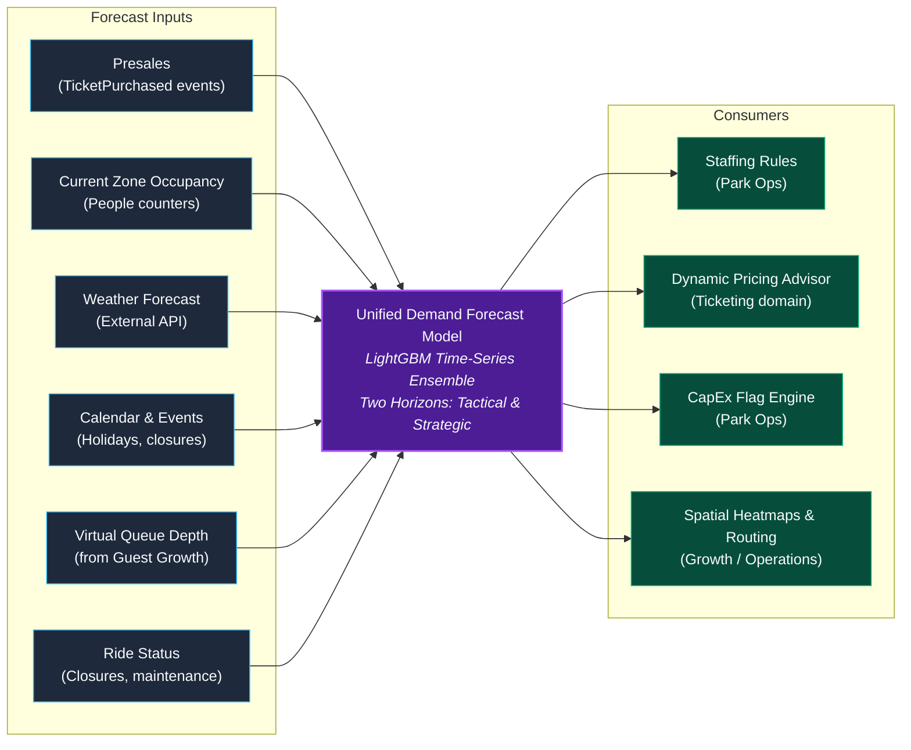
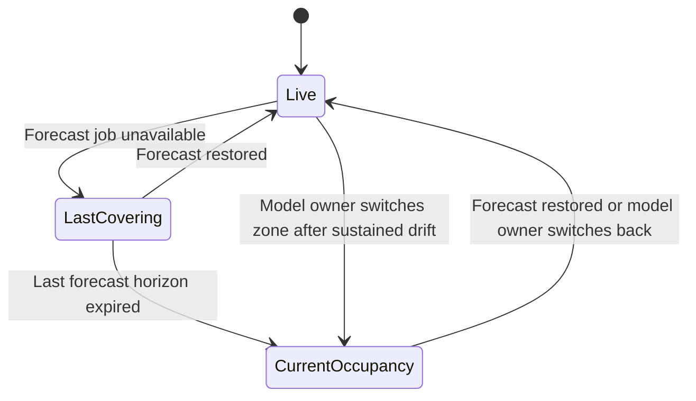
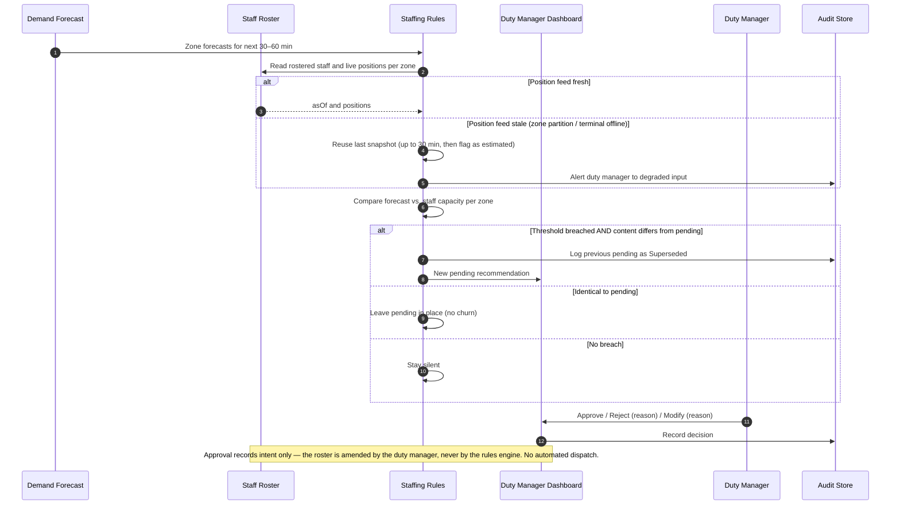
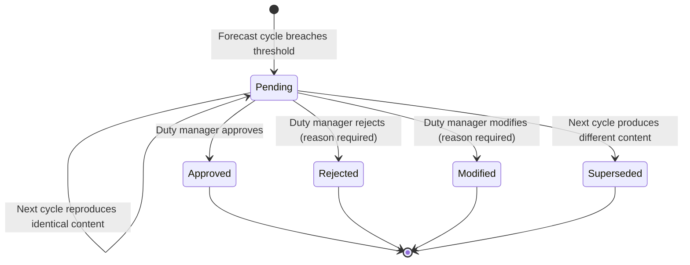
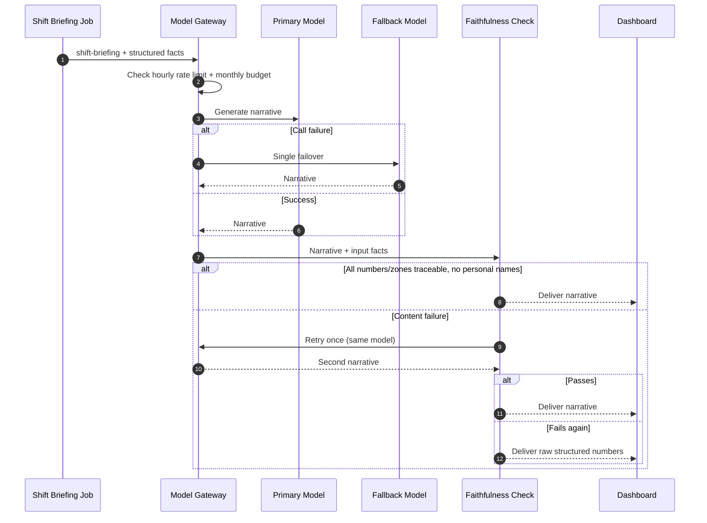
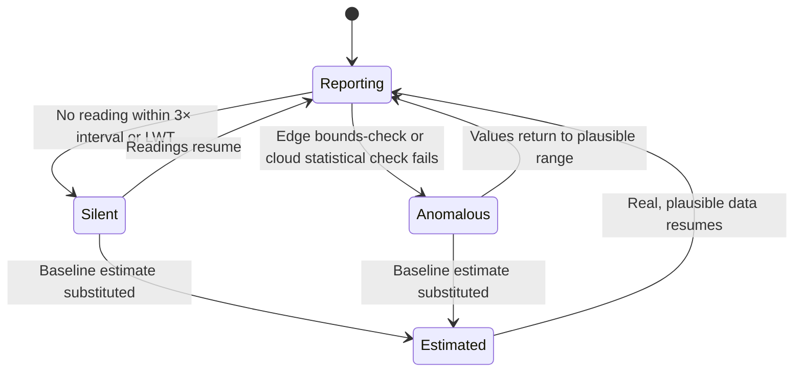
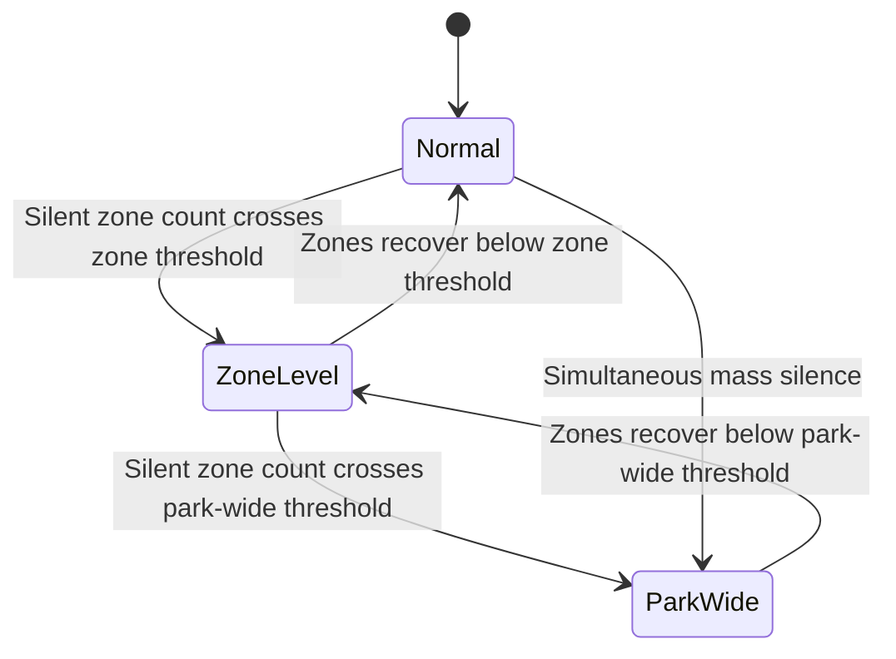

# Park Operations Domain

## Domain Overview

Park Operations owns **ride operations, physical queue management, staff deployment, demand forecasting, popularity scoring, and operational analytics**. The analytics the Countess asked for — which parts of the park are popular, where to put staff, where to invest — is produced here, beside the ride and queue telemetry it is derived from, rather than in a separate bounded context (see [ADR-006](../adrs/ADR-006-unified-demand-forecasting-in-park-ops.md)).

**Key Invariant:** Numbers first, narrative second. Statistical models and deterministic rules produce all operational figures. GenAI narrates — it never derives any number it presents.

---

## Module Decomposition

| Module | Responsibility | AI Involvement |
|---|---|---|
| **Ride Ops** | Dispatch, status tracking, ride-cycle events, and the operational record of the 40 heritage rides. Mechanical safety interlocks and e-stops remain hard-wired Tier 1 circuits that this module observes but cannot command | None |
| **Queue Sensing** | Vision-based queue counting, wait time estimation | Edge CV (queue cameras) |
| **Staff Roster & Scheduling** | Roster of record for 120+ ride operators, keepers, cleaners and concession staff: shift schedules, zone assignments, live position feed | None |
| **Demand Forecast** | ML time-series model: zone occupancy predictions | ML model via Model Gateway |
| **Popularity Score** | Weighted composite of 4 signals per Place | None (formula-based) |
| **Staffing Rules** | Threshold comparison → recommendation generation | None (deterministic rules) |
| **CapEx Flag** | Sustained trend detection for investment reports | None (stateless computation) |
| **Shift Briefing** | GenAI narrative from structured data | GenAI via Model Gateway |
| **Investment Report** | Monthly GenAI narrative from CapEx flags | GenAI via Model Gateway |

---

## Demand Forecast — Multi-Signal Model

### Two Output Horizons, One Authoritative Model

Demand prediction lives in exactly one place. Park Operations runs **the estate's only demand forecast model**, and the same fitted model serves the duty manager's roster and Ticketing's price ladder — published as two output horizons rather than two models:

1. **Tactical Horizon (15-min to 2-hour rolling)**:
   - Evaluated every 15 minutes.
   - Projects micro-occupancy per Zone and queue lane depth.
   - Consumed by **Staff Roster Optimizer** (to recommend moving keepers/operators) and **Guest Growth** (to calculate congestion weights for anti-congestion routing).
2. **Strategic Horizon (14-day lookahead)**:
   - Evaluated nightly or on calendar events.
   - Projects aggregate daily visitor curves and peak entry slots.
   - Consumed by **Ticketing Dynamic Pricing Engine** (to adjust ticket rates within $\pm 30\%$ guardrails).

### Forecast Availability States

- **Live**: Active forecast, full confidence
- **LastCovering**: Last forecast still within its horizon, but no new forecast available
- **CurrentOccupancy**: Fallback to current real-time occupancy comparison (marked "estimated")

---

## Staffing Recommendation Cycle

### Recommendation Lifecycle

All terminal states written to audit trail. **None trigger automatic dispatch or threshold tuning.**

---

## Shift Briefing — GenAI with Faithfulness Gate

### Faithfulness Check Rules
1. Every number in the narrative must be traceable to the structured input data
2. Every zone name must match input zone names exactly
3. No personal names (keeper names, visitor names) — ever
4. No invented zone names, ride names, or figures
5. Failure = retry once → raw structured numbers (never a fabricated narrative)

---

## Popularity Score

A **weighted composite formula** (not ML) over four signals per Place:

| Signal | Weight | Source | Update Cadence |
|---|---|---|---|
| Zone Occupancy | 0.35 | People counters (edge) | Every 30 seconds |
| Ride Cycle Throughput | 0.25 | Reed switches / dispatch logs | Per cycle event |
| Queue Wait Time | 0.25 | Queue cameras (edge CV) | Every 60 seconds |
| Virtual Queue Depth | 0.15 | Guest Growth events | Real-time |

**Why a formula, not ML?** A formula over four signals is no worse than learned weights and stays explainable. Every extra ML touchpoint enlarges the validation surface. The weights are hand-tuned by estate operations and can be adjusted without retraining.

---

## Silence and Anomaly Detection

### Signal Quality States

**Key rule:** Baseline estimates are used live but **never written into permanent history**. A gap is left so the forecast doesn't train on its own guesses.

---

## Connectivity Outage Escalation

| Outage Level | Duty Manager Experience | Recommendations |
|---|---|---|
| **Normal** | Full-fidelity data | Normal confidence |
| **Zone-Level** | Alert: "Verify in person" | Flagged as "estimated" |
| **Park-Wide** | Broadcast alert + trust-less caveat | Flagged, never suppressed |

---

## Published CloudEvents

All events use CloudEvents 1.0 format with ULID `id` and PascalCase `.v1`:

| Published Event (`type`) | Consumers | Key Data Fields | Architectural Impact |
|---|---|---|---|
| `ZoneOccupancyChanged.v1` | Growth, Ticketing, Living Collection | `zoneId`, `occupancyCount`, `asOf` | Raw occupancy; Growth calculates congestion weights; LC assesses crowd stress. |
| `RideWaitTimeUpdated.v1` | **Growth, Ticketing** | `placeId`, `rideId`, `waitMinutes`, `asOf`, `confidence` | Growth renders live wait times; Ticketing Concierge advises best times. |
| `DemandForecastUpdated.v1` | **Ticketing, Growth** | `zoneId`, `horizonStart`, `horizonEnd`, `predictedOccupancy`, `isEstimated` | Single forecast drives Ticketing dynamic pricing and Growth routing. |
| `StaffingRecommendationRaised.v1` | Duty Manager UI, Audit Store | `sourceZoneId`, `targetZoneId`, `headcount`, `reason`, `isEstimated` | Human Approve/Reject/Modify workflow; system never dispatches directly. |
| `RideStatusChanged.v1` | Growth, Ticketing | `rideId`, `status` (`running`/`maintenance`/`closed`), `occurredAt` | Prevents silence read as unpopularity; triggers instant Growth companion reroute. |

---

## Failure & Degraded-Mode Matrix

| Failure | Immediate Reaction | Recovery |
|---|---|---|
| Single sensor silent | Baseline estimate substituted; "estimated" indicator | Readings resume |
| Sensor anomalous | Baseline estimate; debug frame buffer for cameras | Sensor repaired |
| Zone connectivity outage | Gateway buffers; baseline estimates | Tier B drains on reconnect |
| Demand forecast unavailable | Last covering forecast → current occupancy | Forecast job restored |
| Sustained drift | Nothing automatic; alert to model owner | Manual zone switch |
| Staff position feed stale | Last snapshot up to 30 min, then recommendations flagged `isEstimated` | Zone terminals reconnect |
| GenAI call failure | One failover to fallback model | Automatic per request |
| Faithfulness content failure | Retry once → raw numbers | Per request |

---

## Domain ADRs

- [ADR-006: Unified Demand Forecasting in Park Ops](../adrs/ADR-006-unified-demand-forecasting-in-park-ops.md)
- [ADR-008: Numbers-First, Narrative-Second Reporting](../adrs/ADR-008-numbers-first-narrative-second-reporting.md)
- [ADR-015: Deterministic Faithfulness Verification](../adrs/ADR-015-deterministic-faithfulness-verification.md)
