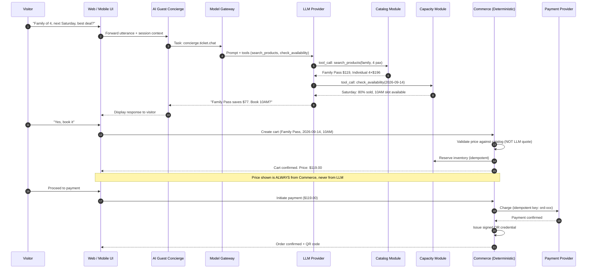
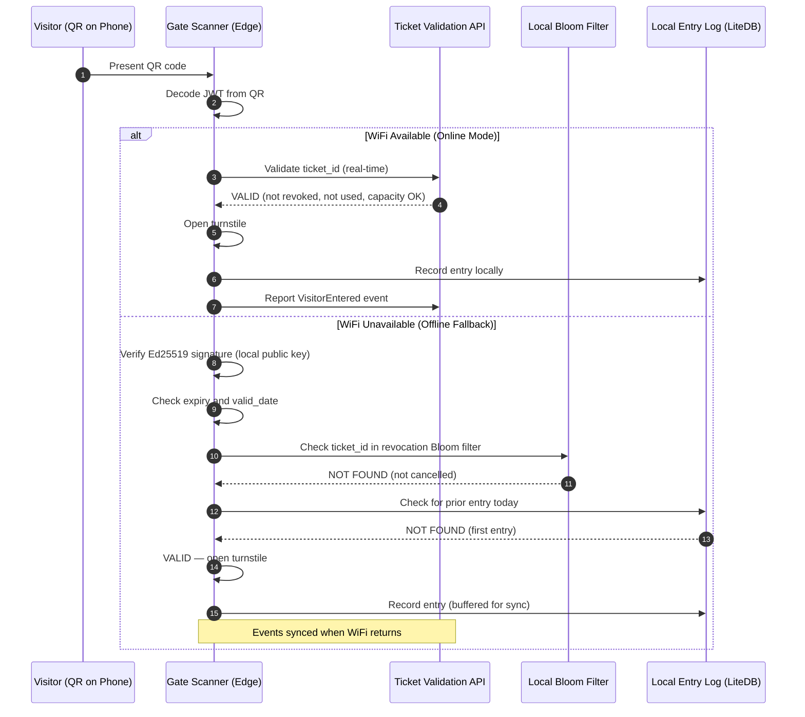
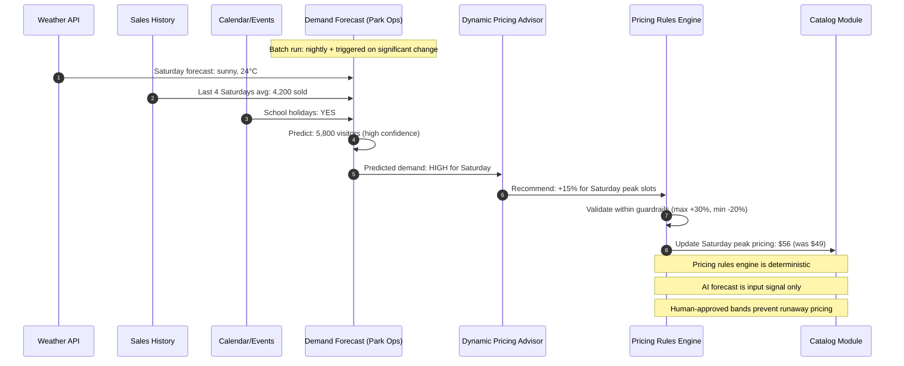
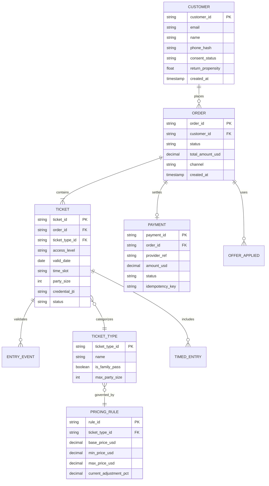

# Ticketing & Access Domain

## Domain Overview

Ticketing & Access owns the **commercial lifecycle of estate admission**: product catalog, cart management, dynamic pricing, payment processing, credential issuance, gate validation, and the AI Guest Concierge. It is the revenue engine of the estate.

**Key Invariant:** The Commerce Module is the sole authority for prices, inventory, and financial transactions. The AI Concierge has read-only access to catalog and availability — it can suggest but never commit.

---

## Module Decomposition

| Module | Responsibility | AI Involvement |
|---|---|---|
| **Catalog** | Product types, ticket types, descriptions | None (reference data) |
| **Cart** | Active shopping sessions (Redis-backed) | None |
| **Pricing Engine** | Base prices + dynamic adjustments within ±30% bands | Consumes demand forecast signal from Park Ops |
| **Commerce** | Order creation, payment delegation, refund processing | None (deterministic) |
| **Credential** | Ed25519 JWT signing, QR generation, revocation management | None (cryptographic) |
| **Gate Validator** | Online validation + offline Ed25519 fallback | None (deterministic) |
| **Capacity** | Redis atomic counters per date/slot, reservation tracking | None |
| **AI Concierge** | NL conversation → tool calls to Catalog/Capacity | GenAI (tool-calling LLM via Model Gateway) |
| **Next Best Action** | Post-purchase upsell recommendations | ML ranking + GenAI copy drafting |
| **Fraud Scoring** | Transaction risk evaluation | ML classification model |

---

## AI Guest Concierge — Detailed Design

### Interaction Flow

### Concierge Guardrails

| Guardrail | Mechanism | Fallback |
|---|---|---|
| Read-only tool access | Tool allowlist: `search_products`, `check_availability`. No write APIs. | Static catalog page |
| Per-session cost ceiling | $0.15 enforced by Model Gateway | Session terminated; redirect to catalog |
| Runaway session detection | > 10 turns | Conversation ended with summary + catalog link |
| Prompt injection defense | Input sanitization, system prompt integrity, no PII in context | Tool call fails gracefully |
| Price mismatch detection | Commerce compares LLM-quoted price against catalog at checkout | Correct price always displayed |

---

## Gate Entry — Online-First with Offline Fallback

---

## Dynamic Pricing Flow

---

## Core Data Entities

---

## Published CloudEvents & Inbound Commands

All events use CloudEvents 1.0 format with ULID `id` and PascalCase `.v1`:

| Published Event (`type`) | Consumers | Key Data Fields | Architectural Impact |
|---|---|---|---|
| `TicketPurchased.v1` | Park Ops, Growth | `orderId`, `ticketIds[]`, `partySize`, `visitDate`, `timeSlot`, `totalAmountUsd` | Park Ops updates presale inputs for demand forecast; Growth starts session. |
| `TicketCancelled.v1` | Park Ops, Growth | `orderId`, `ticketIds[]`, `reason`, `refundAmountUsd` | Forecast adjustments; revocation Bloom filter updated. |
| `TicketRescheduled.v1` | Park Ops, Growth | `orderId`, `originalDate`, `newDate`, `newTimeSlot` | Daily capacity reallocation. |
| `VisitorEntered.v1` | Park Ops, Growth, Living Collection | `ticketId`, `gateId`, `zoneId`, `scannedAt`, `partySize` | Authoritative in-park occupancy increment; starts companion session. |
| `VisitorExited.v1` | Park Ops | `ticketId`, `gateId`, `scannedAt` | Decrements live occupancy count. |
| `CapacityThresholdReached.v1` | Park Ops | `date`, `timeSlot`, `currentSold`, `capacityLimit`, `utilizationPct` | Correlates with crowd forecast and dynamic pricing advisor. |

> **No private timed-entry ledger.** Ticketing sells exhibit windows but does not allocate them. A pre-visit exhibit reservation is published as `VisitRequested.v1` with `origin: pre_visit` and is confirmed — or refused, with alternates — by Living Collection, the sole capacity authority. The exhibit window is only printed on the credential once `VisitConfirmed.v1` returns, so a slot sold at checkout and a slot claimed in-park draw down the same cap.

---

## Failure Scenarios & Mitigations

| Failure | Response | Pattern |
|---|---|---|
| Payment provider down | Hold `pending_payment`; retry with backoff; offer alternate provider | Retry + Circuit Breaker |
| LLM provider down | Gateway failover: secondary → local SLM → static catalog UI | 4-Tier Failover |
| WiFi outage at gates | Full offline mode: Ed25519 + Bloom filter + LiteDB | Edge Autonomy |
| Peak holiday traffic (3×) | Auto-scaling + queue-based checkout (virtual FIFO queue) | Load Leveling |
| Duplicate payment | Idempotency key on every payment request | Idempotency |
| Bloom filter stale | Worst case: one cancelled ticket admitted before 5-min sync | Acceptable Trade-off |

---

## Domain ADRs

- [ADR-003: Offline Cryptographic Ticket Validation](../adrs/ADR-003-offline-cryptographic-ticket-validation.md)
- [ADR-005: Living Collection as Sole Capacity Authority](../adrs/ADR-005-living-collection-as-sole-capacity-authority.md)
- [ADR-013: Modular Monolith per Bounded Context](../adrs/ADR-013-modular-monolith-per-bounded-context.md)
- [ADR-014: Dynamic Pricing Hard Guardrails](../adrs/ADR-014-dynamic-pricing-hard-guardrails.md)
