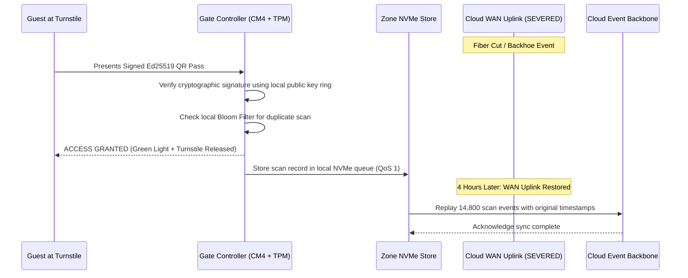
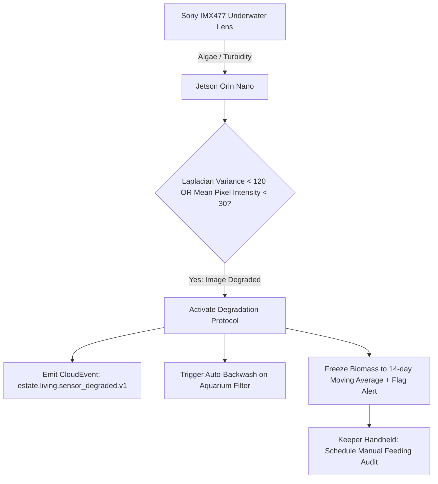
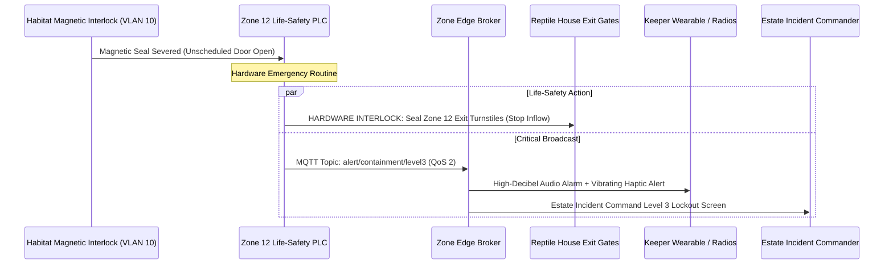

# Falsifiable Architectural Quality Scenarios

## Verification Framework

In accordance with Software Engineering Institute (SEI) architectural evaluation methodologies, each scenario below is **strictly falsifiable**, defined by six formal parameters:
- **Source of Stimulus**: The initiating entity.
- **Stimulus**: The specific event or fault.
- **Artifact**: The architectural subsystem under test.
- **Environment**: Operational conditions under which the stimulus occurs.
- **Response**: The architectural actions triggered.
- **Measurable Metric**: The quantitative, pass/fail threshold.

---

## Scenario 1: Total WAN Uplink Blackout During Peak Saturday Operations

- **Source of Stimulus**: Physical fiber line severance (backhoe incident).
- **Stimulus**: Total loss of estate WAN connectivity and cloud access.
- **Artifact**: 30 Gate Controllers, 6 cluster gateway pairs serving 55 logical zones, MQTT Edge Mesh.
- **Environment**: Peak Saturday summer attendance (15,000 visitors on estate grounds).
- **Response**:
  1. Gate controllers detect WAN timeout and switch to offline autonomous mode within 500ms.
  2. Admission tickets validated locally using offline Ed25519 signature checks and local in-memory Bloom filters.
  3. Every scan event is persisted to local NVMe store-and-forward buffers (rated for 72 hours).
  4. Upon WAN restoration, edge brokers execute deduplicated, backpressure-regulated replay to Apache Kafka.
- **Measurable Metric**:
  - **Zero guest admission rejections** for valid ticket holders during 4-hour blackout.
  - **P99 gate validation latency $\le 45\text{ ms}$** throughout blackout.
  - **Zero data loss**: 100% of admission telemetry successfully synchronized upon link restoration.

---

## Scenario 2: Primary Cloud LLM Provider Outage During Active Park Hours

- **Source of Stimulus**: Upstream cloud infrastructure failure (Anthropic / OpenAI regional API outage).
- **Stimulus**: HTTP 500 / 503 errors and complete request timeout on primary LLM endpoints.
- **Artifact**: Multi-Model Gateway, AI Guest Concierge, Shift Briefing Engine.
- **Environment**: 14:00 peak visitor hours; 85 concurrent guest concierge chat sessions active.
- **Response**:
  1. Multi-Model Gateway circuit breaker trips after 3 consecutive failures or 2,500ms timeout threshold.
  2. Router cascades to Tier 2 provider (OpenAI GPT-4o-mini / Bedrock Claude) within 200ms.
  3. If cloud transit fails completely, cascades to Tier 3 on-premise quantized Small Language Model (Mistral-7B-Instruct on local estate compute).
  4. If local compute capacity saturates, cascades to Tier 4 deterministic template engine.
- **Measurable Metric**:
  - **0% user session aborts or unhandled HTTP 5xx responses**.
  - **Session failover completion $\le 1.8\text{ seconds}$** without requiring guest prompt re-entry.

---

## 3. Scenario 3: Sudden Camera Occlusion or Water Turbidity in Amazonia Piranha Habitat

- **Source of Stimulus**: Severe algae bloom and pump backwash disturbance in the Amazonia main exhibit.
- **Stimulus**: Water turbidity spikes; camera lens obscured, dropping image sharpness index below threshold.
- **Artifact**: Living Collection Edge CV Pipeline (Jetson Orin Nano + YOLO-nano).
- **Environment**: Mid-day visitor viewing period, 450 piranhas in tank.
- **Response**:
  1. Edge image analyzer detects Laplacian variance $\sigma_{\text{Lap}}^2 < 120$ and mean detection confidence drops below 0.70.
  2. Edge model flags the visual stream as **Degraded Quality**.
  3. Rather than emitting inaccurate biomass estimates, the system freezes the automated feed calculation to the 14-day verified rolling average.
  4. Automated CloudEvent dispatched to Life Support Subsystem to initiate filter backwash.
  5. Notification dispatched to Keeper Copilot terminal requesting manual visual inspection.
- **Measurable Metric**:
  - **Zero wild dietary overfeeding or underfeeding spikes** (feed ration deviation $\le 5\%$ of biological baseline).
  - **Turbidity alert dispatched to keeper handheld within $\le 30\text{ seconds}$** of visual degradation.

---

## 4. Scenario 4: Flash Presale Surge (300% Demand Spike in 15 Minutes)

- **Source of Stimulus**: Countess announces exclusive Halloween Gala on television and social media.
- **Stimulus**: Web traffic surges from baseline 20 req/sec to 1,200 req/sec within 15 minutes; checkout attempts increase by 300%.
- **Artifact**: Ticketing & Access Modular Monolith, Dynamic Pricing Engine, Payment Gateway.
- **Environment**: Online commerce web portal on a Friday evening.
- **Response**:
  1. Kubernetes Horizontal Pod Autoscaler (HPA) triggers pod scale-out from 4 to 24 instances based on CPU utilization $> 65\%$ and Kafka lag.
  2. Dynamic pricing engine recalculates demand elasticity every 60 seconds.
  3. **Hard Guardrail Enforcement (ADR-014)**: Pricing increases incrementally up to the strict $+30\%$ ceiling; algorithms are locked from exceeding the ceiling regardless of extreme elasticity.
  4. Virtual waiting room activates automatically if checkout concurrency exceeds payment gateway processing rate.
- **Measurable Metric**:
  - **Zero HTTP 504 Gateway Timeouts** (P99 checkout response latency $< 1,200\text{ ms}$).
  - **Strict compliance with pricing guardrails**: Maximum price charged never exceeds $\$65.00$ ($+30\%$ over $\$50.00$ base).

---

## 5. Scenario 5: Level 3 Venomous Viper Containment Breach Alert

- **Source of Stimulus**: Physical habitat enclosure magnetic seal broken on Gabon Viper exhibit.
- **Stimulus**: Sensor circuit open event (`interlock_state = OPEN_UNAUTHORIZED`).
- **Artifact**: Living Collection VLAN 10 Safety PLC, Zone Edge Broker, Turnstiles.
- **Environment**: 11:30 AM on a crowded weekend; 180 visitors inside the Reptile Pavilion.
- **Response**:
  1. Hardware interlock directly locks external access doors to prevent public entry into Zone 12.
  2. Edge broker issues a priority QoS 2 CloudEvent: `estate.living.containment_alert.v1`.
  3. Automated haptic and loud audio alarm triggered on all keeper mobile handhelds within 500 meters.
  4. Guest Companion apps within 200 meters receive a calm, automated evacuation directive re-routing them to the Great Meadow.
  5. Estate operations dispatch terminal flashes mandatory containment lockdown checklist.
- **Measurable Metric**:
  - **Turnstile lockout and staff alert propagation latency $\le 250\text{ ms}$** from physical sensor trip.
  - **Zero software bypass possible**: Life-safety door interlock wired through fail-safe hardware relays on VLAN 10.
